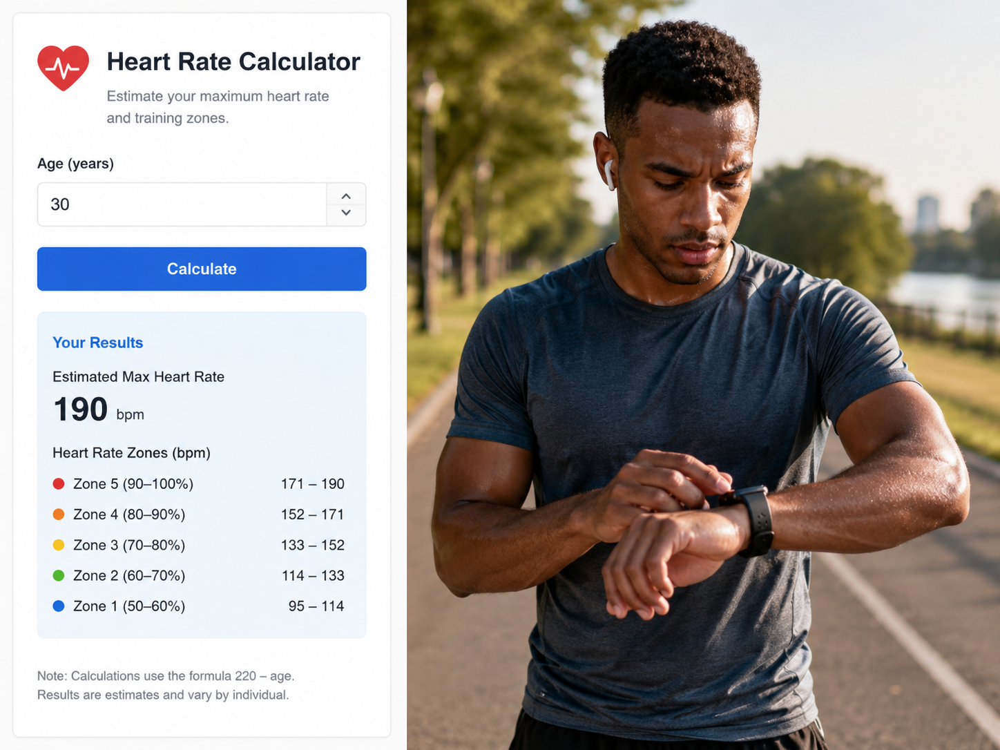
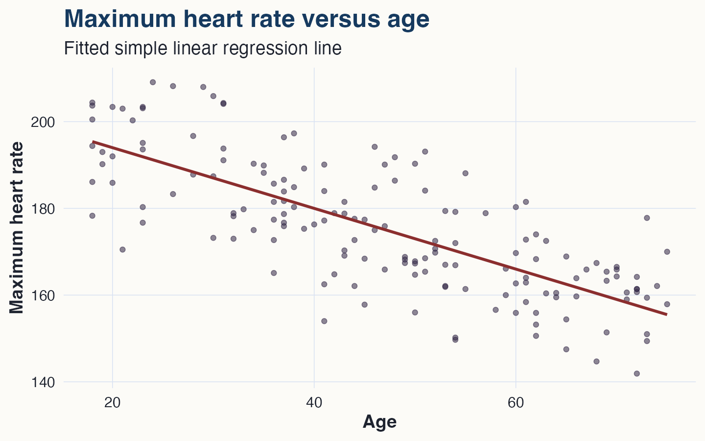
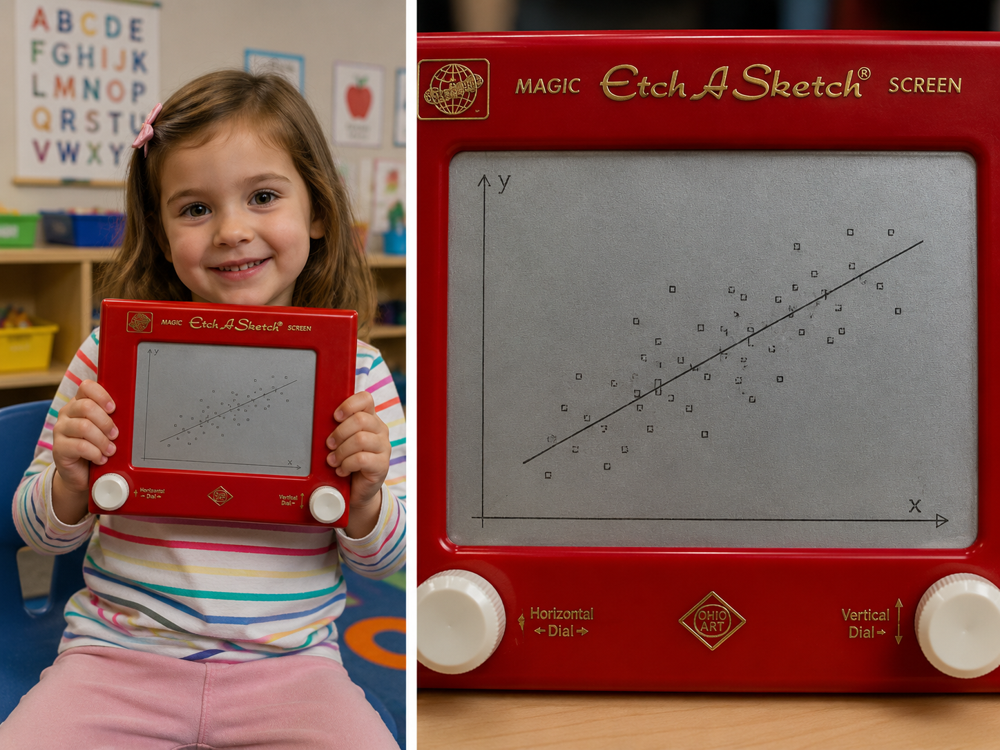
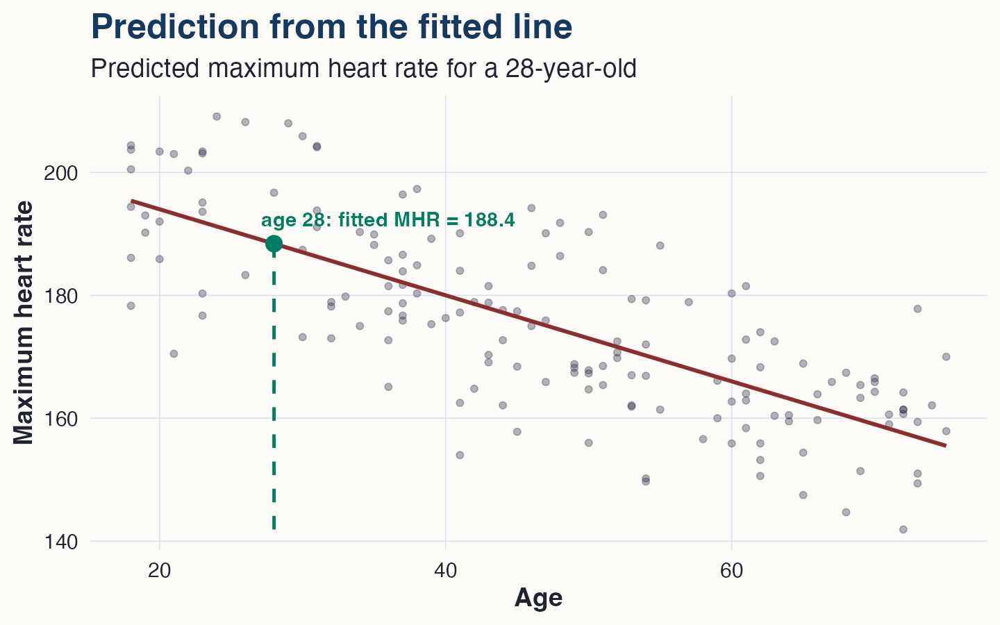
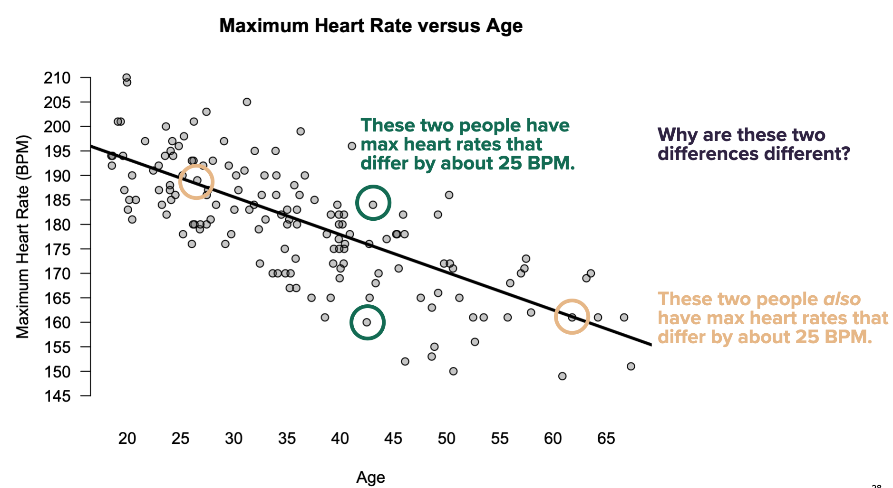

## Equations fit to data

You might have heard this rule: **maximum heart rate = 220 - age**.

That rule is an equation for predicting one variable from another.

## Equations fit to data

People often base their "training zones" on a prediction like this.

{fig-alt="A heart-rate calculator interface uses age as an input to estimate maximum heart rate and training zones, next to a runner checking a smartwatch during exercise." width="85%"}

## Where does a rule like this come from?

-   Recruit a sample of people of different ages.
-   Measure each person’s true maximum heart rate during a supervised exercise test.
-   Plot the data: age on the horizontal axis, maximum heart rate on the vertical axis.
-   Draw a line through the cloud of points.

## The model as a line

## The model as an equation

The equation of this line is: $$
\widehat{\text{MHR}} = 208 - 0.7 \cdot \text{age}
$$ It's a bit more complex than the "220 - age" rule, but not by much!

The rule lets us predict a person’s maximum heart rate from age alone, without making that person do the treadmill test.

This is a **statistical model** because it was learned from observed data.

## Linear regression models

In simple linear regression, we describe the data using this equation:

$$
y_i = \beta_0 + \beta_1 x_i + e_i.
$$

-   subscript $i$ keeps track of **which observation** we're talking about.
-   $x$ is the **predictor** or **feature**.
-   $y$ is the **response** or **outcome** or **target**.
-   $\beta_0$ and $\beta_1$ are **parameters**, here the **intercept** and **slope**.
-   $e_i$ is the **residual**: the amount the line misses for observation $i$.

## Two questions

How do we choose the line?

What can we do with it?

## Choosing the line

For any proposed line, the residual is can be thought of as a function of the proposed parameter:

$$
e_i(\beta_0, \beta_1) = y_i - (\beta_0 + \beta_1 x_i).
$$

You can imagine playing guess and check here:

-   pick some candidate intercept and slopde $(\beta_0, \beta_1)$.
-   calculate $e_i$ for each data point
-   if the errors look big: bad choice!
-   if the errors look small: good choice!

## Setting up the calculus problem

We want the values of $\beta_0$ and $\beta_1$ that minimize

$$
L(\beta_0, \beta_1)
=
\sum_{i=1}^n \left[y_i - (\beta_0 + \beta_1 x_i)\right]^2.
$$

So this is an optimization problem: $(\widehat{\beta}_0, \widehat{\beta}_1)
=
\arg\min_{\beta_0,\beta_1}
L(\beta_0, \beta_1)$.

The calculus idea is familiar:

$$
\frac{\partial L}{\partial \beta_0}=0
\qquad \text{and} \qquad
\frac{\partial L}{\partial \beta_1}=0.
$$

Solving these two equations gives the least-squares line (Legendre, 1805).

## Why bother with all this calculus?

{fig-alt="A photorealistic split image. On the left, a kindergartener holds an Etch A Sketch. On the right, a close-up of the Etch A Sketch screen shows a cloud of points with a straight regression line drawn through the middle." width="70%"}

## Why bother with all this calculus?

So why define a loss function and minimize it?

. . .

Because the principle generalizes. The same idea works when the prediction rule is too complicated to draw by eye:

$$
\widehat{y} = \beta_0 + \beta_1 x
$$

$$
\widehat{y} = \beta_0 + \beta_1 x_1 + \cdots + \beta_p x_p
$$

$$
\widehat{y} = f(x_1, \ldots, x_p)
$$

Regression begins with a line, but the deeper idea is: choose the prediction rule that makes the errors small. **We'll get there!**

## What are regression models good for?

-   **Prediction:** use $x$ to make a best guess about $y$.
-   **Summarizing a relationship:** describe how $y$ tends to change as $x$ changes.
-   **Making fair comparisons:** compare actual outcomes to expected outcomes.
-   **Decomposing variation:** separate systematic variation from individual variation.

## Making a prediction

-   Alice is 28. What is her predicted maximum heart rate?

$$
E(\text{MHR} \mid \text{Age}=28) = 208 - 0.7 \cdot 28 = 188.4.
$$

-   This is our best guess before observing Alice’s actual treadmill test.
-   The fitted value is not a guarantee.
-   It is a conditional average: expected MHR among people of the same age.

## A prediction in the picture

## Actual versus expected

Suppose Professor Scott is 41.

Predicted MHR:

$$
208 - 0.7 \cdot 41 \approx 179.
$$

Will this be his actual heart rate if he takes the aerobic torture test?

[Of course not!](videos/01_heartrate.mp4)

## Actual versus expected

If the treadmill test gives 184, then

$$
\text{Residual} = \text{Actual} - \text{Expected} = 184 - 179 = 5.
$$

Remember: a residual is an observed deviation from the model’s conditional average.

## Summarizing the trend

The fitted equation is:

$$
E(\text{MHR} \mid \text{Age}) = 208 - 0.7 \cdot \text{Age}.
$$

The slope: **-0.7 BPM per year**.

-   Interpretation: maximum heart rate is lower by about 0.7 BPM, on average, for each additional year of age.
-   Notice the units. Slopes have units of "y over x".
-   The line describes an average trend across many people.
-   Most individual people will not lie exactly on the line.

## An aside: the intercept

The intercept: **208 BPM**.

-   Mathematically, the intercept is where the fitted line crosses the vertical axis.

-   Here, it is the predicted maximum heart rate when $\text{Age}=0$.

-   That is necessary for writing down the equation of the line.

-   But it has no useful substantive interpretation in this example.

Why not?

-   Because $\text{Age}=0$ is far outside the range of people in the data.
-   Substantively, the intercept is an extrapolation, not a useful prediction.

## Making fair comparisons

Equations fit to data can also help us make fair comparisons that adjust for the systematic effect of some important variable.

[Consider the Freeze...](videos/01_thefreeze.mp4)

## Making fair comparisons

{fig-alt="Usain Bolt declaring on social media that the Freeze is too fast for him." width="70%"}

## Making fair comparisons

Here’s what we know about these guys:

-   The Freeze is a former D1 college track athlete who missed the 2016 U.S. Olympic team by 0.02 seconds.\
-   The other guy is, literally, a random fan in a Braves t-shirt.

To the make the race interesting, we need to adjust for how fast we expect these guys to run, given what we know about them.

Key insight: equations help us know "what we should expect"!

## Making fair comparisons

Alice is 28 and has MHR = 185.

Brianna is 55 and has MHR = 174.

Alice has the higher MHR. But who has the higher MHR **for her age**?

Compare residuals:

$$
\text{Actual} - \text{Predicted}.
$$

## Fair comparison just means subtraction

Alice:

$$
185 - (208 - 0.7 \cdot 28) = -3.4.
$$

Brianna:

$$
174 - (208 - 0.7 \cdot 55) = 4.5.
$$

-   Brianna is higher relative to expectation for her age.
-   The regression model adjusts for the systematic effect of age.

## Decomposing variation

Regression separates variation in $y$ into two pieces.

-   **Predictable:** differences in $y$ associated with differences in $x$.
-   **Unpredictable:** differences in $y$ among observations with the same, or nearly the same, $x$.

The fitted line is the predictable part. The residuals are the unpredictable part.

Let's see this in our heart-rate example.

## Decomposing variation

{fig-alt="Predictable versus unpredictable differences." width="70%"}

## Two kinds of variation

The picture shows two different ideas.

-   People of different ages tend to have different maximum heart rates.
-   People of the same age can also have different maximum heart rates.

Regression separates these ideas:

$$
\text{observed value}
=
\text{fitted trend}
+
\text{residual}.
$$

Or, for person $i$, $y = \widehat{y} + e$.

## How large are the residuals?

A residual of $+12$ means the person’s maximum heart rate was 12 BPM higher than predicted.

A residual of $-8$ means the person’s maximum heart rate was 8 BPM lower than predicted.

So one way to judge the model is to ask:

**How large are these residuals, typically?**

## RMSE: typical prediction error

The root mean squared error, or RMSE, summarizes the typical size of the residuals:

$$
\text{RMSE}
=
\sqrt{
\frac{1}{n}
\sum_{i=1}^n
(y_i - \widehat{y}_i)^2
}.
$$

In this example, RMSE is measured in **BPM**.

So if $\text{RMSE} = 10$, the fitted line typically misses a person’s maximum heart rate by about **10 BPM**.

RMSE answers: **How far are the points from the fitted line, on average?**

## RMSE is an in-sample summary

That is called **in-sample RMSE**.

-   Fit the line using the data.
-   Use the line to predict the same observations.
-   Compute the residuals.
-   Summarize their typical size.

This tells us how closely the line fits the data we already have.

Later, we will care more about **out-of-sample error**: How well does the model predict new people who were not used to fit the line?

## What does $R^2$ measure?

$R^2$ asks: **How much of the overall variation in** $y$ is accounted for by the regression line? For maximum heart rate:

-   Some variation is associated with age.
-   Some variation remains among people of the same age.
-   $R^2$ describes the fraction associated with the fitted trend.

Informally:

$$
R^2
=
\frac{\text{variation explained by the line}}
{\text{total variation in the outcome}}.
$$

## $R^2$ as proportional reduction in error

Before using age, a simple prediction would be the overall average: $\bar{y}$.

After using age, the prediction is the fitted value: $\widehat{y}_i$.

$R^2$ compares these two prediction rules.

## $R^2$ as proportional reduction in error

How? By sum of squared errors:

$$
R^2
=
1 -
\frac{
\sum_{i=1}^n (y_i - \widehat{y}_i)^2
}{
\sum_{i=1}^n (y_i - \bar{y})^2
}.
$$

The numerator is the squared error from the regression line.

The denominator is the squared error from predicting everyone with the same average.

## Interpreting $R^2$

If $R^2 = 0.30$, then age accounts for about 30% of the variation in maximum heart rate in this sample. That does **not** mean:

-   the model is correct for every individual;
-   age is the only thing that matters.

It means:

-   the fitted line reduces squared error by 30% relative to using the overall average;
-   70% of the variation remains around the fitted trend.

$R^2$ describes how much variation the line accounts for. RMSE describes how large the remaining errors are.

## RMSE and $R^2$ answer different questions

Both summaries describe the fit, but they emphasize different things.

**RMSE**

-   measured in the outcome units (here, BPM)
-   answers: how large are the typical residuals?

$R^2$

-   unitless;
-   between 0 and 1 in ordinary linear regression with an intercept;
-   answers: how much variation does the line account for?

## The grammar to carry forward

Model equation: $y_i = \beta_0 + \beta_1 x_i + e_i$.

Fitted value: $\widehat{y}_i = \widehat{\beta}_0 + \widehat{\beta}_1 x_i$.

Residual: $e_i = y_i - \widehat{y}_i$

Interpretation depends on units: the slope is measured in **units of** $y$ per unit of $x$.
