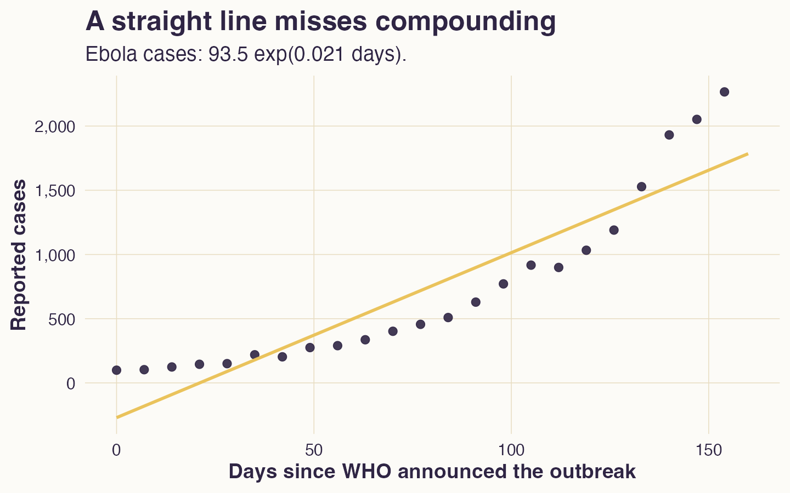
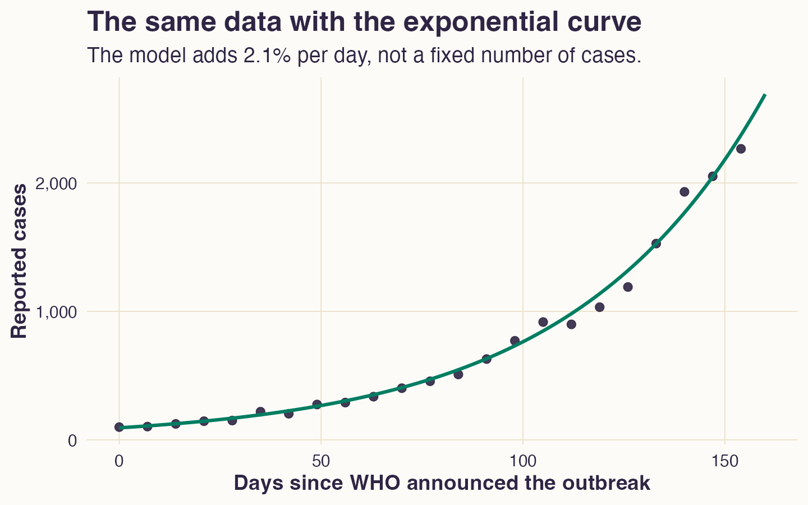
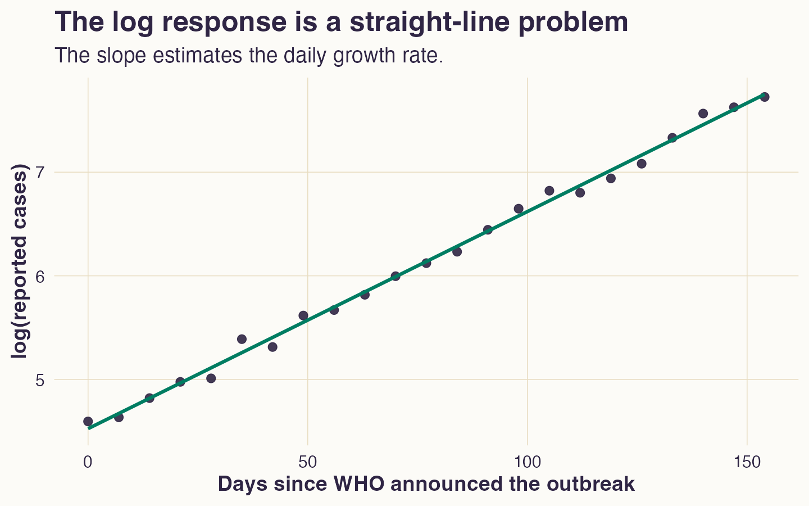
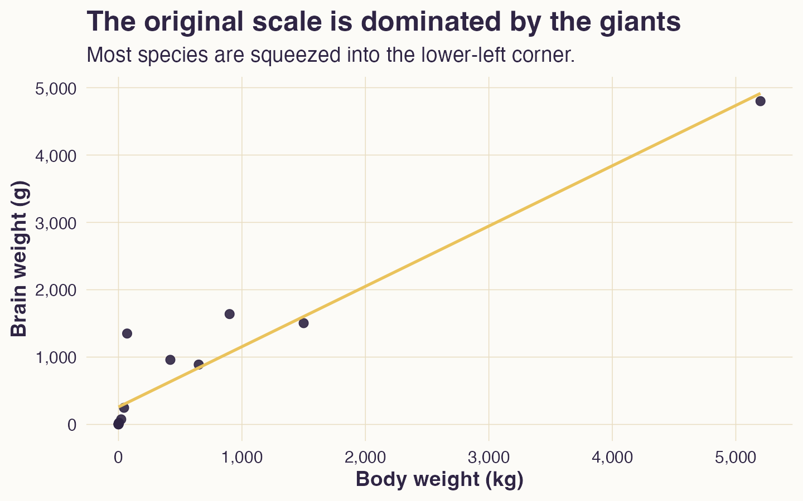
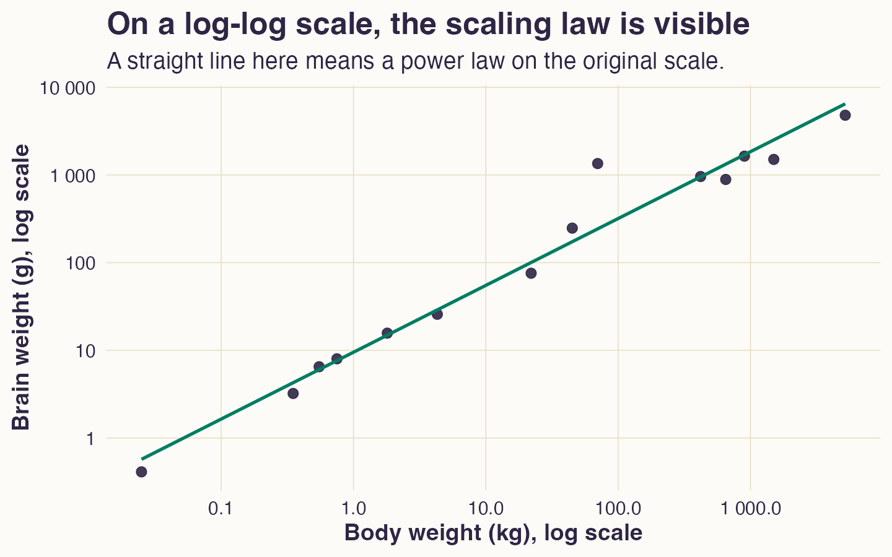
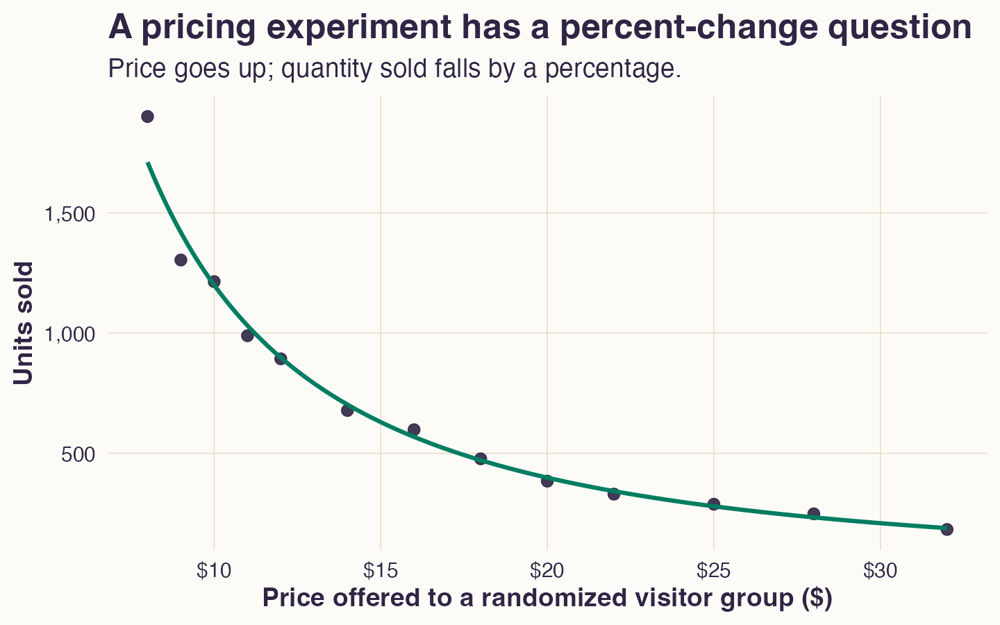
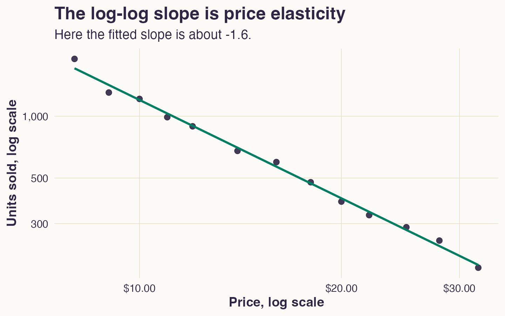

## A straight line is a promise

In simple linear regression, a slope means:

> Add this much to $y$ for one more unit of $x$.

Examples:

-   one more year of age: subtract about 0.7 BPM,
-   one more square foot: add \$500 to house price.

One-unit change in $x$, $\beta_1$-unit change in $y$, no matter the value of $x$.

## March 2014

On March 23, 2014, WHO announced an outbreak of Ebola virus disease in Guinea.

Imagine we are sitting in an outbreak-response meeting.

> If this keeps going, how many cases are we looking at next month?

We need a model before the situation outruns our intuition.

## A bad first instinct

Here's what lab-confirmed case looked like from March 23.

{fig-alt="Ebola cases rise with visible upward curvature. A straight line underfits late observations and overfits the middle." width="86%"}

## What the straight line says

A straight line forces one answer:

> Each additional day adds the same number of cases.

That means:

-   day 10 to day 11: add $c$ cases,
-   day 80 to day 81: add $c$ cases,
-   And so on.

But the outbreak is not adding the same number each day. It is compounding.

## The model we want

For early epidemic growth, the natural model is:

> Each day, the case count is multiplied by roughly the same factor.

In this data set, it turns out that:

$$
\frac{\text{cases tomorrow}}{\text{cases today}} \approx 1.021.
$$

That is 2.1% growth per day. **How did we determine that?**

## The exponential model

The exponential model expresses this as:

$$
Y_t = Y_0 e^{rt}.
$$

-   $Y_0$: initial count at time $t=0$.
-   $Y_t$: expected count after $t$ days.
-   $r$: daily growth rate.
-   $t$: days since the outbreak announcement.

For this example:

$$
Y_t = 93.5e^{0.021t}.
$$

## The curve fits the story

{fig-alt="Ebola cases follow an exponential-growth curve." width="86%"}

## So are we stuck?

No. Logs turn multiplication into addition:

$$
\log(a \cdot b) = \log(a) + \log(b).
$$

Start with the exponential model:

$$
Y_t = Y_0e^{rt}.
$$

Take logs:

$$
\log(Y_t) = \log(Y_0) + rt.
$$

Now we have a straight-line model.

## The same data on the log scale

{fig-alt="The logarithm of Ebola cases, versus days since WHO announced the outbreak. The points lie close to a straight line." width="86%"}

## What the fitted line means

On the log scale, the fitted equation is approximately:

$$
\widehat{\log(\text{cases})} = 4.53 + 0.021 \cdot \text{day}.
$$

Translation:

-   $4.54$ is the starting log count,
-   $0.021$ is the daily log-growth rate,
-   $e^{0.021} \approx 1.021$: the fitted count multiplies by about 1.021 each day.

The slope is the percentage change each time period.

## Comparing scales

On the log scale:

$$
\widehat{\log(\text{cases})} = 4.53 + 0.021 \cdot \text{day}.
$$

On the case-count scale:

$$
\widehat{\text{cases}} = e^{4.53}e^{0.021 \cdot \text{day}}
\approx 94e^{0.021 \cdot \text{day}}.
$$

Same model. The log scale is for fitting and interpretation. The original scale is where the cases live.

## One day versus one month

A 2.1% daily growth rate sounds small.

For one day:

$$
e^{0.021} \approx 1.021.
$$

For 30 days:

$$
e^{0.021 \cdot 30} \approx 1.88.
$$

In words:

> 2.1% per day is about 88% growth over 30 days.

## Doubling time

The doubling time solves for $t$:

$$
2 = e^{rt}.
$$

So:

$$
t = \frac{\log(2)}{r}.
$$

With $r = 0.021$:

$$
\frac{\log(2)}{0.021} \approx 33 \text{ days}.
$$

This is the number you would say in the meeting.

## Rule of 70

A useful shortcut:

$$
\text{doubling time} \approx
\frac{70}{\text{growth rate as a percent}}.
$$

For 2.1% daily growth:

$$
70 / 2.1 \approx 33.
$$

Just using the fact that $\log(2) \approx 0.70$.

## What changed when we logged $y$?

We made a new response:

$$
\log(y_i).
$$

The regression is still a straight-line regression:

$$
\log(y_i) = \beta_0 + \beta_1x_i + \epsilon_i.
$$

But the misses are no longer measured in units of $y$. They are measured in log units.

## Same unit miss, different percent miss

Suppose a model predicts sales.

| fitted sales | actual sales | unit residual | percent residual |
|-------------:|-------------:|--------------:|-----------------:|
|          100 |          120 |           +20 |             +20% |
|         1000 |         1020 |           +20 |              +2% |

A unit-scale model treats both misses as equally large.

But most businesses would not. Missing by 20 units is different when the baseline is 100 than when it is 1000.

## Same percent miss, different unit miss

Now compare these:

| fitted sales | actual sales | unit residual | ratio |
|-------------:|-------------:|--------------:|------:|
|          100 |          120 |           +20 |  1.20 |
|         1000 |         1200 |          +200 |  1.20 |

A log-response model treats these as the same size miss.

Why?

Both actual values are 20% above the fitted value.

## Log residuals are ratios

The log residual $\epsilon$ is:

$$
\epsilon = \log(y) - \log(\widehat{y}).
$$

Use the log rule:

$$
\epsilon = \log\left(\frac{y}{\widehat{y}}\right).
$$

So a log residual is a logged ratio.

If $\epsilon = \log(1.20)$, the actual value is 20% above fitted.

If $\epsilon = \log(0.80)$, the actual value is 20% below fitted.

## What the error story becomes

Start with:

$$
\log(y_i) = \beta_0 + \beta_1x_i + \epsilon_i.
$$

Exponentiate both sides:

$$
y_i = e^{\beta_0 + \beta_1x_i} \cdot e^{\epsilon_i}.
$$

The fitted part sets the expected level.

The residual multiplies that level up or down.

## When that error story makes sense

Log the response when typical misses feel like percentage misses.

-   sales forecasts: missing by 10% feels comparable across stores of very different sizes,
-   salary models: variation often grows with the salary level,
-   house prices: price estimates for expensive houses usually have larger dollar misses,
-   epidemic counts: uncertainty grows as the outbreak grows.

The log model changes what "a typical error" means.

## A warning about zero

Logs require positive values.

-   $\log(12.8)$ is fine.
-   $\log(1)$ is fine.
-   $\log(0.29)$ is fine.
-   $\log(0)$ is undefined.
-   $\log(-3)$ is not a real number.

Do not silently add 1, or 0.0001, because software complained.

Ask what zero means in the data.

## Elasticity

Now suppose the predictor also lives on a ratio scale.

Question:

> What happens to $y$ when $x$ changes by 1%?

That is no longer a unit-change question about $x$.

. . .

**Use a log-log model.**

## Example: body weight and brain weight

How does brain weight scale with body weight?

Adding 1 kg of body weight is not the same for every animal.

-   Mouse to dog: big change from adding 20 kg.\
-   Horse to slightly larger horse: small change from adding 20 kg.

An additive slope is a strange target.

## The original scale hides the pattern

{fig-alt="Brain weight is plotted against body weight. Most species sit near the origin while a few very large species stretch the axes." width="86%"}

## A power law

Many scaling relationships use:

$$
y = Kx^\beta.
$$

-   $x$: body weight.
-   $y$: brain weight.
-   $K$: proportionality constant.
-   $\beta$: scaling exponent.

If $\beta = 1$, brain weight scales proportionally with body weight.

If $\beta < 1$, brain weight grows more slowly than body weight.

## The log-log trick

Take logs:

$$
\log(y) = \log(K) + \beta\log(x).
$$

For mammals:

$$
\log(\text{brain}) =
\alpha + \beta\log(\text{body}) + e.
$$

This is a straight-line model for two logged variables.

The slope is an elasticity:

## Elasticity

An elasticity answers:

> If $x$ changes by 1%, how many percent does $y$ change?

In a log-log model, the elasticity is $\beta$.

$$
\log(y) = \alpha + \beta\log(x),
$$

The units disappear; percent talks to percent.

## Elasticity

To see why, take derivatives of both sides:

$$
\frac{d}{dx}\log(y)
=
\frac{d}{dx}\left[\alpha + \beta \log(x)\right].
$$

Using the chain rule,

$$
\frac{1}{y}\frac{dy}{dx}
=
\beta \frac{1}{x}.
$$

Rearrange: $$
\beta
=
\frac{dy / y}{dx / x}
=
\frac{\%\text{ change in } y}{\%\text{ change in } x}
$$

## The log-log model for mammals

{fig-alt="Logged brain weight is plotted against logged body weight. Points form a straight increasing band with a fitted line." width="86%"}

## Interpreting the mammal slope

Suppose the fitted equation is:

$$
\widehat{\log(\text{brain})}
= 2.25 + 0.76\log(\text{body}).
$$

The elasticity is $0.76$.

In words:

> A 1% increase in body weight corresponds to about a 0.76% increase in brain weight, on average.

Not grams.

Percent to percent.

## A bigger move

If body weight doubles, predicted brain weight is multiplied by:

$$
2^{0.76} \approx 1.69.
$$

So doubling body weight predicts about 69% more brain weight.

Because $0.76 < 1$, brain weight grows less than proportionally with body weight.

## Elasticities in economics

Examples:

-   Price elasticity of demand: if price rises 1%, how much does quantity demanded fall?
-   Income elasticity: if income rises 1%, how much does spending rise?
-   Cross-price elasticity: if a competitor's price rises 1%, what happens to your sales?
-   Wage elasticity of labor supply: if wages rise 1%, how much do hours worked change?
-   Advertising elasticity: if ad spend rises 1%, how much do sales rise?

Same grammar, different economic question.

## The online seller

An online seller runs a pricing experiment.

Visitors are randomized to see one price for the same product:

$$
\$8, \$9, \$10, \ldots, \$32.
$$

For each price, the seller records units sold.

The business question is:

> If we raise price by 1%, how much demand do we lose?

That is a price-elasticity question.

## Demand on the original scale

{fig-alt="Units sold decline as randomized price rises, with a curved fitted demand relationship." width="86%"}

## Demand on the log-log scale

{fig-alt="Logged units sold are plotted against logged price. The fitted line slopes downward and is roughly straight." width="86%"}

## Reading the price elasticity

Suppose the fitted equation is:

$$
\widehat{\log(\text{quantity})}
= 10.75 - 1.59\log(\text{price}).
$$

The slope is $-1.59$.

In words:

> A 1% increase in price predicts a 1.6% decrease in quantity sold.

That is elastic demand: quantity moves more than price, in percent terms.

## Why the sign matters

Price elasticity is usually negative: higher price, lower quantity.

If the slope were $-0.3$:

-   a 1% price increase predicts a 0.3% quantity decrease,
-   demand is inelastic,
-   typically revenue tends to rise when price rises.

If the slope were $-1.6$:

-   a 1% price increase predicts a 1.6% quantity decrease,
-   demand is elastic,
-   typically revenue tends to fall when price rises.

## Why revenue changes

Revenue is:

$$
\text{revenue} = \text{price} \times \text{quantity}.
$$

If price rises 1% and quantity falls 1.6%, then revenue changes by roughly:

$$
1\% - 1.6\% = -0.6\%.
$$

Not exact calculus, but still a good first read.

## Three common log models

| Model | Fit this | Slope means |
|----|----|----|
| level-level | $y$ on $x$ | additive change in $y$ per unit of $x$ |
| log-level | $\log(y)$ on $x$ | percent change in $y$ per unit of $x$ |
| log-log | $\log(y)$ on $\log(x)$ | percent change in $y$ per percent change in $x$ |

The model form tells you what comparison you are making.

## A decision rule

Use logs when the question is naturally about multiplication, ratios, or percentages.

-   growth happens by compounding,
-   changes are reported as rates,
-   the spread grows with the level,
-   the original-scale plot is dominated by large values,
-   on a log-scale plot, the data look like they follow a linear relationship.

This is a modeling choice, driven by a combination of data exploration and prior knowledge.

## What can go wrong?

The common mistakes:

-   interpreting a log-scale slope as a unit-change slope,
-   fitting on logs and never translating back,
-   using logs to hide outliers,
-   forgetting that errors are now ratio errors,
-   adding 1 to handle zeros without thinking.

The transformation is useful, but the interpretation has to follow it.

## The practical lesson

Logs are useful because they turn some nonlinear stories into straight-line stories:

$$
\text{compounding} \rightarrow \text{log-response line}
$$

$$
\text{power law} \rightarrow \text{log-log line}
$$

But logging a variable changes the question.

-   Level models speak in units.
-   Log models speak in percentages and ratios.
