## Grouped data

Imagine a streaming service testing three cancellation-page offers:

-   no offer,
-   one free month,
-   switch to a cheaper annual plan.

Each row in the data is a customer who clicked "cancel."

The business question:

> Which offer keeps more customers active 30 days later?

## The motif

This one example of a common motif:

> use regression to compare outcomes across named conditions.

For example:

-   late-delivery rates under different carrier contracts,
-   readmission rates under different discharge protocols,
-   support resolution times under different routing rules.

The trick is to write the comparison directly into the model. To do that, we need to talk about how we encode numbers.

## Raw form

{fig-alt="Simone Biles, JJ Watt, and Yao Ming shown with their raw heights." width="88%"}

## Baseline/offset form

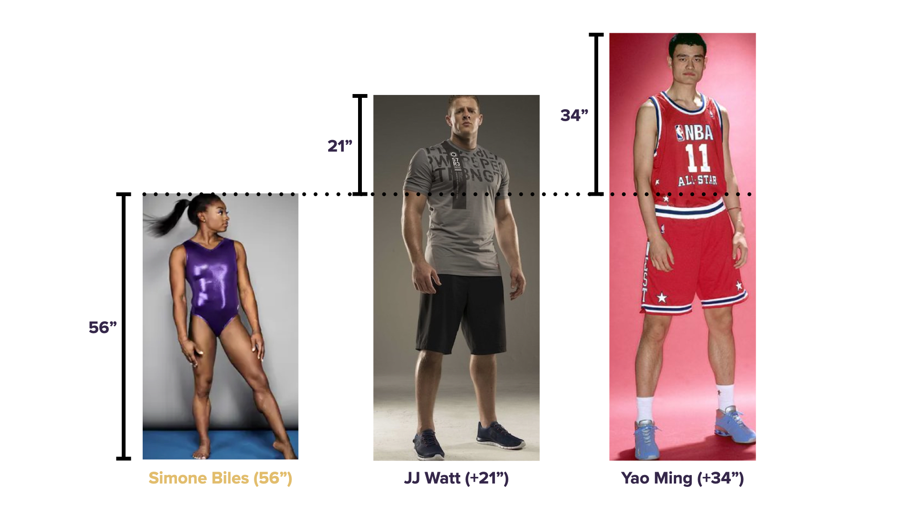{fig-alt="Simone Biles is the baseline at 56 inches. JJ Watt is 21 inches above the baseline, and Yao Ming is 34 inches above the baseline." width="88%"}

## A different baseline

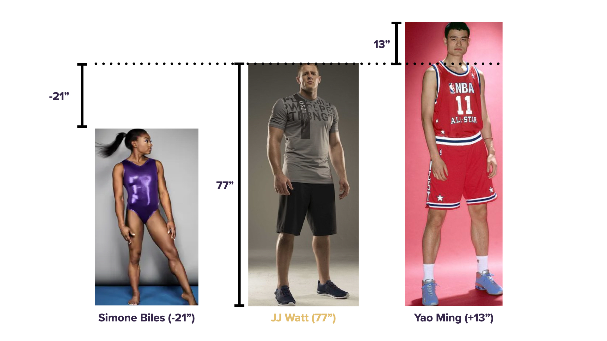{fig-alt="JJ Watt is the baseline at 77 inches. Simone Biles is 21 inches below the baseline, and Yao Ming is 13 inches above the baseline." width="88%"}

## Baseline/offset form

Raw form:

-   Simone Biles: 56 inches
-   JJ Watt: 77 inches
-   Yao Ming: 90 inches

Baseline/offset form, using Simone Biles as the baseline:

-   Simone Biles: 56 inches
-   JJ Watt: +21 inches
-   Yao Ming: +34 inches

Same information. Different encoding.

## Why do this?

Baseline/offset form is awkward for three numbers.

It becomes useful when the model has:

-   many groups,
-   multiple categorical variables,
-   numerical variables and categorical variables together,
-   interactions.

Most regression software calls the baseline the intercept, even if geometrically, there's no line.

## Cheese at Kroger

The data: 61 weeks of packaged cheese sales at a Dallas-area Kroger.

The question:

> How much more cheese sells when there is an in-store ad display?

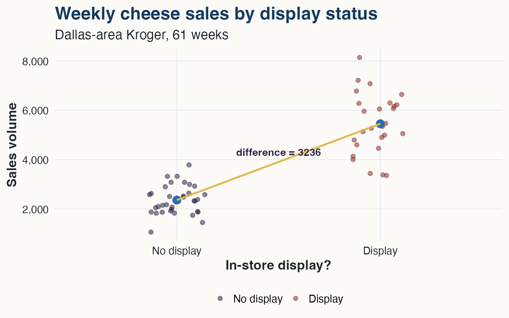{fig-alt="Weekly cheese sales are higher during display weeks. The plot shows group means and the difference between them." width="78%"}

## Cheese means

Average weekly sales:

| display? | mean sales |
|----------|-----------:|
| no       |       2341 |
| yes      |       5577 |

Same information in baseline/offset form:

| group      | baseline/offset |
|------------|----------------:|
| no display |            2341 |
| display    |     3236 higher |

The display group is the baseline plus an offset.

## Dummy variables

A dummy variable takes only two values:

-   1 if a case is in some category,
-   0 otherwise.

For cheese:

$$
\text{Display}_i =
\begin{cases}
1, & \text{week } i \text{ had a display}\\
0, & \text{otherwise}
\end{cases}
$$

The dummy turns a yes/no question into a (binary) number.

## The cheese model

Use the dummy variable as a predictor:

$$
\text{Sales}_i = \beta_0 + \beta_1\text{Display}_i + e_i.
$$

If Display = 0:

$$
\text{Sales}_i = \beta_0 + e_i.
$$

If Display = 1:

$$
\text{Sales}_i = \beta_0 + \beta_1 + e_i.
$$

## Reading the coefficients

For the cheese data:

$$
\widehat{\text{Sales}} = 2341 + 3236 \cdot \text{Display}.
$$

Interpretation:

-   intercept: predicted mean sales without a display,
-   display coefficient: predicted difference between display and no-display weeks,
-   fitted display mean: $2341 + 3236 = 5577$.

The coefficient is the comparison we wanted.

## Let your software create the dummies

We can create the dummy by hand:

``` r
mutate(dispyes = ifelse(disp == "yes", 1, 0))
lm(vol ~ dispyes, data = kroger_dallas)
```

But your software will do it automatically:

``` r
lm(vol ~ disp, data = kroger_dallas)
```

The software chooses a baseline level and creates the offset.

## More than two groups

Suppose a categorical variable has $K$ groups.

Regression uses:

-   one baseline group (e.g. Simone Biles)
-   $K-1$ dummy variables (e.g. one each for JJ Watt and Yao Ming),
-   $K-1$ offsets from the baseline.

Why not $K$ dummies?

-   Because one group must be the reference point.
-   Otherwise the model encodes the same information twice.

## The baseline is arbitrary

Changing the baseline changes the coefficients.

It does not change the fitted group means.

If we use a different baseline:

-   the intercept changes,
-   the offsets change,
-   the predictions stay the same.

So choose a baseline that makes the model easy to explain.

## More than one categorical variable

A delivery platform is testing priority dispatch. Each row is an order.

``` r
delivery %>% sample_n(5)
```

| order | rest | Peak | Priority | minutes late |
|------:|------|-----:|---------:|-------------:|
|  1800 | R06  |    0 |        0 |          5.7 |
|   685 | R08  |    1 |        1 |          7.8 |
|  1536 | R08  |    0 |        0 |          3.5 |
|   558 | R11  |    0 |        0 |          5.5 |
|  1303 | R02  |    1 |        1 |         14.6 |

Business question:

> How much does Priority dispatch reduce late deliveries?

## Start simple

Let's start by asking the simplest possible question: **Are priority orders earlier, on average?**

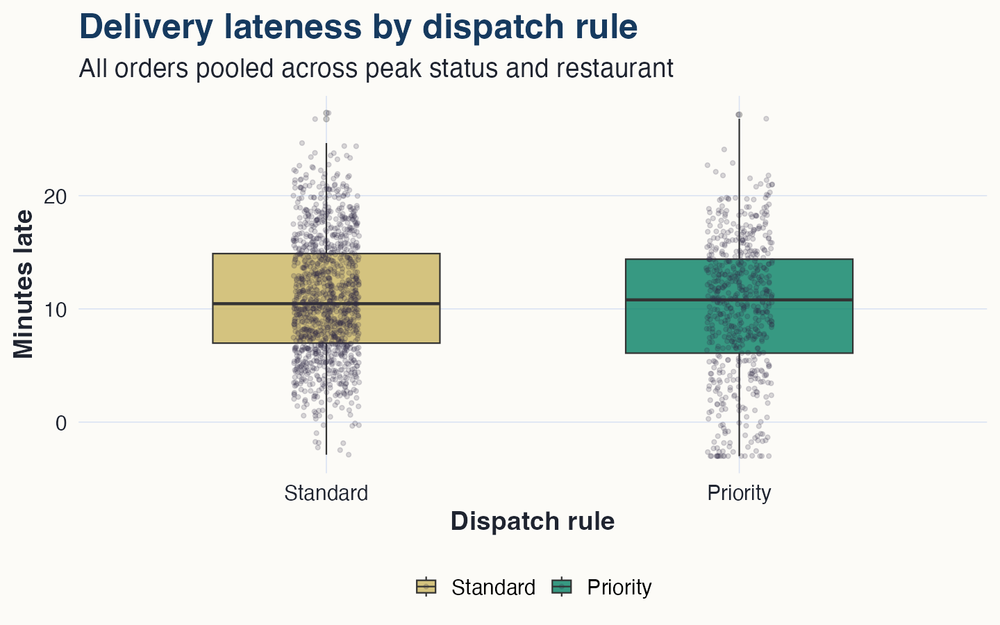{fig-alt="Boxplots compare standard and priority dispatch." width="98%"}

## The one-variable model

Fit the model we already know how to fit:

$$
\text{Late}_i = \beta_0 + \beta_1\text{Priority}_i + e_i.
$$

For these data:

$$
\widehat{\text{Late}} = 11.2 - 0.9\text{Priority}.
$$

That says priority dispatch predicts only about 0.9 fewer minutes late.

. . .

**Pretty underwhelming.** Is priority dispatch just a fancy button likely to disappoint customers in the long run?

## But look at when priority dispatch is used

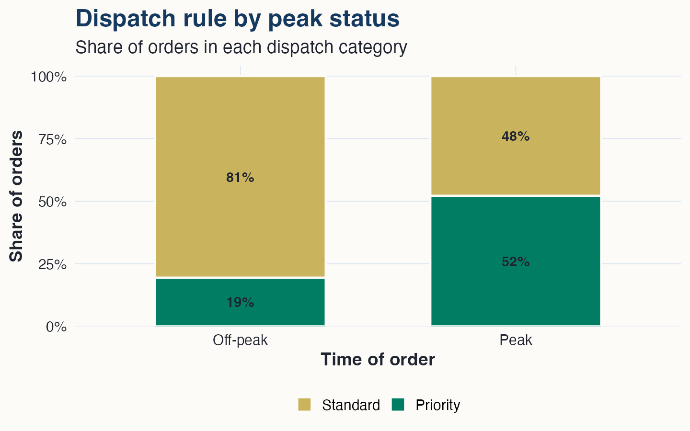{fig-alt="Off-peak orders are mostly standard dispatch, while peak-hour orders are much more likely to receive priority dispatch." width="82%"}

## But look at when priority dispatch is used

So our naive comparison is not just **priority versus standard.**

It is also, implicitly, **peak-hour versus off-peak orders.**

. . .

This is **confounding.** A confounder is a variable that is related to:

-   the predictor we care about,
-   the outcome we are trying to explain.

So the one-variable priority coefficient mixes two stories.

## Adjust for peak hours

Use both dummies:

$$
\text{Late}_i
= \beta_0
+ \beta_1\text{Priority}_i
+ \beta_2\text{Peak}_i
+ e_i.
$$

Side note: this is the moment regression becomes a language for comparisons with multiple inputs:

$$
\widehat{y} = f(x_1, x_2, \ldots).
$$

We'll lean on this heavily from now on!

## The adjusted fit

For these data:

$$
\widehat{\text{Late}}
= 8.9
- 3.8\text{Priority}
+ 7.6\text{Peak}.
$$

Now the priority coefficient looks more sensible:

-   compare two off-peak orders, or
-   compare two peak-hour orders,
-   holding peak status fixed.

Priority dispatch predicts about 3.8 fewer minutes late.

## Adjustment as subtraction

Start with the fitted equation:

$$
\widehat{\text{Late}}
= 8.9
- 3.8\text{Priority}
+ 7.6\text{Peak}.
$$

Move the peak-hour piece to the left:

$$
\widehat{\text{Late}} - 7.6\text{Peak}
= 8.9 - 3.8\text{Priority}.
$$

Left side: delivery lateness, adjusted for peak status.

Right side: the partial priority effect.

## Partial versus overall

Overall relationship:

> Compare all priority orders with all standard orders.

That gave about -0.9 minutes.

Partial relationship:

> Compare priority and standard orders with the same peak status.

That gave about -3.8 minutes. Different comparison, different coefficient.

## Main effects only

Our two-variable model was:

$$
\text{Late} \sim \text{Priority} + \text{Peak}.
$$

This is a main-effects model.

It assumes the priority gap is the same regardless of circumstance:

-   off-peak,
-   at peak.

## Does the gap look the same?

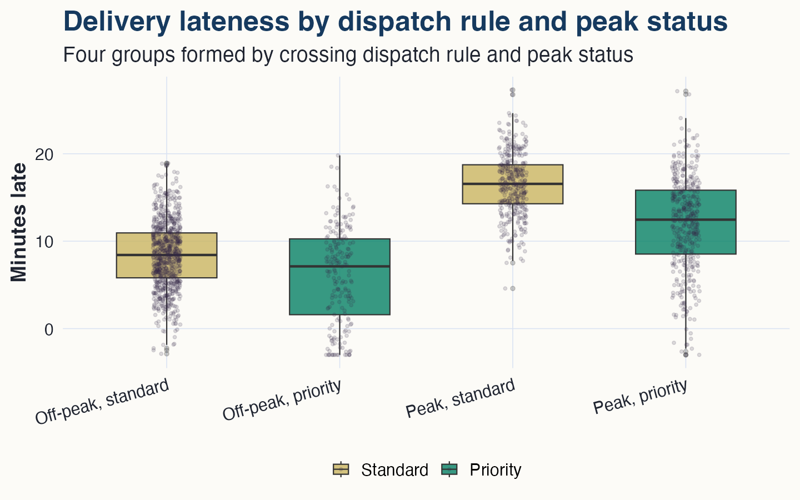{fig-alt="The priority gap looks larger during peak hours. This doesn't seem consistent with our modeling assumptions." width="84%"}

## What is an interaction?

An interaction means the effect of one variable depends on another variable.

Plain examples:

-   high gear is fine on flat ground, awful uphill,
-   a breeze feels good in August, bad in January,
-   two Tylenol pills mean one thing for an adult and another thing for an elephant.

The phrase "the effect of x on y" is incomplete until we name the context in which x operates.

## Add the interaction

We encode interactions using the product of the two dummy variables:

$$
\text{Late}_i =
\beta_0
+ \beta_1\text{Priority}_i
+ \beta_2\text{Peak}_i
+ \beta_{12}\text{Priority}_i\text{Peak}_i
+ e_i.
$$

The product is 1 only for priority orders during peak hours.

That last coefficient is the extra "oomph" from being both Priority=1 and Peak=1.

**Let's see why this works.**

## Four fitted means

With the interaction:

| Priority | Peak | fitted mean                                |
|---------:|-----:|--------------------------------------------|
|        0 |    0 | $\beta_0$                                  |
|        1 |    0 | $\beta_0 + \beta_1$                        |
|        0 |    1 | $\beta_0 + \beta_2$                        |
|        1 |    1 | $\beta_0 + \beta_1 + \beta_2 + \beta_{12}$ |

The priority effect is now context-specific:

-   off-peak: $\beta_1$,
-   peak: $\beta_1 + \beta_{12}$.

## Interaction fit

For these data:

$$
\widehat{\text{Late}}
= 8.7
- 2.6\text{Priority}
+ 8.3\text{Peak}
- 2.1\text{Priority}\cdot\text{Peak}.
$$

Then:

-   priority effect off-peak: $-2.6$ minutes,
-   priority effect at peak: $-2.6 - 2.1 = -4.7$ minutes.

So what's the effect of Priority dispatch? **It depends.** That is the interaction.

## But restaurants differ, too

Some restaurants are just harder:

-   slower kitchen,
-   parking chaos,
-   awkward pickup counter,
-   local traffic patterns.

"Which restaurant" is not the main business question. But ignoring it can still distort the answer.

## But restaurants differ, too

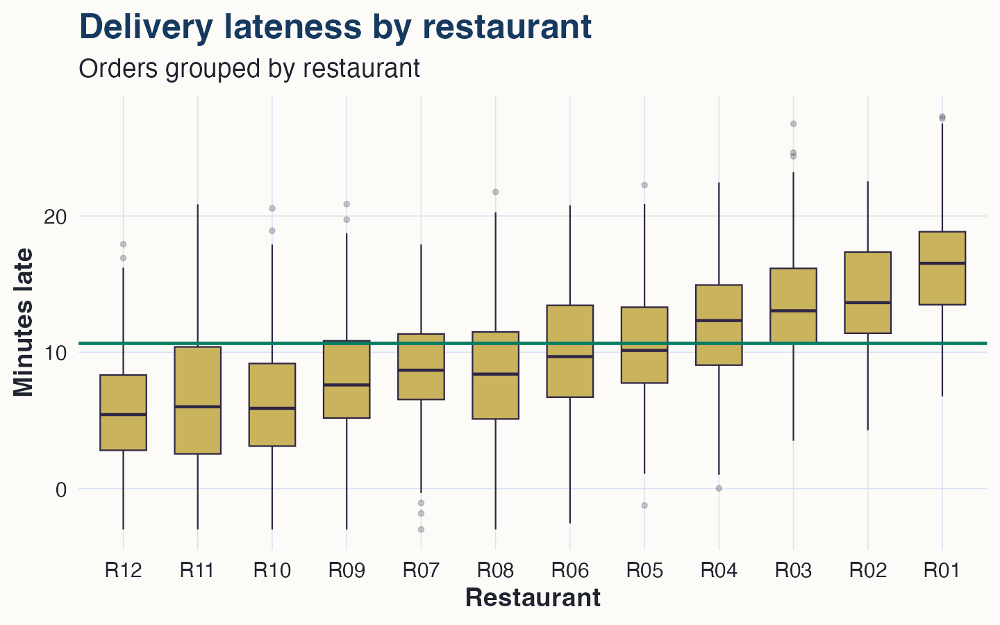{fig-alt="Boxplots by restaurant show large differences in baseline lateness across the 12 restaurants." width="84%"}

## Restaurant-level confounding

Priority dispatch also differs by restaurant.

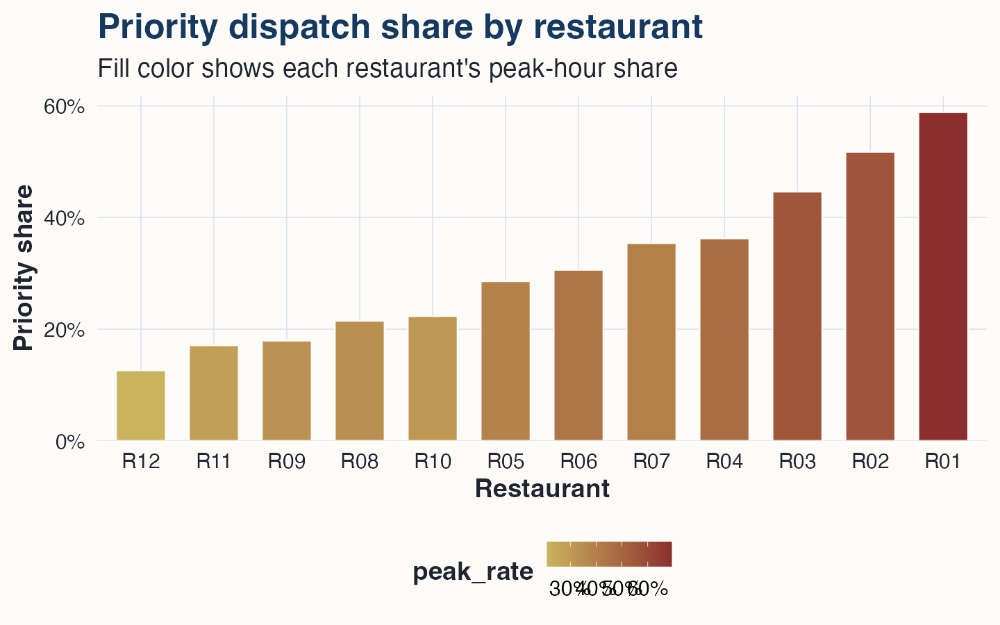{fig-alt="Priority dispatch rates vary across restaurants. Restaurants with higher peak-hour shares tend to have more priority dispatch." width="86%"}

## Restaurant-level confounding

So the priority comparison is implicitly mixing over:

-   dispatch rule,
-   peak-hour mix,
-   restaurant mix.

This is why observational data are a pain in the neck.

## Add restaurant dummies

Use restaurant offsets:

$$
\text{Late}
\sim \text{Priority}
+ \text{Peak}
+ \text{Priority}:\text{Peak}
+ \text{Restaurant}.
$$

Now the restaurant coefficients adjust baseline lateness.

That is a baseline shift, not a new dispatch effect.

## Regression output

Fitted model:

$$
\text{Late} \sim \text{Priority} + \text{Peak} + \text{Priority} : \text{Peak} + \text{Restaurant}.
$$

| coefficient                        | estimate |
|:-----------------------------------|---------:|
| intercept: R01, standard, off-peak |     14.3 |
| priority offset                    |     -4.0 |
| peak offset                        |      7.5 |
| priority:peak offset               |     -2.1 |

These are the coefficients tied directly to dispatch and peak status.

## Restaurant offsets

Same model, restaurant coefficients:

| restaurant | offset | restaurant | offset |
|:-----------|-------:|:-----------|-------:|
| R02        |   -1.7 | R08        |   -7.8 |
| R03        |   -2.9 | R09        |   -7.5 |
| R04        |   -3.3 | R10        |   -8.5 |
| R05        |   -4.6 | R11        |   -9.1 |
| R06        |   -6.1 | R12        |   -9.3 |
| R07        |   -6.3 |            |        |

All restaurant offsets are relative to R01. For example, R12 is about 9.3 minutes earlier than R01, after adjusting for dispatch and peak status.

## The equation gets ugly

With 12 restaurants, the full model equation looks like:

$$
\begin{aligned}
\text{Late}_i
=&\ \beta_0
+ \beta_1\text{Priority}_i
+ \beta_2\text{Peak}_i
+ \beta_{12}\text{Priority}_i\text{Peak}_i \\
&+ \gamma_2R02_i + \gamma_3R03_i + \cdots + \gamma_{12}R12_i
+ e_i.
\end{aligned}
$$

(Self-check: why only 11 restaurant dummies?)

This is why nobody enjoys reading raw regression output before coffee.

## Back to baseline/offset form

This is where baseline/offset form starts earning its keep.

Question:

> How does priority dispatch affect delivery delay?

There are two paths:

-   treat every group mean as primary,
-   treat a baseline and offsets as primary.

The second path is how regression stays readable as the problem gets more complicated.

## Path 1: raw means

Raw form says: **compute the mean lateness for every combination.**

Here that means:

$$
12 \text{ restaurants}
\times 2 \text{ peak statuses}
\times 2 \text{ dispatch rules}
= 48 \text{ cell means}.
$$

Then we stare across those 48 means and try to answer: **what is the priority effect?**

That is not a clean question anymore.

## What goes wrong

The raw-means path is clumsy.

-   Some cells might have very small samples. (In these data, the smallest cell has only 5 orders.)
-   The priority effect has to be reconstructed by comparing many pairs of means.
-   Adding another variable means slicing again.

It also implicitly allows every effect to depend on everything else:

$$
\text{Priority} \times \text{Peak} \times \text{Restaurant}.
$$

That is a three-way interaction.

## Path 2: baseline plus offsets

Baseline/offset form says: **build each fitted mean out of components.**

For example:

$$
\begin{aligned}
\widehat{\text{Late}}
=&\ \text{baseline lateness} \\
&+ \text{priority offset} \\
&+ \text{peak offset} \\
&+ \text{restaurant offset} \\
&+ \text{chosen interaction offsets}.
\end{aligned}
$$

The fitted means are still there implicitly; they are just assembled from *comparisons among conditions*.

## Why this helps

Regression software does the assembly. We get a direct answer to the question/contrast we care about:

> priority versus standard dispatch, holding peak status and restaurant fixed.

That is much cleaner once the problem has several moving parts.

## One more interaction

What if priority dispatch works better for some restaurants than others?

Maybe:

-   one restaurant has a dedicated pickup shelf,
-   another makes drivers wait in line,
-   another is already so fast that priority has little room to help.

Then the priority effect depends on restaurant.

Add `Priority:Restaurant`.

## Full working model

The model formula:

$$
\text{Late}
\sim \text{Priority} + \text{Peak}
+ \text{Restaurant} + \text{Priority}:\text{Peak}
+ \text{Priority}:\text{Restaurant}.
$$

This includes two two-way interactions:

-   `Priority:Peak`,
-   `Priority:Restaurant`.

It lets the priority effect depend on peak status and restaurant.

## Reading the priority coefficients

From the fitted model:

| coefficient                      | estimate |
|:---------------------------------|---------:|
| priority effect at R01, off-peak |     -0.7 |
| extra priority effect at peak    |     -2.8 |
| extra priority effect at R09     |     -6.4 |
| extra priority effect at R10     |     -6.8 |
| extra priority effect at R11     |     -6.7 |
| extra priority effect at R12     |     -6.3 |

For any restaurant:

$$
\text{priority effect at peak}
=
\text{priority effect off-peak} - 2.8.
$$

Negative means fewer minutes late.

## Where priority saves the most time

The model-implied priority savings:

| restaurant | off-peak savings | peak savings |
|:-----------|-----------------:|-------------:|
| R10        |          7.5 min |     10.3 min |
| R11        |          7.4 min |     10.2 min |
| R09        |          7.1 min |      9.9 min |
| R12        |          7.0 min |      9.8 min |
| R07        |          5.9 min |      8.7 min |

These are fitted contrasts:

> standard dispatch minus priority dispatch, holding restaurant and peak status fixed.

## Visualize the fitted effects

Instead of reading 20+ coefficients, plot the fitted means.

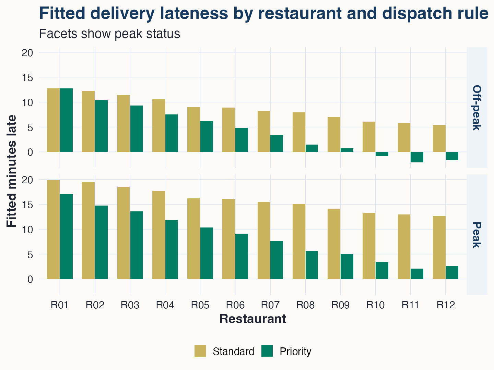{fig-alt="Fitted minutes late are shown for standard and priority dispatch for each restaurant. The plot has separate off-peak and peak panels. The standard-to-priority gap varies across restaurants." width="94%"}

## Numerical and categorical variables together

Now we mix two kinds of predictors:

-   numerical variables: slopes,
-   categorical variables: baseline shifts,
-   interactions: context-specific slopes.

Start with a toy picture.

## Toy grouped data

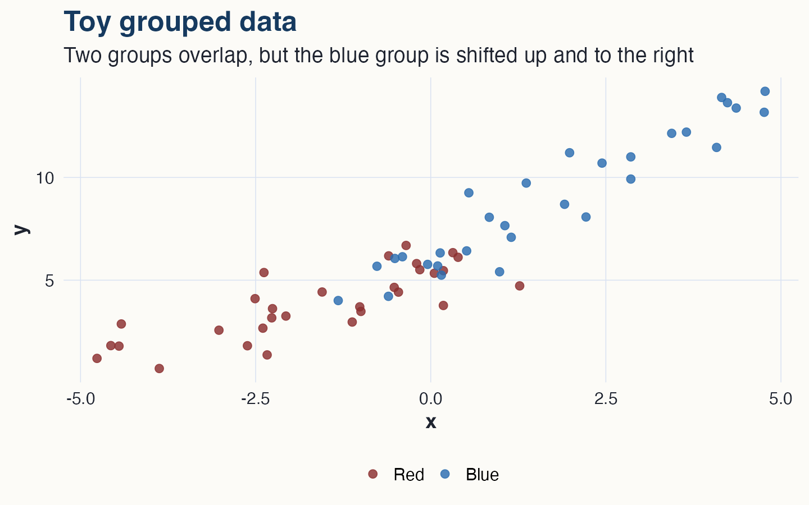{fig-alt="Toy scatterplot with red and blue groups. The blue group is shifted up and to the right and appears steeper, with some overlap near the middle." width="92%"}

## One line ignores the groups

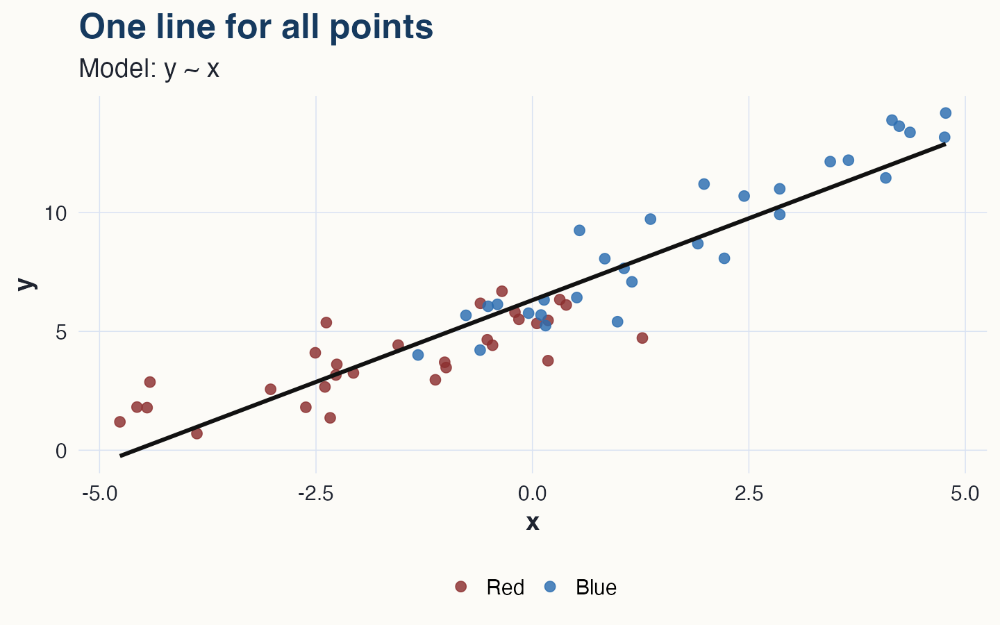{fig-alt="Toy scatterplot with one fitted regression line through all points. The line does not capture the red and blue group structure." width="94%"}

## The one-line model

The model:

$$
y_i = \beta_0 + \beta_1x_i + e_i.
$$

This treats the red and blue points as one undifferentiated cloud: same intercept, same slope.  

But the blue points look shifted up, relative to the red, even at the same value of $x$.  

## Add the dummy

A model with a dummy variable captures this:

$$
y_i = \beta_0 + \beta_1x_i + \beta_2\text{Blue}_i + e_i.
$$

Now blue gets an intercept offset.

- Red equation: $\widehat{y} = \beta_0 + \beta_1x$  
- Blue equation: $\widehat{y} = (\beta_0 + \beta_2) + \beta_1x$  

The $\beta_2\text{Blue}_i$ term shifts the line up whenever $\text{Blue}_i = 1$.

## Add the dummy

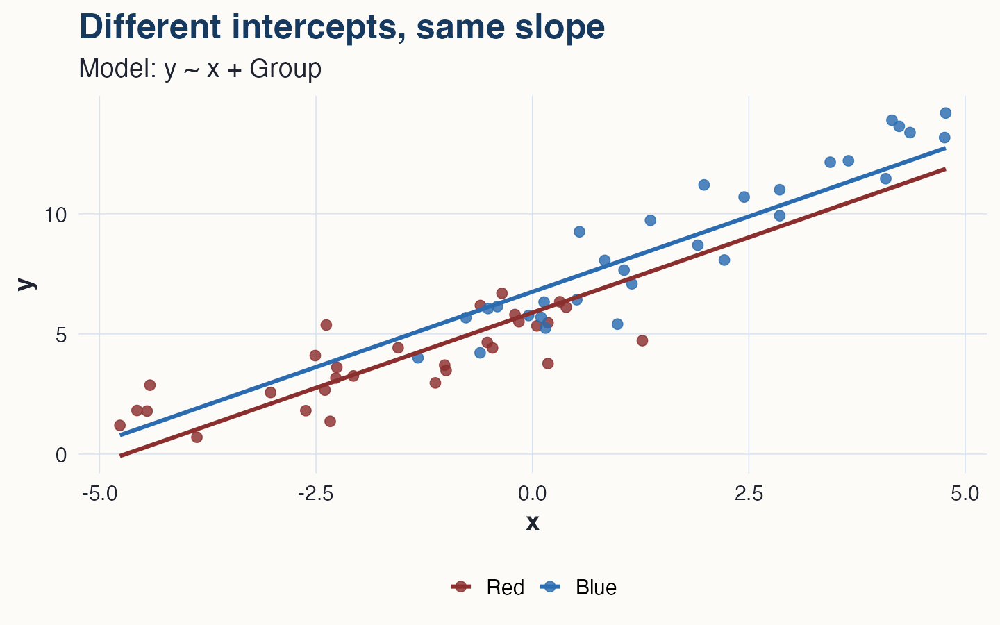{fig-alt="Toy scatterplot with separate fitted lines for red and blue groups from a main-effects model. The fitted lines have different intercepts but the same slope." width="94%"}

## What is missing?

But the two fitted lines are still parallel.

The picture suggests two things:

-   blue starts higher,
-   blue rises faster with $x$.

A dummy variable handles the first part, but not the second.

## Add the interaction

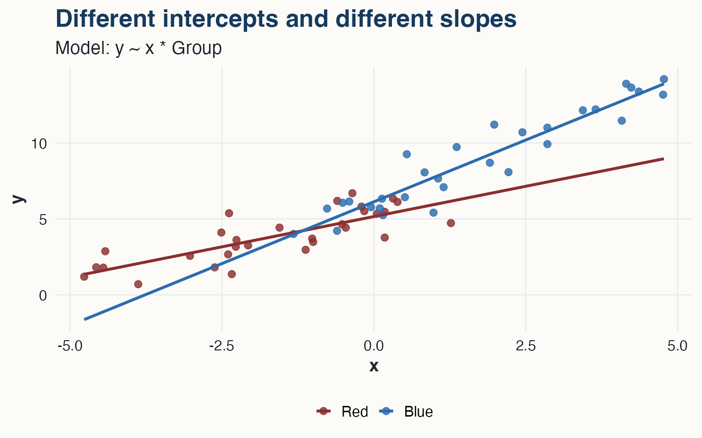{fig-alt="Toy scatterplot with separate fitted lines for red and blue groups from an interaction model. The fitted lines have different intercepts and different slopes." width="94%"}

## The interaction model

The model:

$$
y_i =
\beta_0
+ \beta_1x_i
+ \beta_2\text{Blue}_i
+ \beta_3x_i\text{Blue}_i
+ e_i.
$$

For red points, $\text{Blue}=0$:

$$
\widehat{y}
=
\beta_0 + \beta_1x.
$$

For blue points, $\text{Blue}=1$, we collect like terms:

$$
\widehat{y}
=
(\beta_0 + \beta_2)
+ (\beta_1 + \beta_3)x.
$$

The dummy coefficient is an intercept offset; the interaction coefficient is a slope offset.

## Austin house prices

A sample of Austin home sales, collected by students for a class project last year, focusing on three neighborhoods, post 2023:

-   Hyde Park,
-   Clarksville,
-   Barton Hills.

Variables:

-   `Sqft`: square footage,
-   `PriceK`: sale price in thousands,
-   `MajorReno10`: major renovation in the last 10 years.

## Price per square foot

Realtors often quote:

$$
\frac{\text{price}}{\text{square footage}}.
$$

That sounds like a slope: dollars per extra square foot.

But it is a **ratio**, not a marginal slope.

It draws a line through zero:

$$
\text{Price} = (\text{price per sqft})\cdot \text{Sqft}.
$$

## Ratio versus fitted line

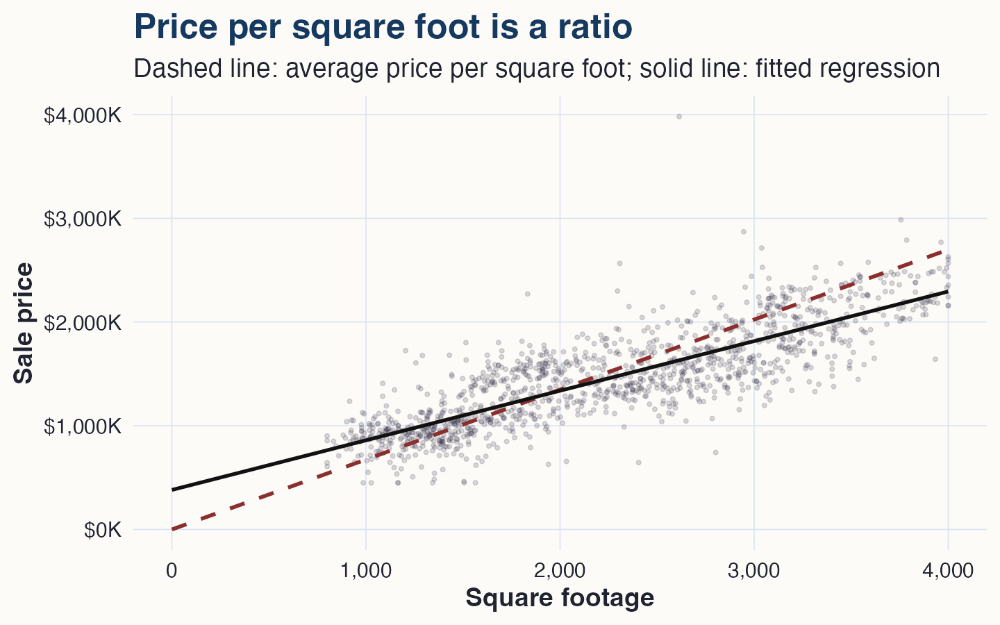{fig-alt="Austin home sale price versus square footage, zoomed out to include zero. The average price-per-square-foot ratio is shown as a dashed line through the origin, while a fitted regression line has its own intercept." width="94%"}

## Diagnosing confounders 

But fitting a single line through the point cloud potentially mixes over multiple stories:

- size
- neighborhood
- renovation status 

Let's check whether we should worry about confounders here.  


## EDA: neighborhood

Size and price differ by neighborhood:

| neighborhood | mean sqft | mean price | mean price/sqft |
|--------------|----------:|-----------:|----------------:|
| Hyde Park    |      2065 |      1194K |           \$604 |
| Clarksville  |      2000 |      1289K |           \$689 |
| Barton Hills |      2676 |      1870K |           \$727 |

Barton Hills has larger houses and higher prices.

Clarksville has similar average size to Hyde Park, but higher average price.

Neighborhood cannot be ignored.

## EDA: renovation status

Size and price also differ by renovation status:

| major renovation | mean sqft | mean price | mean price/sqft |
|------------------|----------:|-----------:|----------------:|
| No               |      1979 |      1297K |           \$690 |
| Yes              |      2692 |      1717K |           \$650 |

Recently renovated homes are larger, and also more expensive, on average.

So renovation status is also confounded with size.

## Building a model

So these three variables are all confounded with each other:  

- size
- neighborhood
- renovation status 

Let's build a model that cleanly separates these effects. Remember:

- dummy variables shift the line up or down  
- interactions between dummies and numerical variables change the slope  


## Centering the predictor

We need a preliminary data-wrangling step.  Define:

$$
\text{Sqft100} = \frac{\text{Sqft} - 1800}{100}.
$$

Why subtract 1800? Because 1800 sq.ft. is a typical house in this sample. So:

-   `Sqft100 = 0` means 1800 square feet,
-   `Sqft100 = 1` means 1900 square feet,
-   `Sqft100 = -1` means 1700 square feet.

The slope is still measured per 100 square feet.

## Without centering

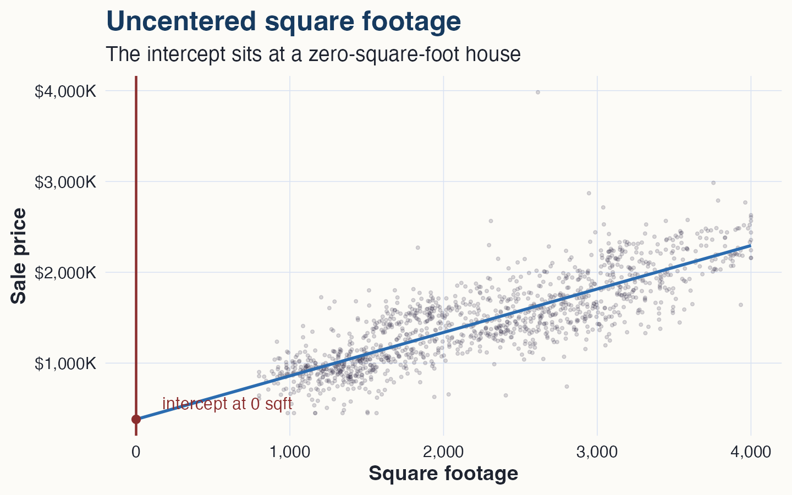{fig-alt="Austin home sale price versus square footage. The uncentered regression intercept appears at zero square feet." width="94%"}

## With centering

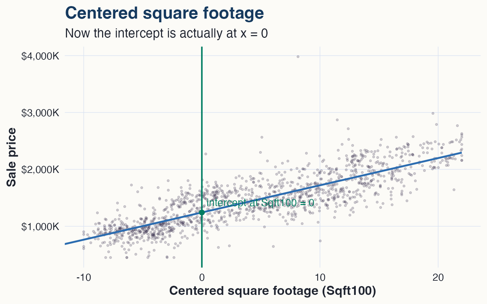{fig-alt="Austin home sale price versus square footage with a vertical marker at 1800 square feet. The centered intercept appears at the typical home size." width="94%"}


## Main effects model

Start with:

$$
\text{PriceK}
\sim
\text{Sqft100}
+ \text{MajorReno10}
+ \text{Neighborhood}.
$$

Our fitted model:

$$
\text{PriceK}
= 1050
+ 35.2\text{Sqft100}
+ 161.8\text{MajorReno10}
+ \text{neighborhood offsets}
+ e.
$$

This model shifts the line up or down by neighborhood and renovation status.  

## One model, six lines

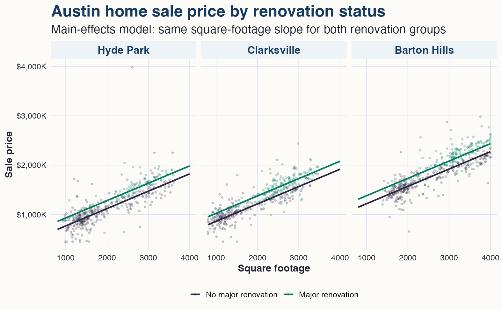{fig-alt="Austin home sale price versus square footage, faceted by neighborhood, with fitted lines by renovation status from a main-effects model. The renovation-status lines are parallel within each neighborhood." width="94%"}

## Add the interaction

Now we let the square-footage slope differ by renovation status:

$$
\text{PriceK}
\sim
\text{Sqft100} * \text{MajorReno10}
+ \text{Neighborhood}.
$$

For these data:

$$
\begin{aligned}
\widehat{\text{PriceK}}
&= 1054.6
+ 105.9\text{MajorReno10} \\
&+ 32.8\text{Sqft100} \\
&+ 8.1\text{Sqft100}\cdot\text{MajorReno10}\\
&+ \text{neighborhood offsets}
\end{aligned}
$$

Now renovation status shifts the intercept and the slope.

## Separate slopes by renovation status

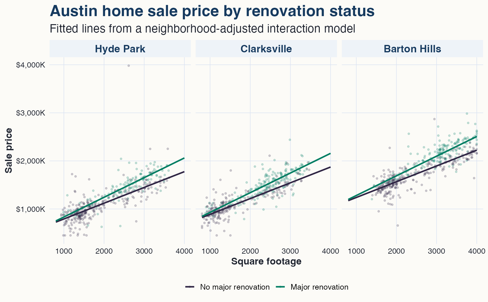{fig-alt="Austin home sale price versus square footage, faceted by neighborhood, with fitted lines for major renovation status. Renovated homes have a steeper fitted square-footage slope." width="94%"}

## Hyde Park arithmetic

Let $R=\text{MajorReno10}$, $C=\text{Clarksville}$, and $B=\text{Barton Hills}$. The full fitted equation is:

$$
\begin{aligned}
\widehat{\text{PriceK}}
=&\ 1054.6 + 32.8\text{Sqft100} + 105.9R \\
&+ 96.1C + 446.7B + 8.1(\text{Sqft100}\cdot R).
\end{aligned}
$$

Hyde Park: $C=0$, $B=0$.  There are two lines:

- $R=0$: $\widehat{\text{PriceK}}= 1054.6 + 32.8\text{Sqft100}$. 
- $R=1$: $\widehat{\text{PriceK}} = (1054.6 + 105.9) + (32.8 + 8.1)\text{Sqft100}$.


## Barton Hills arithmetic

Let $R=\text{MajorReno10}$, $C=\text{Clarksville}$, and $B=\text{Barton Hills}$. The full fitted equation is:

$$
\begin{aligned}
\widehat{\text{PriceK}}
=&\ 1054.6 + 32.8\text{Sqft100} + 105.9R \\
&+ 96.1C + 446.7B + 8.1(\text{Sqft100}\cdot R).
\end{aligned}
$$

Barton Hills: $C=0$, $B=1$.  There are two lines:

- $R=0$: $\widehat{\text{PriceK}} = (1054.6 + 446.7) + 32.8\text{Sqft100}$. 
- $R=1$: $\widehat{\text{PriceK}} = (1054.6 + 446.7 + 105.9) + (32.8 + 8.1)\text{Sqft100}$. 

## What does 105.9 mean?

The coefficient on `MajorReno10` is 105.9. The tempting reading is:

> recent major renovation is worth \$105.9K.

But that is not quite right. With the interaction, the renovation gap is a difference between two fitted prices for houses of the same size, in the same neighborhood, from this equation:  

$$
\begin{aligned}
\widehat{\text{PriceK}}
=&\ 1054.6 + 32.8\text{Sqft100} + 105.9R \\
&+ 96.1C + 446.7B + 8.1(\text{Sqft100}\cdot R).
\end{aligned}
$$

## What does 105.9 mean?

Fix a neighborhood and a value of `Sqft100`. Compare:

$$
\begin{aligned}
\widehat{\text{PriceK}}_{\text{reno}}
&= \text{same neighborhood offset}
+ 1054.6 + 32.8\text{Sqft100} \\
&\quad + 105.9 + 8.1\text{Sqft100},\\
\widehat{\text{PriceK}}_{\text{no reno}}
&= \text{same neighborhood offset}
+ 1054.6 + 32.8\text{Sqft100}.
\end{aligned}
$$

Subtract:

$$
\begin{aligned}
\text{renovation gap}
&=
\widehat{\text{PriceK}}_{\text{reno}}
-
\widehat{\text{PriceK}}_{\text{no reno}}\\
&= 105.9 + 8.1\text{Sqft100}.
\end{aligned}
$$

So 105.9 is the renovation gap only when `Sqft100 = 0`.

## Renovation gap by size

Because `Sqft100 = 0` means 1800 square feet:

| home size | Sqft100 | fitted renovation gap |
|----------:|--------:|----------------------:|
| 1400 sqft |      -4 | \$73.5K |
| 1800 sqft |       0 | \$105.9K |
| 2200 sqft |       4 | \$138.3K |

So the dummy coefficient is not "the value of renovation" for every home.

It is the renovation gap at the centered size: 1800 square feet.

## Summary

With a numerical variable and a group:

-   dummy variable: intercept offset,
-   interaction with the numerical variable: slope offset.

For Austin:

-   neighborhood adjusts baseline prices,
-   renovation status adjusts baseline prices,
-   `Sqft100:MajorReno10` lets the square-footage premium differ by renovation status.

That is the same toy red/blue grammar, just with real variables.

## Correlation versus interaction

Students often confuse these.

Correlation among predictors means: It is hard to tell which predictor is driving variation in $y$.

Interaction means: The relationship between one predictor and $y$ depends on another predictor.

Correlation is causal confusion.

Interaction is causal complexity.

## Tennis forehand setup

Suppose a coach is rebuilding your forehand. Two things can change:

-   grip: **semi-western** versus **western**,
-   stance: **side-on/neutral** versus **open**.

The outcome: how many times you hit the deep target area, out of 100 forehands.

## A bad experiment

The coach gives you two blocks:

| stance          | semi-western grip | western grip |
|:----------------|------------------:|-------------:|
| side-on/neutral |                58 |           -- |
| open            |                -- |           72 |

You did better with the second setup.

So what helped?

## Complete correlation

In the bad experiment:

| stance          | semi-western grip | western grip |
|:----------------|------------------:|-------------:|
| side-on/neutral |                58 |           -- |
| open            |                -- |           72 |

Grip and stance are perfectly correlated.

That is causal confusion from bad design.

## A better experiment

Now the coach has you hit 100 forehands in all four conditions:

| stance          | semi-western grip | western grip |
|:----------------|------------------:|-------------:|
| side-on/neutral |                66 |           58 |
| open            |                55 |           75 |

Now grip and stance are not correlated by design.

That is what lets us ask better questions.

## What the full table says

The stance effect depends on the grip. For the semi-western grip:

$$
55 - 66 = -11.
$$ For the western grip:

$$
75 - 58 = 17.
$$

Same stance change, different effect.

That is an interaction.

## Neither implies the other

You can have:

-   correlated predictors with no obvious interaction,
-   an interaction in a balanced experiment,
-   correlated predictors and an interaction.

So when someone asks, "what is the effect of $x$ on $y$?"

Correlation means: hard to tell.

Interaction says: it depends.

## Diagnosing interactions

Good reasons to include an interaction:

-   subject-area knowledge says an effect is context-specific,
-   a plot shows clearly different slopes or gaps,
-   the interaction coefficient looks big, in practical terms,
-   predictive performance improves enough to matter.

There is no universal cutoff. You have to judge the problem.

## The practical lesson

Categorical variables are not a special regression species.

They are a coding system.

-   Dummies create baseline shifts.
-   Multiple dummies create multiple offsets.
-   Numerical variables create slopes.
-   Interactions let offsets or slopes depend on context.

Once you see that, a lot of models are just different combinations of the same pieces.
