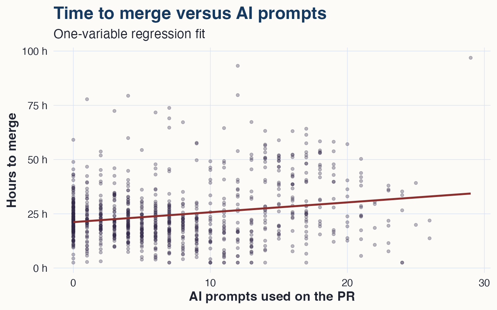
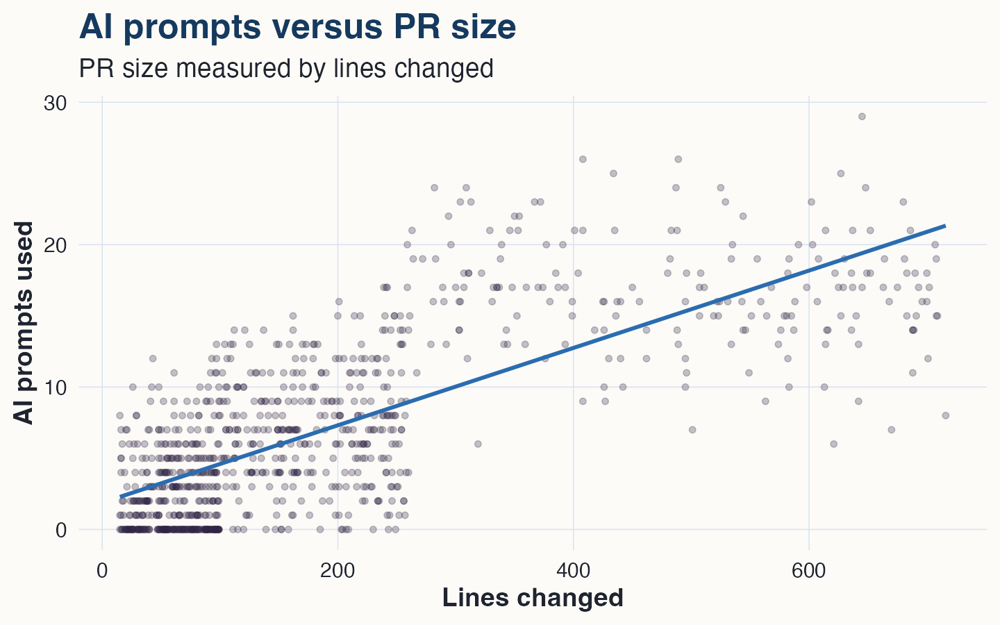
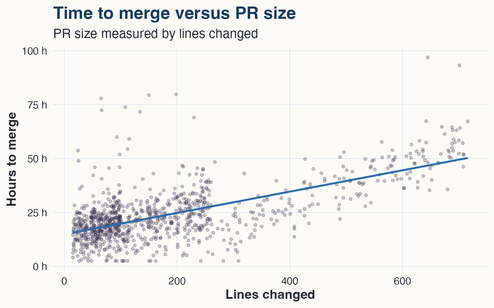
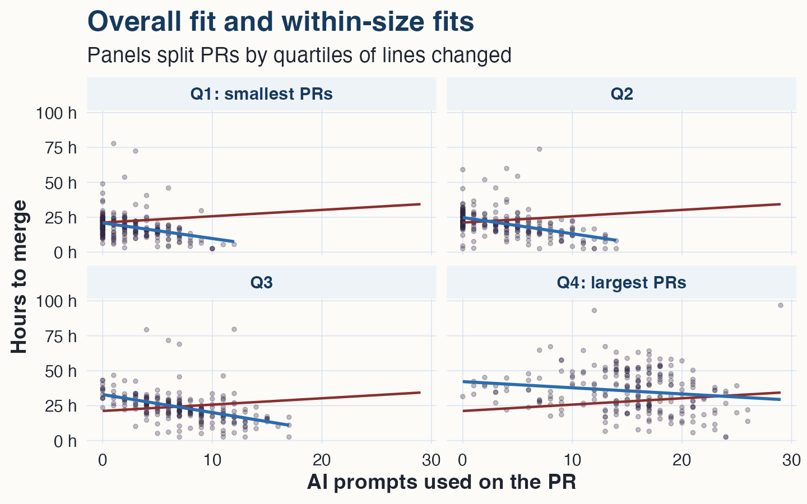
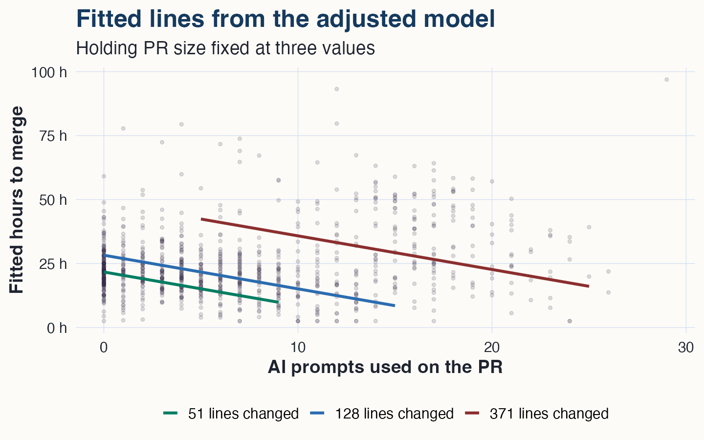
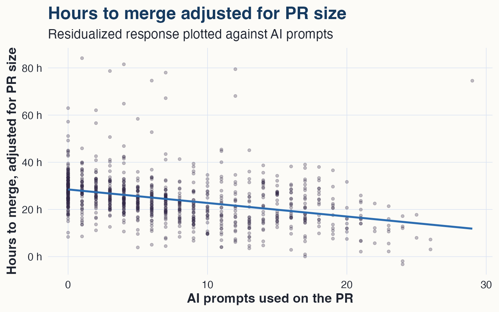
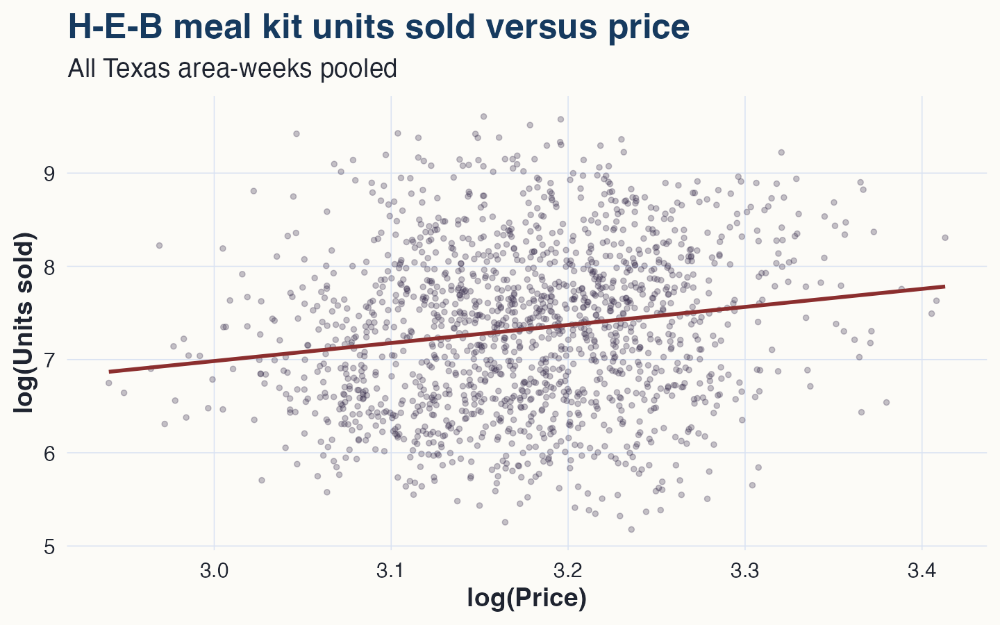
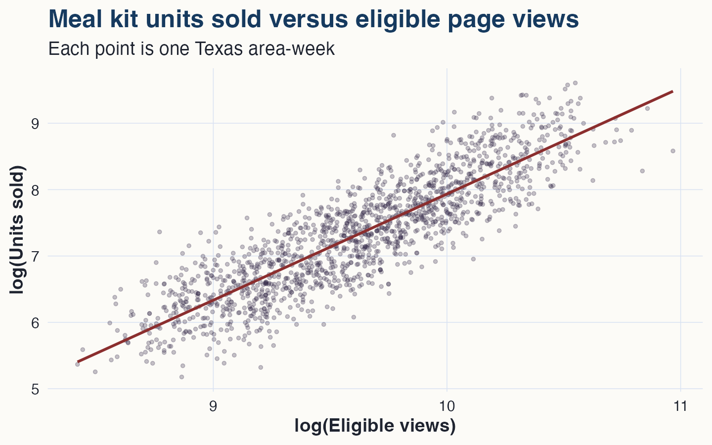
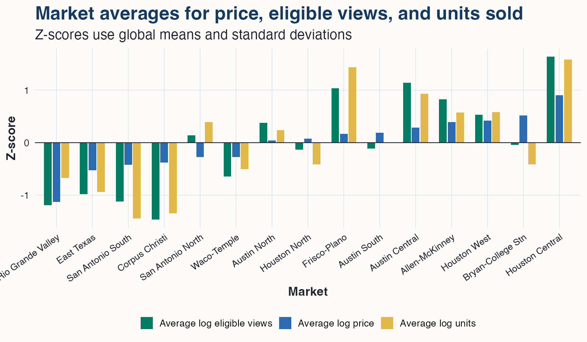
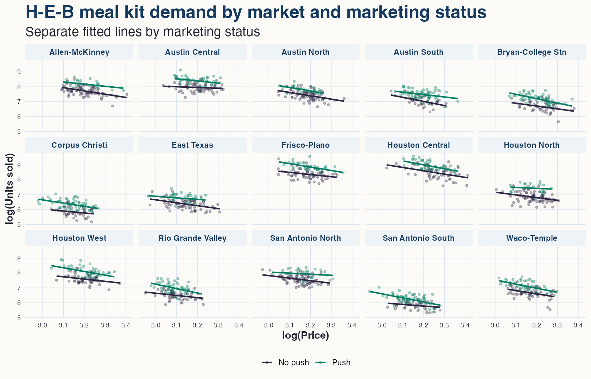

## Multiple regression

When we first fit regresion models, we asked:

> How does $y$ vary with one $x$?

But since then we've learned to ask a more grown-up version:

> How does $y$ vary with one $x$, after adjusting for another $x$?

That phrase, **after adjusting**, is the whole game.

## The case

The SDS undergraduate capstone course has students work in teams on semester-long data products.

-   Every team uses GitHub.
-   Every team submits its AI-assistant logs as part of the assignment.

So for every merged pull request across all teams, we can construct:

-   `HoursToMerge`: hours from opening the PR to merge,
-   `AIPrompts`: number of AI-assistant prompts linked to the PR,
-   `LinesChanged`: total lines added plus deleted.

The question: **Did AI-assistant use speed up PRs?**

## A few rows

``` r
prs %>% sample_n(8)
```

|  PR | AI prompts | lines changed | hours to merge |
|----:|-----------:|--------------:|---------------:|
| 180 |          3 |            74 |           19.6 |
| 106 |          0 |            54 |           16.9 |
| 314 |         12 |           310 |           29.3 |
| 820 |          1 |            29 |           19.1 |
| 206 |          7 |           501 |           44.6 |
| 524 |          5 |            59 |           14.2 |
| 740 |          1 |            61 |           16.9 |
| 810 |         17 |           387 |           25.1 |

Already: these PRs are not all the same kind of task.

## First read

{fig-alt="Hours to merge is plotted against the number of AI prompts used on the pull request. The fitted one-variable regression line slopes upward." width="100%"}

## First read

Fit the simple model:

$$
\text{HoursToMerge}_i
= \beta_0 + \beta_1\text{AIPrompts}_i + e_i.
$$

For these data:

$$
\widehat{\text{HoursToMerge}}
= 21.2 + 0.45\text{AIPrompts}.
$$

Naive answer: each additional AI prompt predicts about **0.45 more hours** before merge.

That sounds bad.

## But big PRs mean more prompts

{fig-alt="AI prompts are plotted against lines changed. Larger pull requests tend to use more AI prompts." width="100%"}

## And big PRs also take longer to merge

{fig-alt="Hours to merge is plotted against lines changed. Larger pull requests tend to take longer to merge." width="100%"}

## The confounding pattern

Bigger PRs also take longer to merge.

So `LinesChanged` is related to:

-   the predictor we care about, `AIPrompts`,
-   the outcome, `HoursToMerge`.

That is the confounding pattern again.

## The wrong comparison

The naive model explicitly compares: PRs with many prompts versus PRs with few prompts.

But because prompt count and PR size are related, it also implicitly compares: larger PRs versus smaller PRs.

That is not the comparison we meant. We want something closer to: **compare PRs of similar size, with different numbers of AI prompts.**

## A simple adjustment idea

Split PRs into quartiles by `LinesChanged`.

Then compare prompt use **within each size range**.

``` r
prs = prs %>%
  mutate(SizeQuartile = cut_number(LinesChanged, 4))
```

This is not the final method.

It is a picture of the adjustment we want regression to do.

## A simple adjustment idea

{fig-alt="Each panel shows pull requests in one quartile of lines changed. The red overall fit slopes upward. The blue within-size fits slope downward." width="100%"}

## Reading the quartile plot

Red line:

> compare PRs of all sizes.

Blue lines:

> compare PRs of similar size.

The sign changes.

## What happened?

The overall relationship says:

> PRs with more AI prompts take longer.

The within-size relationship says:

> among similarly sized PRs, more AI prompts predict faster merges.

Those are not contradictory, just different comparisons.

## From bins to a continuous adjustment

The quartile plot adjusted for size by making four bins.

That was useful because we could see the logic:

> compare high-prompt and low-prompt PRs among similarly sized PRs.

But `LinesChanged` is not really a four-level variable. It is numerical.

Multiple regression can do the same comparison more directly.

## Keep size numerical

Don't ask: which size quartile is this PR in?

Ask: how many lines changed?

The model then uses all the size information, not just a bin label.

This moves us from stratified adjustment to multiple regression with two numerical inputs.

## From lines to planes

With one numerical predictor:

$$
y_i = \beta_0 + \beta_1x_i + e_i.
$$

With two numerical predictors:

$$
y_i = \beta_0 + \beta_1x_{i1} + \beta_2x_{i2} + e_i.
$$

The fitted object is no longer a line in a two-dimensional plot.

It is a plane in a three-dimensional cloud.

## The multiple regression model

Use both predictors:

$$
\text{HoursToMerge}_i
= \beta_0
+ \beta_1\text{AIPrompts}_i
+ \beta_2\text{Lines100}_i
+ e_i.
$$

where

$$
\text{Lines100}_i = \frac{\text{LinesChanged}_i}{100}.
$$

## The fitted equation

For these data:

$$
\widehat{\text{HoursToMerge}}
= 17.3
- 1.3\text{AIPrompts}
+ 8.5\text{Lines100}.
$$

Interpretation:

-   among PRs with similar size, one more AI prompt predicts about **1.3 fewer hours** to merge,
-   among PRs with similar prompt counts, 100 more changed lines predicts about **8.5 more hours** to merge.

## Partial relationships

The coefficient on `AIPrompts` is a **partial slope**. It answers:

> How does merge time change with prompt count, holding PR size fixed?

The one-variable slope was an **overall slope**. It answered:

> How do prompt count and merge time vary together, without holding PR size fixed?

##  {.plain}

{fig-alt="Adjusted model fitted lines are plotted for three fixed values of lines changed. The lines slope downward and have different vertical positions." width="100%"}

## Reading the fitted lines

This plot is a two-dimensional slice through the multiple regression model.

Each line holds PR size fixed at one value.

Same slope for prompts.

Different baselines for PR size.

## Adjustment as subtraction

Start with the fitted equation:

$$
\widehat{\text{HoursToMerge}}
= 17.3
- 1.3\text{AIPrompts}
+ 8.5\text{Lines100}.
$$

Move the PR-size part to the left:

$$
\widehat{\text{HoursToMerge}} - 8.5\text{Lines100}
= 17.3 - 1.3\text{AIPrompts}.
$$

Left side: merge time, adjusted for PR size.

Right side: the remaining partial relationship with AI prompts.

##  {.plain}

{fig-alt="Hours to merge adjusted for PR size is plotted against AI prompts. The fitted line slopes downward." width="100%"}

## Reading the partial picture

After removing the PR-size pattern, the prompt relationship is negative.

This is the blue-line story from the quartile plots, compressed into one model.

## What regression bought us

The quartile plot was useful because it made the problem visible.

But it was also clunky:

-   quartile cutoffs are arbitrary,
-   PRs near a cutoff get separated,
-   we get four slopes instead of one clean adjusted estimate.

Multiple regression adjusts for `LinesChanged` directly.

## The warning label

This is observational data.

So we should not announce: AI prompts caused faster merges.

Better: After adjusting for PR size, PRs with more AI-assistant prompts tended to merge faster.

That is still useful. It is just not a randomized experiment.

## Practical lesson

A one-variable slope can answer the wrong question.

Before interpreting a slope, ask:  What comparison is this coefficient making?

Overall relationship:

> compare everyone.

Partial relationship:

> compare units that are similar on the adjustment variable.

## A pricing question

H-E-B sells a weeknight meal kit through its grocery app.

-   The meals change week to week: enchilada trays, salmon dinners, fajita kits, stir-fry bowls. Not a niche product. 
-   Customers first land on the main app page. Conditional on that page view, some eligible viewers get a homepage or push promotion.

The business question: **if we raise price, how much demand do we lose?**

The app has some week-to-week price variation. But this was not a clean price experiment.

## What got recorded

Each row is one week in a single Texas area, aggregated across stores within that area.

-   `Market`: the Texas area.
-   `UnitsSold`: number of kits sold,
-   `Price`: average price for meal kits sold that week,
-   `EligibleViews`: home screen app views eligible for the marketing push,
-   `Marketing`: whether eligible viewers got the homepage/push promotion,


## A few rows

``` r
meal_kits %>% sample_n(8)
```

| Market            | Week | Price | Eligible views | Marketing | Units sold |
|:------------------|-----:|------:|---------------:|:----------|-----------:|
| East Texas        |   64 | 23.80 |          10749 | Push      |       1025 |
| Houston Central   |   44 | 24.43 |          32608 | Push      |      10978 |
| Rio Grande Valley |   22 | 21.47 |           9179 | Push      |       1258 |
| San Antonio South |   80 | 21.72 |          11891 | Push      |        547 |
| Austin North      |   52 | 23.23 |          16339 | Push      |       3307 |
| Houston Central   |   21 | 28.44 |          35809 | No push   |       5089 |
| Houston West      |   56 | 25.58 |          21210 | Push      |       4016 |
| Frisco-Plano      |   81 | 25.70 |          19581 | Push      |       4427 |

Demand varies a lot more than price does. A big reason is exposure: some area-weeks have many more eligible page views.

##  Start with a log-log model

{fig-alt="Log units sold is plotted against log price for all Texas area-weeks pooled. The fitted line slopes upward." width="100%"}

## The naive model

Fit the one-variable model:

$$
\log(\text{UnitsSold}_i)
= \beta_0 + \beta_1\log(\text{Price}_i) + e_i.
$$

For these data:

$$
\widehat{\log(\text{UnitsSold})}
= 1.18 + 1.94\log(\text{Price}).
$$

Naive answer: higher prices predict more sales. Terrible pricing advice!

## Marketing is not random

Marketing pushes likely increase demand, but also appear more often in lower-price weeks.

| Marketing | Weeks | Average price | Average eligible views | Average units |
|:----------|------:|--------------:|-----------------------:|--------------:|
| No push   |   879 |         24.17 |                  17368 |          1883 |
| Push      |   681 |         23.84 |                  16093 |          2615 |

So price is confounded with the marketing push.

## Adjust for marketing

Add a marketing indicator:

$$
\log(\text{UnitsSold}_i)
= \beta_0
+ \beta_1\log(\text{Price}_i)
+ \beta_2\text{Push}_i
+ e_i.
$$

Fitted equation:

$$
\widehat{\log(\text{UnitsSold})}
= 0.55 + 2.09\log(\text{Price})
+ 0.28\text{Push}.
$$

The price slope is still positive.

Marketing adjustment alone has not fixed the comparison.

## Exposure matters

`EligibleViews` is measured before the marketing push.

The sequence is:

1.  a shopper reaches the app home page,
2.  the app may show a push for the meal kit to eligible viewers,
3.  the shopper may buy.

So `EligibleViews` is an exposure variable. It tells us how many shoppers had a chance to buy.

##  Sales vs views

{fig-alt="Log units sold is plotted against log eligible views for Texas area-weeks. The fitted relationship slopes upward." width="100%"}

## Adjust for exposure

Now include both numerical predictors:

$$
\log(\text{UnitsSold}_i)
= \beta_0
+ \beta_1\log(\text{Price}_i)
+ \beta_2\log(\text{EligibleViews}_i)
+ \beta_3\text{Push}_i
+ e_i.
$$

For these data:

$$
\widehat\beta_1 = -2.71,
\qquad
\widehat\beta_2 = 1.81.
$$

Price now slopes downward. Eligible views are doing what they should: more eligible viewers means more sales.

## Something else is moving

Prices, eligible views, and demand all vary a lot by market.

That is normal:

-   markets differ in size,
-   markets differ in income and delivery costs,
-   local teams may choose different price levels,
-   H-E-B is not equally mature in every Texas area.

So a pooled regression may be comparing Houston Central weeks to Rio Grande Valley weeks, not just expensive weeks to cheap weeks.

##  Correlation among predictors

{fig-alt="For each market, bars show z-scores of average log price, average log eligible views, and average log units sold. Some higher-price markets also have more eligible views and higher average demand." width="100%"}


## Adjust for market

Now compare weeks in the same market:

$$
\log(\text{UnitsSold}_i)
= \beta_0
+ \beta_1\log(\text{Price}_i)
+ \beta_2\log(\text{Views}_i)
+ \beta_3\text{Push}_i
+ \gamma_{\text{Market}_i}
+ e_i.
$$

The fitted price slope is:

$$
\widehat\beta_1 = -2.35.
$$

Interpretation:

> comparing weeks in the same area, with similar eligible page views and the same marketing status, a 1% price increase predicts about 2.35% fewer units sold.

## Revenue implication

For a log-log demand model:

$$
\text{revenue elasticity} \approx 1 + \text{demand elasticity}.
$$

With the market-adjusted estimate:

$$
1 + (-2.35) = -1.35.
$$

So a 1% price increase predicts roughly:

-   2.35% fewer units,
-   1.35% lower revenue.

That is a very different business answer.

##  What about slopes?

{fig-alt="Each panel shows one market. Points and fitted lines are colored by marketing status. Push weeks tend to sit higher and have slightly steeper fitted price slopes." width="100%"}

## Reading the market fits

Within markets, push weeks tend to sit higher.

The push-week slopes also look a bit steeper.

So one more question is natural:

> Is the price elasticity the same in push weeks and no-push weeks?

## Add the interaction

Let the price slope differ by marketing status.

Remember: mean-center numerical predictors when adding interactions. Define:

$$
x_i = \log(\text{Price}_i) - \log(23).
$$

Then fit:

$$
\log(Q_i)
= \beta_0
+ \beta_1x_i
+ \beta_2\text{Push}_i
+ \beta_3x_i\text{Push}_i
+ \beta_4\log(\text{Views}_i)
+ \gamma_{\text{Market}_i}
+ e_i.
$$

The centering makes the push coefficient refer to a price of about \$23.

## The fitted interaction

For the interaction model:

$$
\widehat\beta_1 = -2.23,
\qquad
\widehat\beta_3 = -0.28.
$$

So:

| Marketing status | Estimated price elasticity |
|:-----------------|---------------------------:|
| No push          |                      -2.23 |
| Push             |                      -2.51 |

At a price of about \$23, push weeks have about **55% higher** expected unit sales, after adjusting for eligible views and market.

## What might have happened?

The data do not look like a fully randomized pricing experiment.

A reasonable diagnosis:

-   local price tests created week-to-week price variation,
-   marketing pushes were more common in cheaper weeks,
-   the number of eligible page views varied a lot by area and week,
-   some Texas areas had higher prices and higher baseline demand,
-   pooling all markets mixed those patterns together.

The first slope was the right answer to the wrong question.

## Practical lesson, again

For the price question, the useful comparison is:

> higher-price weeks versus lower-price weeks, within the same market and marketing condition.

The final model estimates that comparison.

That is the move from **overall relationship** to **partial relationship, holding relevant factors constant.**
