## Today

Regression is not just a way to get coefficients.

Today:

- use a cheap test to estimate an expensive measurement,
- bootstrap a regression slope,
- build a model around one focused comparison,
- check residuals for visible failure,
- avoid controls that should not be controls.

## A gasoline problem

A refinery needs the octane rating of a gasoline batch.

The definitive test burns the gasoline.

That is accurate.

It is also destructive.

So the lab also has a cheap nondestructive test.

Question:

> Can the cheap test estimate the octane rating well enough to use it for screening?

## One row

Each row is one gasoline sample.

| sample | cheap test index | octane rating |
|:-------|-----------------:|--------------:|
| G001 |            89.05 |         86.35 |
| G002 |            86.99 |         83.87 |
| G003 |            88.43 |         85.67 |
| G004 |            88.29 |         85.64 |
| G005 |            98.90 |         94.94 |

The cheap test is the proxy.

The octane rating is the expensive measurement.

## Regression calibration {.smaller}

This is a common use of regression:

> use a cheap proxy measurement to estimate an expensive, slow, or destructive measurement.

Examples:

- lab assay versus field sensor,
- destructive strength test versus ultrasound reading,
- expert review versus automatic score,
- long customer interview versus short screening survey.

## The calibration plot

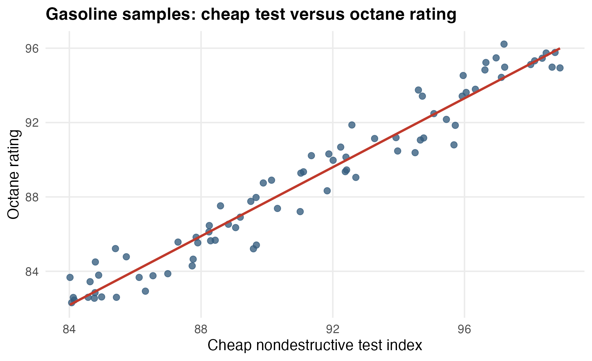{fig-alt="Gasoline octane rating is plotted against a cheap nondestructive test index. The points follow a strong positive linear pattern." width="88%"}

The straight line is a calibration rule.

Use the cheap test.

Predict the expensive test.

## The fitted line

For these samples:

$$
\widehat{\text{Octane}}
= 4.33 + 0.93(\text{Cheap test index}).
$$

In words:

> one more point on the cheap test predicts about 0.93 more octane-rating points.

The fitted line is not the truth.

It is an estimate from one set of samples.

## What uncertainty means here

If the lab had tested a different set of gasoline samples, the fitted slope would move.

So the question is:

> how much would the cheap-test slope move from sample to sample?

That is sampling uncertainty.

We can see it by bootstrapping.

## Bootstrap principle

The bootstrap idea:

> resample the rows, refit the model, watch the estimate move.

``` r
boot_slope <- replicate(4000, {
  boot_sample <- octane |> slice_sample(n = nrow(octane), replace = TRUE)
  coef(lm(octane_rating ~ cheap_test_index,
          data = boot_sample))["cheap_test_index"]
})
```

No new gasoline samples.

Just a way to ask how much the fitted slope depends on this sample.

## Bootstrap picture

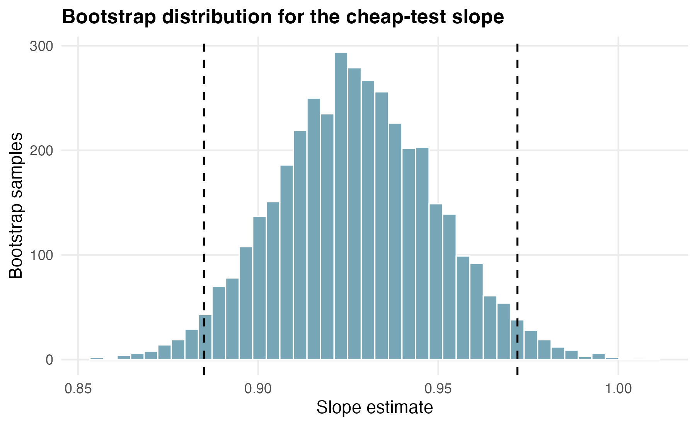{fig-alt="The bootstrap distribution for the cheap-test slope is centered around 0.93. Dashed vertical lines mark a middle interval from about 0.88 to 0.97." width="88%"}

The middle 95% of bootstrap slopes is about:

$$
[0.88,\ 0.97].
$$

The cheap test is clearly informative.

The slope is not pinned to one exact number.

## The shortcut column {.smaller}

R can estimate the same wiggle without resampling anything:

``` r
tidy(octane_model, conf.int = TRUE)
```

| term | estimate | std.error | conf.low | conf.high |
|:-----|---------:|----------:|---------:|----------:|
| cheap_test_index | 0.927 | 0.024 | 0.88 | 0.97 |

The `std.error` column is a formula-based stand-in for the bootstrap's standard deviation.

Bootstrap interval: $[0.88,\ 0.97]$. Formula interval: $[0.88,\ 0.97]$.

> Every confidence interval that `lm()` or `glm()` reports later in this course is this: the closed-form version of the same sample-to-sample wiggle.

## A diagnostic question {.smaller}

Before trusting the calibration rule, ask:

> does the straight line miss an obvious curve?

For that, look at residuals.

Residual:

$$
e_i = y_i - \widehat{y}_i.
$$

Here:

> actual octane rating minus predicted octane rating.

## Residuals for the octane model

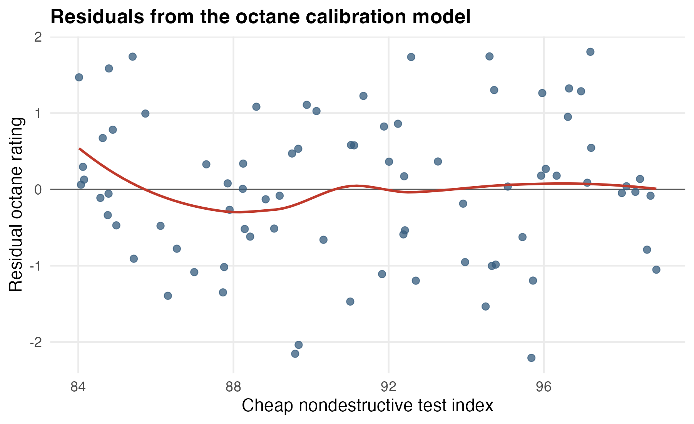{fig-alt="Residuals from the octane model are centered around zero across the cheap-test range. The smooth curve is fairly flat." width="88%"}

No obvious curve.

The straight-line calibration looks adequate.

Not perfect.

Adequate.

## What the first case buys us

We now have three reusable ideas:

- a fitted value is an estimate,
- a bootstrap distribution shows sampling wiggle,
- a residual plot asks whether the fitted form is missing something visible.

Now use those ideas in a messier model-building problem.

## Barcelona rentals

A previous student project studied Airbnb listings in Barcelona for one summer night.

The focal question is about location:

> how does nightly price change as a rental gets farther from La Rambla?

La Rambla is a famous pedestrian boulevard near the center of the tourist city.

Closer usually means more convenient.

But closer also means different kinds of rentals.

## One listing

Each row is one listing for the same summer date.

| listing | price | km to Rambla | bedrooms | bathrooms | superhost | reviews |
|:--------|------:|-------------:|---------:|----------:|----------:|--------:|
| BCN0001 |   128 |         0.61 |        2 |         2 |         0 |      20 |
| BCN0002 |   206 |         3.21 |        3 |         3 |         0 |       5 |
| BCN0003 |   153 |         4.00 |        1 |         1 |         0 |       9 |
| BCN0004 |   117 |         4.94 |        2 |         2 |         0 |       3 |
| BCN0005 |   109 |         3.62 |        1 |         1 |         0 |       1 |

Price is in euros per night.

## Start with the overall relationship

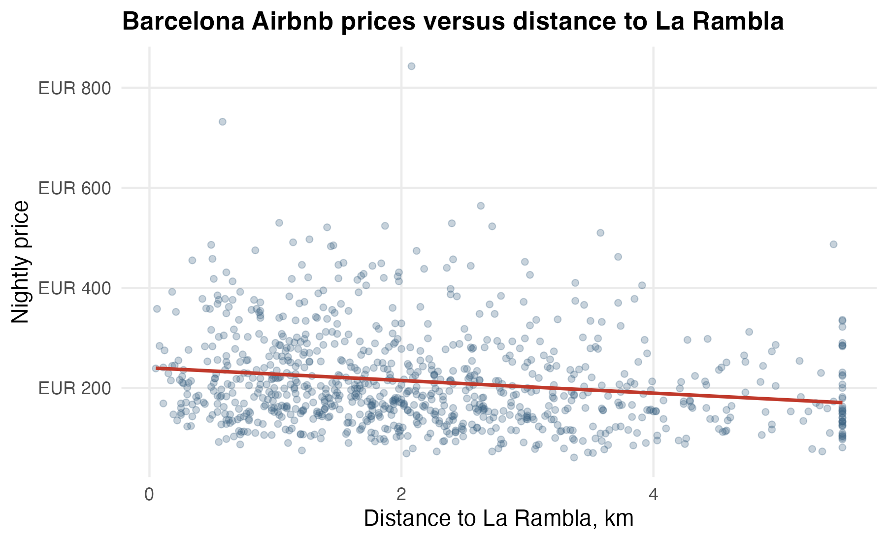{fig-alt="Nightly price is plotted against distance to La Rambla. The fitted line slopes downward, but the point cloud is wide." width="88%"}

The one-variable model says:

$$
\widehat{\text{Price}} = 240.1 - 12.6(\text{km to Rambla}).
$$

Overall, each kilometer farther away predicts about 13 EUR lower nightly price.

## But what comparison is that?

The overall slope compares listings that differ in distance.

But they may also differ in:

- number of bedrooms,
- number of bathrooms,
- host status,
- number of reviews.

The coefficient is only useful if that comparison matches the question.

## Confounder test

A candidate confounder has two jobs:

1. it is related to the predictor we care about;
2. it is related to the outcome.

Here the predictor we care about is distance to La Rambla.

The outcome is nightly price.

So ask:

> Are larger or better-reviewed listings distributed differently across distance?

## Size and distance

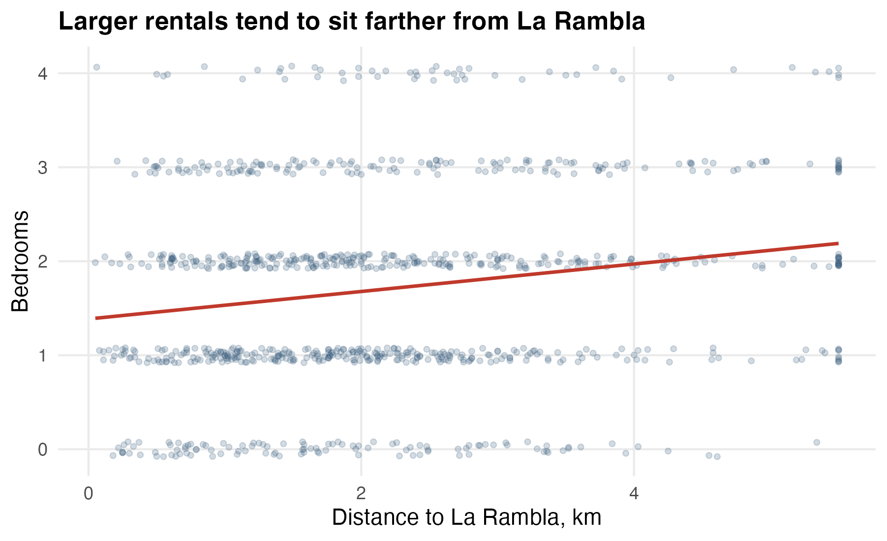{fig-alt="Bedrooms are plotted against distance to La Rambla. The fitted line slopes upward, showing that larger listings tend to be farther from La Rambla." width="88%"}

Larger rentals tend to be farther from La Rambla.

That matters because larger rentals also cost more.

This can mask part of the location gradient.

## Size is not one variable

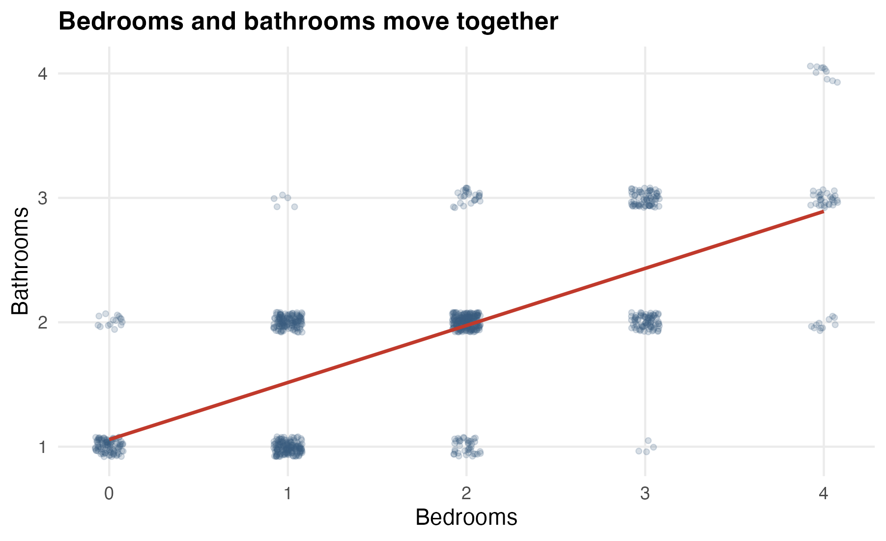{fig-alt="Bathrooms are plotted against bedrooms. Listings with more bedrooms tend to have more bathrooms." width="88%"}

Bedrooms and bathrooms move together.

This is ordinary real estate structure, not a statistical surprise.

It does mean that a price-distance model has to be clear about what it is holding fixed.

## Reviews are lopsided

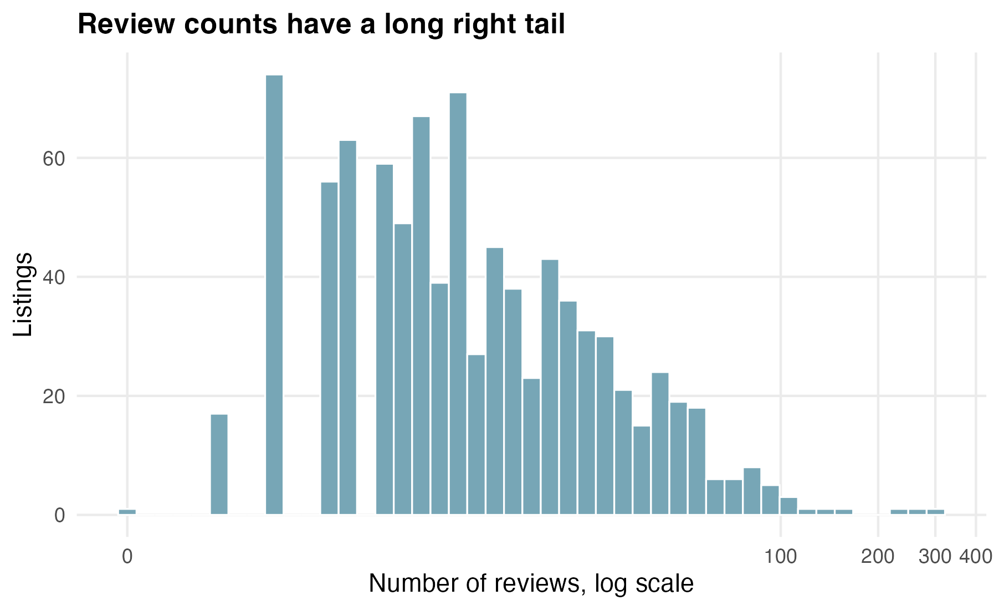{fig-alt="Most listings have few reviews, while a small number have many reviews. The x-axis uses a log scale." width="88%"}

Review counts have a long right tail.

So the model uses:

$$
\log(1 + \text{reviews})
$$

That keeps the first few reviews important without letting the largest review counts dominate.

## Build the model in steps

Overall model:

$$
\text{Price} \sim \text{Distance}.
$$

Size-adjusted model:

$$
\text{Price} \sim \text{Distance} + \text{Bedrooms} + \text{Bathrooms}.
$$

Target model:

$$
\text{Price} \sim
\text{Distance} + \text{Bedrooms} + \text{Bathrooms}
+ \text{Superhost} + \log(1+\text{Reviews}).
$$

## What changes?

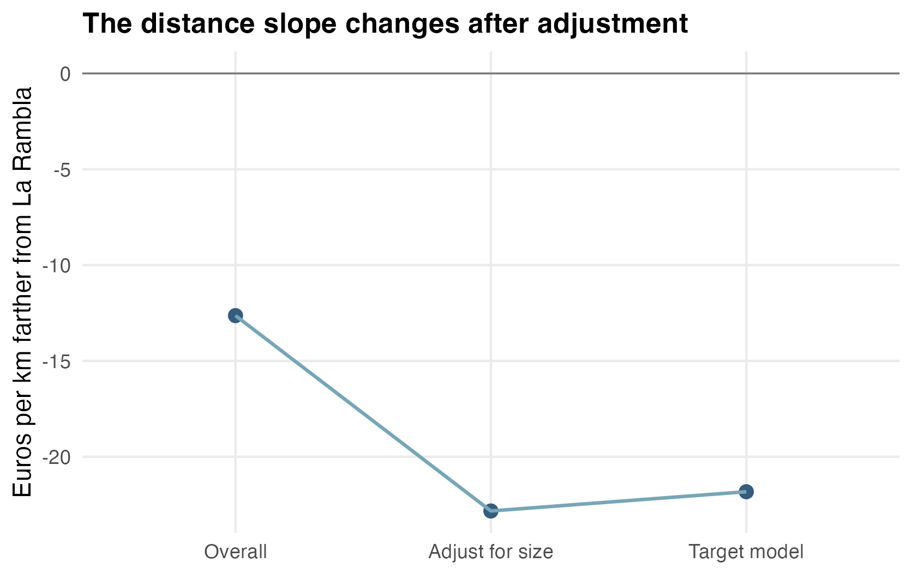{fig-alt="The distance slope is about -13 euros per kilometer in the overall model and about -22 euros per kilometer after adjustment." width="82%"}

The overall slope is about:

$$
-12.6 \text{ EUR per km}.
$$

The target-model slope is about:

$$
-21.8 \text{ EUR per km}.
$$

Adjustment made the location gradient steeper.

## Why steeper? {.smaller}

Larger rentals tend to be farther from La Rambla.

Larger rentals also cost more.

So the raw comparison partly compares:

> smaller central listings against larger farther-out listings.

That size pattern hides some of the central-location premium.

Adjustment asks a cleaner question:

> among listings with similar size, host status, and review history, how does price change with distance?

## The target equation

For these data:

$$
\begin{aligned}
\widehat{\text{Price}}
=\;&82.9
-21.8(\text{km to Rambla}) \\
&+57.9(\text{bedrooms})
+24.6(\text{bathrooms}) \\
&+25.3(\text{superhost})
+9.0\log(1+\text{reviews}).
\end{aligned}
$$

Each coefficient has units.

The distance coefficient is euros per km, after adjustment.

## Uncertainty again

Use the same bootstrap idea:

> resample listings, refit the target model, watch the distance coefficient move.

The object is now a partial slope:

``` r
lm(nightly_price_eur ~ distance_to_rambla_km + bedrooms +
     bathrooms + superhost + log1p(num_reviews))
```

Same bootstrap principle.

Richer model.

## Bootstrap distance slope

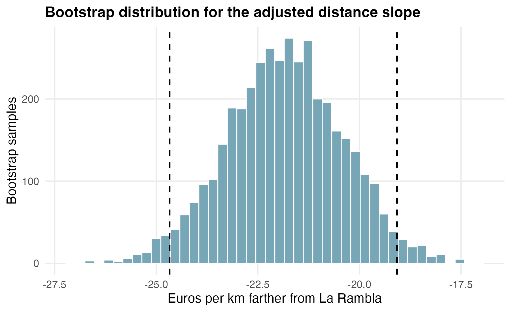{fig-alt="The bootstrap distribution for the adjusted distance slope is centered around -22 euros per kilometer, with the middle 95 percent roughly from -25 to -19." width="88%"}

The middle 95% of bootstrap slopes is about:

$$
[-24.7,\ -19.1].
$$

The adjusted location gradient is not a tiny effect.

It is also not one exact number.

## What to report {.smaller}

Weak report:

> Distance is significant.

Better report:

> After adjusting for bedrooms, bathrooms, superhost status, and review history, each kilometer farther from La Rambla is associated with about 22 EUR lower nightly price. A bootstrap interval is roughly 19 to 25 EUR lower per km.

Then add the diagnostic caveat.

## Diagnostics are questions

Diagnostics are not ceremonies.

They are questions:

- Where does the model miss?
- Does the miss matter for the question?
- Is the miss a data problem?
- Is the miss a model-building clue?

Do this after the target model.

Otherwise you diagnose the wrong model.

## Residuals versus fitted values

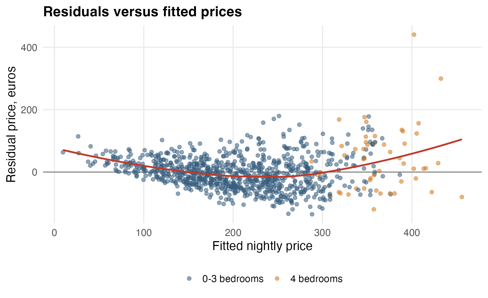{fig-alt="Residuals from the target model are plotted against fitted price. Four-bedroom listings appear more often above zero." width="88%"}

Most residuals are centered around zero.

But some large rentals are above zero.

That means:

> their actual prices are higher than the model expects.

## Residuals by bedroom count {.smaller}

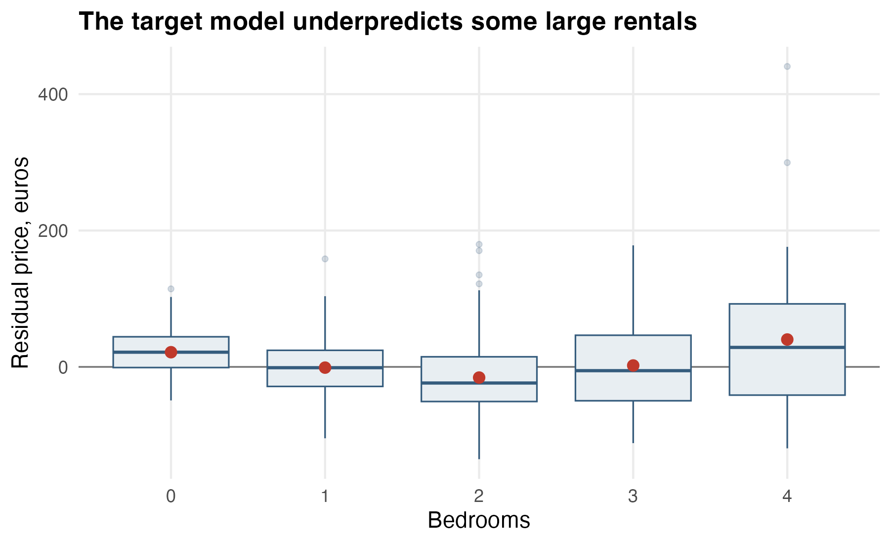{fig-alt="Residual price is shown by bedroom count. Four-bedroom listings have positive residuals on average, suggesting underprediction for some very large units." width="88%"}

Four-bedroom listings have a mean residual around:

$$
+40 \text{ EUR}.
$$

The model is underpredicting some large units.

Maybe the size effect is not perfectly linear.

Maybe luxury listings enter the four-bedroom group.

The diagnostic gives us the next modeling question.

## One possible next model

We might add:

- an indicator for very large units,
- a bedroom-by-bathroom interaction,
- a log-price model,
- or a separate luxury-listing flag if the data actually contain one.

But first we needed the residual plot.

The plot tells us where the model is strained.

## Do not include everything

Model building is not:

> add every variable in the spreadsheet.

Some variables are bad controls.

The most dangerous kind for this module:

> variables caused by the predictor whose relationship with the outcome we care about.

That is a post-treatment variable.

## Collider

A collider is a variable with two arrows pointing into it.

Plain version:

> two different causes can both make the same thing happen.

Conditioning on that shared consequence can create a fake association between the causes.

That sounds weird.

It is very real.

## Hospital data example

Suppose we study only hospitalized patients.

People can be hospitalized because of COVID.

People can also be hospitalized because of other serious health problems.

Hospitalization is the shared consequence.

If we condition on hospitalization, COVID and comorbidities can look related in a way created by the selection rule.

## The model-building rule {.smaller}

Before adding a variable, ask what role it plays.

Good adjustment variable:

> helps make the comparison fairer.

Bad control:

> happens after the predictor of interest, or is caused by the outcome, or is a collider.

The regression formula is not just syntax.

It is a claim about the comparison.

## What to carry forward

1. Start with the question.
2. Name the coefficient that answers it.
3. Check candidate confounders before adjusting.
4. Quantify uncertainty as the model changes.
5. Use residuals to find visible failures.
6. Do not condition on post-treatment variables or colliders.

Regression is a language for comparisons.

Model building is choosing the comparison carefully.
