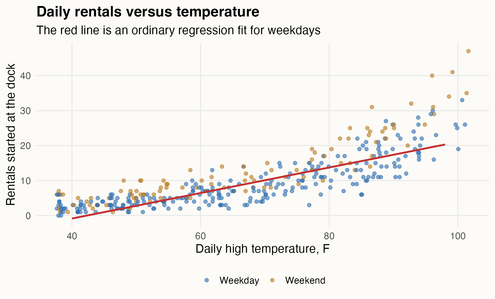
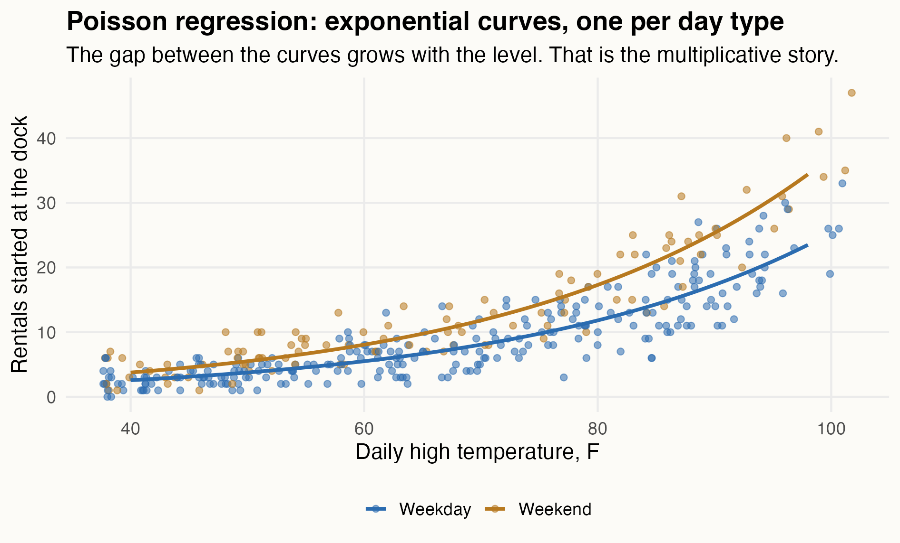
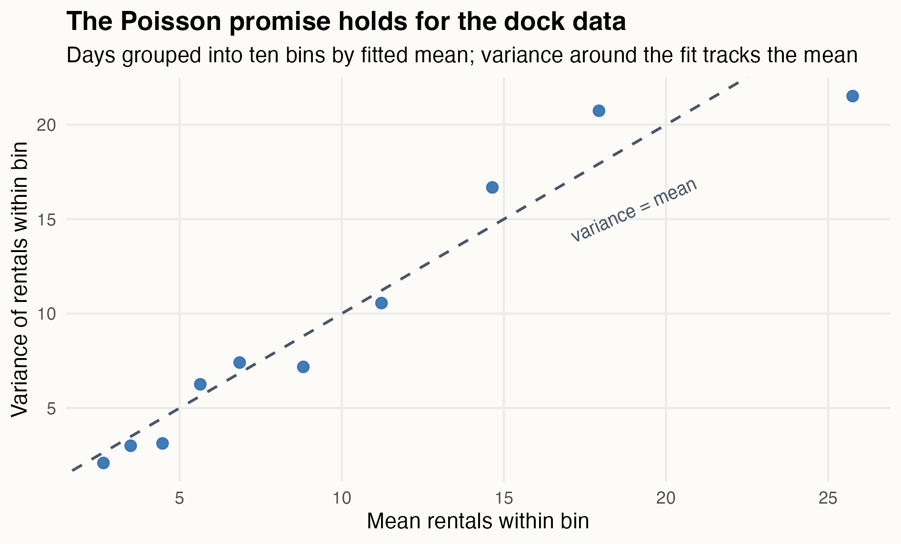
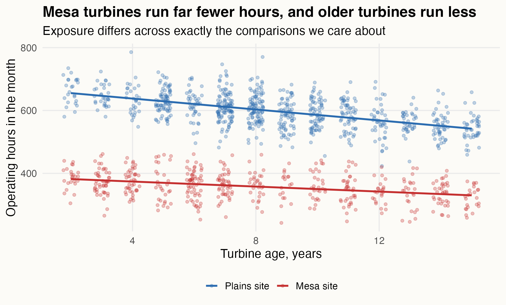
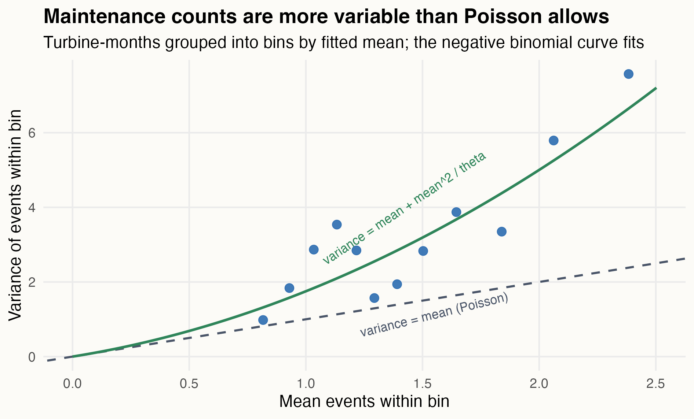
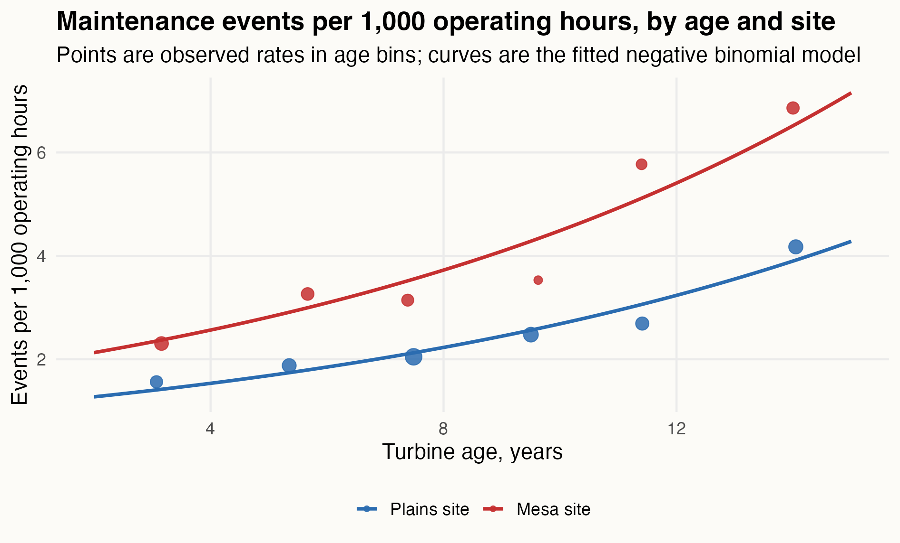

## Generalized linear models {.smaller}

So far, our response variable has usually been numerical:

> price, hours, minutes, demand, delay.

But many practical questions have a different kind of response:

- did the home team win?
- did a passenger make the connection?
- how many trips started here?
- how many support tickets arrived?

Today: binary outcomes first.

Then counts.

## A first binary question {.smaller}

Sportsbooks publish a point spread for NBA games.

In this data set:

- `HomeSpread` is the spread in favor of the home team,
- negative means the visitor is favored,
- positive means the home team is favored,
- `HomeWin` records whether the home team won.

Question:

> How does the point spread translate into home-team win probability?

## A few rows

| Game | Season | Home spread | Result |
|----:|----:|----:|:---|
| 81 | 2021 | -8.4 | Visitor win |
| 436 | 2024 | 3.8 | Home win |
| 911 | 2020 | 12.1 | Home win |
| 1240 | 2023 | -1.9 | Home win |
| 1557 | 2022 | 6.7 | Visitor win |
| 2016 | 2025 | 0.4 | Home win |

The response is a 0/1 event.

That changes the modeling problem.

## First try

Could we fit ordinary regression?

$$
\text{HomeWin}_i
=
\beta_0 + \beta_1\text{HomeSpread}_i + e_i.
$$

This is called a **linear probability model**.

It is tempting because the fitted value looks like a probability.

##  {.plain}

{fig-alt="Home win indicator and binned home win rates versus point spread, with a linear probability model." width="95%"}

## What goes wrong?

A probability has to live between 0 and 1.

A straight line does not know that.

It can predict impossible probabilities if we ask about large enough spreads.

And the relationship is not really straight. Moving from `-12` to `-8` matters differently than moving from `0` to `4`.

## Model the odds

Instead of modeling probability directly, logistic regression models log odds.

If $p_i$ is the probability of a home win:

$$
\log\left(\frac{p_i}{1-p_i}\right)
=
\beta_0 + \beta_1\text{HomeSpread}_i.
$$

The left side can be any real number.

The probability still stays between 0 and 1.

##  {.plain}

{fig-alt="Binned home win rates versus point spread, with a fitted logistic regression curve." width="95%"}

## In R

``` r
nba_fit <- glm(
  HomeWin ~ HomeSpread,
  data = nba_games,
  family = binomial()
)
```

The new part is:

``` r
family = binomial()
```

That tells R we have a binary response and want the logit link.

## What replaced least squares? {.smaller}

`lm()` chooses coefficients to minimize the sum of squared residuals.

That recipe does not fit here: the outcomes are 0s and 1s, and the model predicts probabilities.

`glm()` chooses coefficients by **maximum likelihood**:

> find the coefficients that give the highest probability to the outcomes actually observed.

Least squares is the special case: for a numerical response with normal errors, maximum likelihood picks the same line.

The standard errors and intervals in the output come from the same likelihood machinery.

## Reading the coefficient

The fitted model is approximately:

$$
\log\left(\frac{\widehat p}{1-\widehat p}\right)
=
0.135 + 0.190\cdot\text{HomeSpread}.
$$

The slope is on the log-odds scale.

One more point of home-team spread adds `0.190` to the log odds of a home win.

## Odds ratios

Exponentiate the slope:

$$
e^{0.190} \approx 1.21.
$$

So:

> each additional point of home-team spread multiplies the odds of a home win by about 1.21.

That is an odds ratio.

## Probabilities are not additive {.smaller}

The same odds ratio can imply different probability changes.

In this model:

- home team favored by 10: fitted win probability about `0.88`,
- pick'em game: fitted win probability about `0.53`,
- visitor favored by 10: fitted win probability about `0.15`.

The coefficient is constant on the log-odds scale.

It is not a constant probability difference.

## More than one input

Now a more operational binary problem.

An airline studies passenger connections through six major hubs:

- ATL, CLT, DFW,
- DEN, ORD, IAH.

Each row is one passenger connection.

Question:

> Which connections are likely to be made?

## The data {.smaller}

For each connection:

- `MadeConnection`: made or missed,
- `ScheduledConnectionMinutes`: scheduled time between flights,
- `ArrivalDelayMinutes`: arrival delay of the inbound flight,
- `Hub`: connecting airport,
- `TerminalChange`: whether the passenger had to change terminals.

This is not just an airline problem.

It is the same modeling problem as churn, conversion, default, fraud, and admission.

## A few rows

| Hub | Scheduled connection | Arrival delay | Terminal change | Result |
|:---|----:|----:|:---|:---|
| DEN | 155 | -15 | Same terminal | Made connection |
| DFW | 52 | 16 | Same terminal | Missed connection |
| CLT | 118 | -6 | Same terminal | Made connection |
| DFW | 59 | -2 | Terminal change | Made connection |
| DFW | 35 | -13 | Same terminal | Made connection |
| CLT | 67 | 0 | Same terminal | Made connection |

Already: delay alone cannot be the whole story.

## Start with arrival delay

First model:

$$
\log\left(\frac{p_i}{1-p_i}\right)
=
\beta_0 + \beta_1\text{ArrivalDelayMinutes}_i.
$$

Here $p_i$ is the probability that passenger $i$ makes the connection.

##  {.plain}

{fig-alt="Binned connection success rates versus arrival delay, with a logistic curve using arrival delay only." width="95%"}

## Delay is not enough

Arrival delay matters.

But a 20-minute delay is not the same thing for every passenger.

It depends on how much connection time the itinerary had in the first place.

That is the next input.

## Add connection time {.smaller}

The model becomes:

$$
\log\left(\frac{p_i}{1-p_i}\right)
=
\beta_0
+ \beta_1\text{ScheduledConnectionMinutes}_i
+ \beta_2\text{ArrivalDelayMinutes}_i.
$$

The comparison:

> scheduled connection time, holding arrival delay fixed.

and

> arrival delay, holding scheduled connection time fixed.

## Interpreting ten minutes {.smaller}

The adjusted model estimates:

- 10 more scheduled connection minutes multiply the odds of making the connection by about `2.4`,
- 10 more minutes of arrival delay multiply the odds by about `0.36`.

In words:

> more scheduled buffer helps; later arrival hurts.

No surprise. But now we can quantify both in the same model.

## Terminal changes

A terminal change is not the same at every airport.

At DFW, the Skylink train makes most gate pairs reachable quickly.

At ATL, the Plane Train and parallel concourses make many transfers manageable.

At ORD or IAH, some terminal changes are more costly.

So we should not assume one universal terminal-change penalty.

## First look

{fig-alt="Binned connection success rates by time remaining after arrival, shown separately for same-terminal and terminal-change connections." width="95%"}

## Main effect only

A main-effect model would say:

$$
\log\left(\frac{p_i}{1-p_i}\right)
=
\cdots
+ \gamma_{\text{Hub}_i}
+ \delta\text{TerminalChange}_i.
$$

This gives:

- each hub its own baseline,
- one shared terminal-change penalty.

That shared penalty is probably too blunt.

## Interaction

Let the terminal-change effect depend on the hub:

$$
\log\left(\frac{p_i}{1-p_i}\right)
=
\cdots
+ \gamma_{\text{Hub}_i}
+ \delta\text{TerminalChange}_i
+ \theta_{\text{Hub}_i}\text{TerminalChange}_i.
$$

Now the terminal-change odds ratio can be different at DFW, ATL, ORD, and so on.

This is exactly the same interaction idea as before.

The response is binary, so the model is logistic.

##  {.plain}

{fig-alt="Fitted connection probability by scheduled connection time, faceted by hub and colored by terminal-change status." width="95%"}

## Terminal-change odds ratios

{fig-alt="Terminal-change odds ratios by hub for a 60-minute scheduled connection and 12-minute arrival delay." width="90%"}

## What we learn

For a 60-minute scheduled connection with a 12-minute arrival delay:

- DFW terminal change odds ratio: about `1.1` — no detectable penalty,
- ORD terminal change odds ratio: about `0.37`,
- IAH terminal change odds ratio: about `0.39`.

So the effect is not "terminal changes are bad."

It depends on the hub layout.

## The practical lesson so far

Logistic regression is for binary outcomes.

The model is linear on the log-odds scale:

$$
\log\left(\frac{p}{1-p}\right)
=
\text{linear predictor}.
$$

Exponentiated coefficients are odds ratios.

But the modeling grammar is familiar:

> start with the question, adjust for the right variables, and use interactions when the effect depends on context.

## Part two: counting things

The other response type from the opening slide:

- how many rentals started at this dock?
- how many breakdowns did this truck have?
- how many tickets, claims, no-shows, defects?

A count is not a yes/no.

It is also not an ordinary numerical measurement.

It is a non-negative integer, often small, often skewed.

## A dock full of bikes

Austin's bike-share ops team restocks a busy downtown dock every morning.

Stock too few bikes: lost rides.

Truck too many across town: wasted labor.

The data: one row per day for a full year.

Question:

> How does daily demand at this dock move with weather and the day of the week?

## One row

| date       | high temp (F) | weekend | rentals |
|:-----------|--------------:|--------:|--------:|
| 2024-01-01 |            38 |       0 |       0 |
| 2024-01-15 |            39 |       0 |       1 |
| 2024-05-09 |            77 |       0 |      13 |
| 2024-06-01 |            96 |       1 |      29 |
| 2024-07-18 |            86 |       0 |      10 |

The response is a count of events per day.

Some days it is zero.

## The straight-line try

``` r
lm(Rentals ~ TempHighF + Weekend)
```

The fitted line says every degree adds about $0.36$ rentals — the same $0.36$ on a January day averaging 3 rides and an August day averaging 25.

{fig-alt="Daily rentals against temperature, colored by weekday and weekend, with a straight regression line for weekdays. The point cloud fans out as temperature rises." width="85%"}

The data disagree twice: the trend bends upward, and the scatter grows with the level.

## Why not just log the counts? {.smaller}

The module-02 move would be `lm(log(Rentals) ~ ...)`.

But the dock had days with **zero** rentals.

$\log(0)$ does not exist. And $\log(y + 1)$ quietly changes the question.

The GLM move is different:

> leave the counts alone. Put the log on the **mean**.

$$
\log\big(\mu_i\big) = \beta_0 + \beta_1 x_{i1} + \cdots
$$

A mean of 3.2 rentals is a perfectly good number to take the log of, even on a day that happened to produce zero.

## The Poisson distribution

The workhorse distribution for counts. One parameter: the **mean rate** of event arrivals, $\mu$.

If events arrive independently at an average rate of $\mu$ per day, the number that actually arrive on a given day follows a Poisson distribution with mean $\mu$.

{fig-alt="Three Poisson probability distributions with mean rates 2, 8, and 25. Each is a bar chart over counts; higher rates shift right and spread out." width="72%"}

Set the rate, and the whole distribution follows — including its spread.

## Poisson regression

$$
\log(\mu_i)
=
\beta_0
+ \beta_1\,\text{TempHighF}_i
+ \beta_2\,\text{Weekend}_i,
$$

with the counts treated as Poisson around that mean.

``` r
glm(Rentals ~ TempHighF + Weekend, family = poisson())
```

Same `glm()` as the logistic models.

Different family, different link: **log** instead of logit.

## Reading the coefficients

Exponentiate, exactly as with odds ratios — but now they are **rate ratios**:

- per degree: $e^{0.0382} \approx 1.039$ — each degree adds about $3.9\%$ more rentals,
- per 10 degrees: about $\times 1.47$,
- weekend: $e^{0.381} \approx 1.46$ — weekends run about $46\%$ hotter at any temperature.

Multiplicative, not additive.

A warm snap matters more at a busy dock than at a dead one — automatically.

## The fitted curves

{fig-alt="Daily rentals versus temperature with two fitted exponential curves, one for weekdays and one for weekends. The gap between the curves widens as the level rises." width="92%"}

Two exponential curves, one per day type.

The weekend lift is a constant *percentage*, so the visible gap grows with the level.

## The distribution does the rest

For a 90-degree Saturday, the fitted mean is about

$$
\widehat\mu = 25.3 \text{ rentals}.
$$

But ops does not stage the mean. Poisson specifies the **whole count distribution**, so:

> stage 34 bikes, and the dock covers demand on about 96% of such days.

That is the payoff of modeling counts as counts: the model answers inventory questions, not just trend questions.

## Check the promise

Poisson makes a strong claim:

$$
\text{Var}(Y_i) = \mu_i.
$$

{fig-alt="Within-bin variance of rentals against within-bin mean, hugging the variance-equals-mean dashed line." width="80%"}

For the dock data the promise holds: the Pearson dispersion statistic is $0.95 \approx 1$.

Do not expect that gift every time.

## A turbine problem

A wind operator in the Texas Panhandle runs **210 identical 2.3-MW turbines** across two sites: smooth-inflow **plains**, and a **mesa** with turbulent air.

Every unplanned maintenance event costs technician time, lost generation, and sometimes a crane.

> How fast does the event rate grow with turbine age, and is the mesa really harder on machines?

## One row

Each row is one turbine-month.

| turbine | month | age (yrs) | site   | run hours | events |
|:--------|------:|----------:|:-------|----------:|-------:|
| WT050   |     6 |         9 | plains |       524 |      1 |
| WT017   |     1 |         3 | mesa   |       392 |      2 |
| WT125   |     4 |        11 | plains |       596 |      0 |
| WT107   |     5 |         7 | mesa   |       397 |      1 |

One column changes everything: **operating hours**.

A parked turbine accumulates no wear.

## The exposure trap

{fig-alt="Operating hours per month against turbine age, colored by site. Plains turbines run about 600 to 650 hours a month and mesa turbines about 350 to 400; both decline with age." width="90%"}

Mesa turbines run **far fewer hours**: turbulence means more curtailment and more fault downtime.

Older turbines run less than newer ones.

Exposure differs across **exactly the comparisons we care about**.

## The naive model clears the mesa

Model the raw counts, ignore hours:

``` r
glm(MaintEvents ~ AgeYears + Site, family = poisson())
```

- mesa site: rate ratio $1.01$, $p = 0.91$ — *no site effect*,
- age: about $+8.6\%$ per year.

The naive model answers "events per **month**."

Mesa turbines log no more events per month — because they run 40% fewer hours.

That is not the reliability question.

## Rates need offsets

The question is about events per **operating hour**. Write the mean as a rate times an exposure:

$$
\mu_i = \text{rate}_i \times \frac{\text{Hours}_i}{1{,}000}
\quad\Longrightarrow\quad
\log(\mu_i) = \underbrace{\log\!\left(\tfrac{\text{Hours}_i}{1{,}000}\right)}_{\text{offset}} + \log(\text{rate}_i).
$$

The exposure enters the model with its coefficient **pinned at 1**.

That pinned term is an **offset**. Everything else now describes the rate.

## The offset model

``` r
glm(
  MaintEvents ~ AgeYears + Site + offset(log(RunHours / 1000)),
  family = poisson()
)
```

- mesa site: rate ratio $1.69$, 95% CI $[1.53,\ 1.86]$,
- age: $\times 1.10$ per year, CI $[1.09,\ 1.11]$.

Per hour of operation, the mesa is about $69\%$ harder on machines.

The naive model hid that entirely behind the hours gap.

## But check the variance

{fig-alt="Within-bin variance of maintenance events against within-bin mean. Points sit far above the variance-equals-mean line and track the negative binomial curve." width="88%"}

The dock data hugged the Poisson line.

The turbine data sit **far above it**.

## Overdispersion {.smaller}

The Poisson model says: two turbine-months with the same age, site, and hours have the same expected events — and variance equal to that mean.

But turbines the model sees as identical are not identical:

- some drew a gearbox from a bad casting batch,
- micro-siting puts some units in dirtier air than their neighbors,
- maintenance history and component swaps differ unit to unit.

Unmeasured differences pile extra variation on top of Poisson noise.

That extra variation is **overdispersion**.

## Measuring it {.smaller}

The Pearson dispersion statistic — squared standardized residuals, averaged:

$$
\widehat\phi = \frac{1}{n - p}\sum_i \frac{(y_i - \widehat\mu_i)^2}{\widehat\mu_i} = 2.17.
$$

Poisson promised $1$. The counts are about **twice as variable** as the model claims.

Why care? Standard errors inherit the false promise:

> Poisson SEs here are roughly $\sqrt{2.17} \approx 1.5\times$ too small. Every interval is too narrow. Every p-value is too confident.

The means are fine. The certainty is fake.

## The negative binomial

Keep the mean model. Fix the variance promise.

$$
E(Y_i) = \mu_i,
\qquad
\text{Var}(Y_i) = \mu_i + \frac{\mu_i^2}{\theta}.
$$

Same log link, same coefficients-as-rate-ratios, same offset.

One new parameter: $\theta$, the dial for unmeasured heterogeneity.

- $\theta$ huge: the extra term vanishes — back to Poisson.
- $\theta$ small: lots of unit-to-unit variation the model cannot see.

## Fitting it

``` r
library(MASS)

glm.nb(
  MaintEvents ~ AgeYears + Site + offset(log(RunHours / 1000))
)
```

|             | Poisson | Negative binomial |
|:------------|--------:|------------------:|
| mesa rate ratio | 1.69 | 1.67 |
| mesa SE (log scale) | 0.049 | 0.071 |
| age rate ratio | 1.100 | 1.098 |
| $\widehat\theta$ | — | 1.33 |

The estimates barely move. The standard errors grow to honest size.

## The reliability answer

{fig-alt="Maintenance events per 1,000 operating hours against turbine age, with observed binned rates and fitted negative binomial curves for the plains and mesa sites. Mesa sits well above plains and both rise with age." width="90%"}

A 12-year mesa turbine runs about **3.9 times** the per-hour event rate of a 3-year plains turbine.

That curve prices the aging fleet — and says the mesa gets the next repower.

## The GLM family

One grammar, three variance stories:

| response | family | link | $e^{\beta}$ means |
|:----------------|:------------|:-----|:------------------------|
| yes/no | `binomial()` | logit | odds ratio |
| count | `poisson()` | log | rate ratio |
| overdispersed count | `glm.nb()` | log | rate ratio, honest SEs |

Every model: a linear predictor, a link, and a distribution.

The linear predictor is the same grammar as week one — dummies, adjustments, interactions, offsets.

## What to carry forward {.smaller}

1. Counts are not yes/no and not ordinary measurements. Model the log of the **mean**, not the log of the data — zeros are then welcome.
2. Exponentiated Poisson coefficients are rate ratios: multiplicative effects on the expected count.
3. When counts accumulate over different exposures — miles, hours, customers — put the exposure in as an **offset**, or the model answers the wrong question.
4. Poisson promises variance = mean. Check it: the Pearson dispersion should sit near 1.
5. Overdispersion means fake precision, not wrong means. The negative binomial keeps the mean model and adds $\theta$: $\text{Var} = \mu + \mu^2/\theta$.
6. Binary, count, or overdispersed count: the modeling moves never change — only the family and link do.
