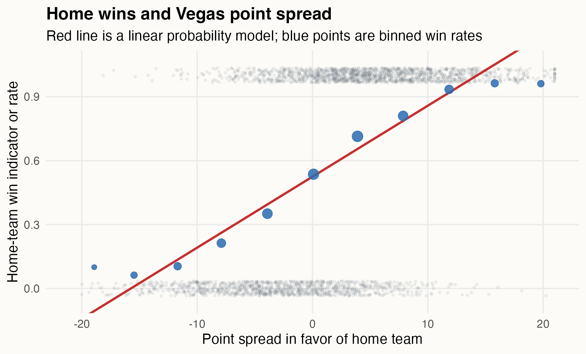
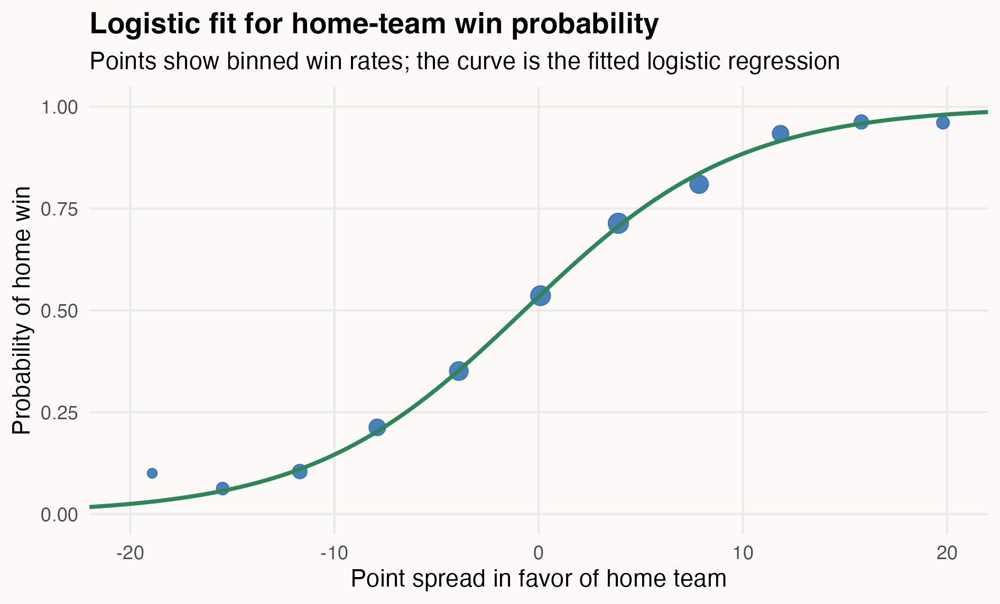
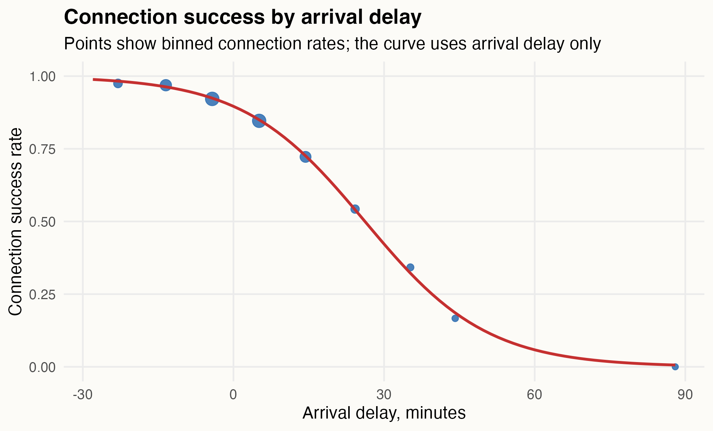
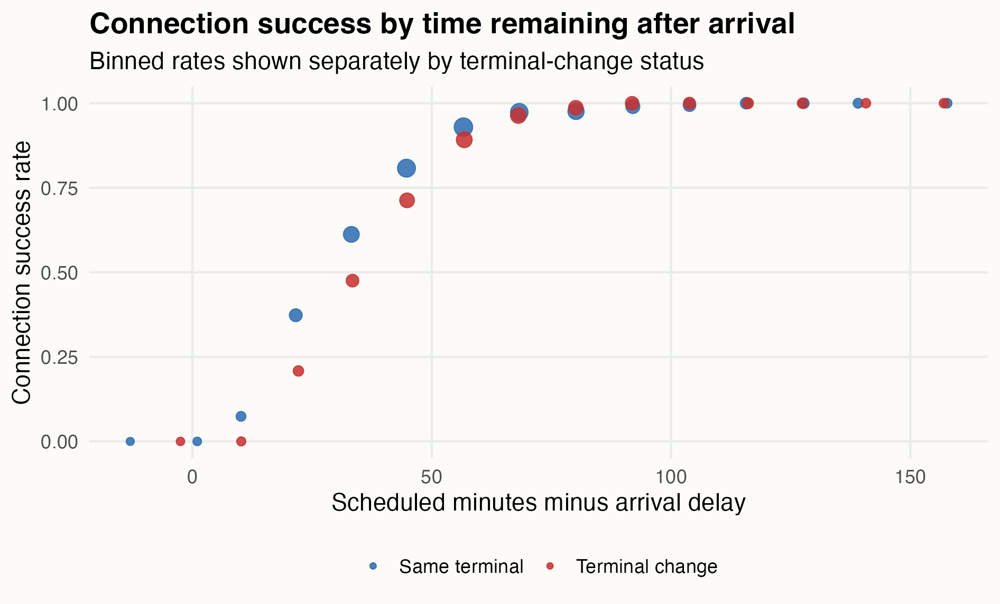
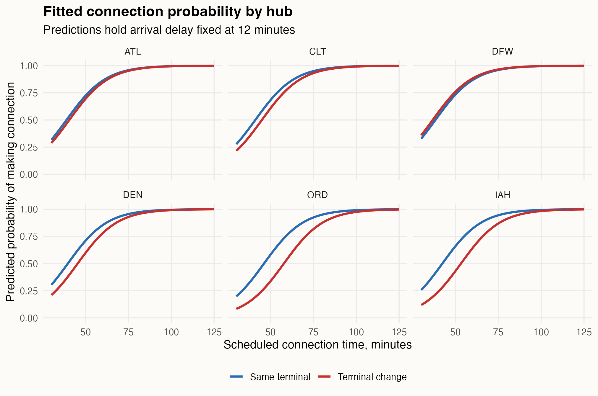
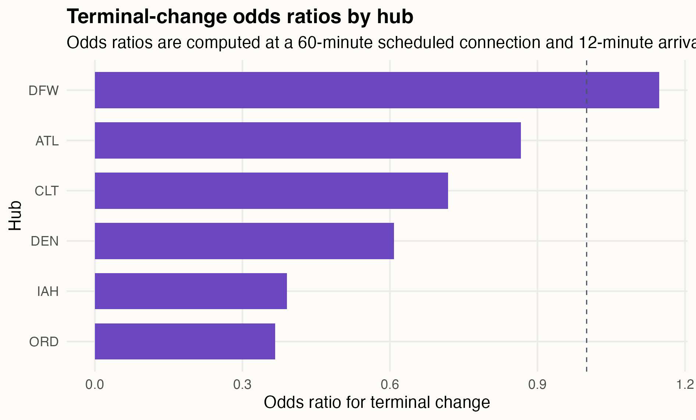
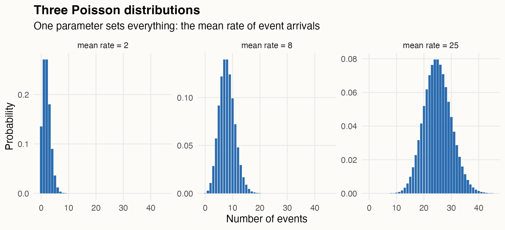

```{r}
#| label: setup
#| include: false
library(tidyverse)
library(broom)

module_dir <- if (file.exists("nba_home_spreads.csv")) {
  "."
} else {
  "modules/06_generalized_linear_models"
}
```

## Why logistic regression exists

Ordinary regression expects a numerical response. Logistic regression is for a binary response: win/loss, made/missed, yes/no, churned/stayed, converted/did not convert.

The key problem is that probabilities must stay between 0 and 1. A straight-line model for probability can wander outside that range. Logistic regression solves this by modeling the log odds:

$$
\log\left(\frac{p_i}{1-p_i}\right)
=
\beta_0 + \beta_1x_i.
$$

The left side can be any real number. The corresponding probability stays between 0 and 1.

## Intro case: NBA point spreads

Sportsbooks publish a point spread for NBA games. Here `HomeSpread` is the spread in favor of the home team. Negative means the visitor is favored. Positive means the home team is favored.

```{r}
#| echo: true
nba_games <- read_csv(file.path(module_dir, "nba_home_spreads.csv")) |>
  mutate(HomeWin = factor(HomeWin, levels = c("Visitor win", "Home win")))
```

The question is:

> How does the point spread translate into home-team win probability?

The linear probability model is tempting:

```{r}
#| echo: true
nba_lpm <- lm(as.integer(HomeWin == "Home win") ~ HomeSpread, data = nba_games)
tidy(nba_lpm)
```

But it uses a straight line for a probability.

{fig-alt="Home win indicator and binned home win rates versus point spread, with a linear probability model." width="95%"}

## Fitting the logistic model

Fit logistic regression with `glm()` and `family = binomial()`:

```{r}
#| echo: true
nba_fit <- glm(
  HomeWin ~ HomeSpread,
  data = nba_games,
  family = binomial()
)

tidy(nba_fit)
```

A note on what `glm()` is doing under the hood. `lm()` chooses coefficients to minimize the sum of squared residuals, and that recipe does not apply here: the outcomes are 0s and 1s while the model predicts probabilities. `glm()` instead chooses coefficients by **maximum likelihood** — find the coefficients that give the highest probability to the outcomes actually observed. Least squares is the special case of this principle for a numerical response with normal errors, and the standard errors and intervals in the output come from the same likelihood machinery. Nothing about how you *read* the output changes.

The fitted model is approximately

$$
\log\left(\frac{\widehat p}{1-\widehat p}\right)
=
0.135 + 0.190\cdot\text{HomeSpread}.
$$

{fig-alt="Binned home win rates versus point spread, with a fitted logistic regression curve." width="95%"}

## Odds ratios

The coefficient is on the log-odds scale. Exponentiating gives an odds ratio:

```{r}
#| echo: true
exp(coef(nba_fit)["HomeSpread"])
```

Here the odds ratio is about 1.21. So each additional point of home-team spread multiplies the odds of a home win by about 1.21.

This does not mean each point adds 21 percentage points to the win probability. Logistic regression is additive on the log-odds scale, not on the probability scale.

## Complex case: airline connections

An airline studies passenger connections through six hubs: ATL, CLT, DFW, DEN, ORD, and IAH.

Each row is one passenger connection.

```{r}
#| echo: true
connections <- read_csv(file.path(module_dir, "airline_connections.csv")) |>
  mutate(
    MadeConnection = factor(MadeConnection, levels = c("Missed connection", "Made connection")),
    Hub = factor(Hub, levels = c("ATL", "CLT", "DFW", "DEN", "ORD", "IAH")),
    TerminalChange = factor(TerminalChange, levels = c("Same terminal", "Terminal change"))
  )
```

The variables are:

- `MadeConnection`: made or missed the connection,
- `ScheduledConnectionMinutes`: scheduled time between flights,
- `ArrivalDelayMinutes`: delay of the inbound flight,
- `Hub`: connecting airport,
- `TerminalChange`: same terminal or terminal change.

The question is:

> Which connections are likely to be made?

## Start with arrival delay

The simplest model uses arrival delay only:

```{r}
#| echo: true
delay_only <- glm(
  MadeConnection ~ ArrivalDelayMinutes,
  data = connections,
  family = binomial()
)

tidy(delay_only)
```

{fig-alt="Binned connection success rates versus arrival delay, with a logistic curve using arrival delay only." width="95%"}

Arrival delay matters, but delay alone is incomplete. A 20-minute delay is different when the original itinerary had a 35-minute connection versus a 95-minute connection.

## Add scheduled connection time

Now include both the scheduled buffer and the delay:

```{r}
#| echo: true
connection_main <- glm(
  MadeConnection ~ ScheduledConnectionMinutes + ArrivalDelayMinutes +
    Hub + TerminalChange,
  data = connections,
  family = binomial()
)

tidy(connection_main)
```

Ten-minute odds ratios are easier to read:

```{r}
#| echo: true
coef(connection_main)[c("ScheduledConnectionMinutes", "ArrivalDelayMinutes")] |>
  (\(x) exp(10 * x))()
```

In this model, 10 more scheduled connection minutes multiply the odds of making the connection by about 2.4. Ten more minutes of arrival delay multiply the odds by about 0.36.

## Hub and terminal changes

A terminal change is not the same at every hub. DFW has the Skylink train, and most gate pairs are reachable quickly. ATL has the Plane Train and a regular concourse layout. ORD and IAH can impose a larger terminal-change penalty.

The first visual clue is that terminal-change connections trail same-terminal connections, but the gap is not the same everywhere.

{fig-alt="Binned connection success rates by time remaining after arrival, shown separately for same-terminal and terminal-change connections." width="95%"}

## Add the interaction

Use a hub-by-terminal-change interaction:

```{r}
#| echo: true
connection_interaction <- glm(
  MadeConnection ~ ScheduledConnectionMinutes + ArrivalDelayMinutes +
    Hub * TerminalChange,
  data = connections,
  family = binomial()
)

tidy(connection_interaction)
```

The model still has the same logistic form. The interaction lets the terminal-change odds ratio vary by hub.

{fig-alt="Fitted connection probability by scheduled connection time, faceted by hub and colored by terminal-change status." width="95%"}

## Reading the interaction

The terminal-change penalty can be summarized as an odds ratio at a fixed scheduled connection time and arrival delay.

{fig-alt="Terminal-change odds ratios by hub for a 60-minute scheduled connection and 12-minute arrival delay." width="90%"}

At a 60-minute scheduled connection and 12-minute arrival delay:

- DFW terminal change odds ratio is about 1.1 — no detectable penalty,
- ORD terminal change odds ratio is about 0.37,
- IAH terminal change odds ratio is about 0.39.

The interaction answers the real question better than one shared terminal-change coefficient.

## What to carry forward

Logistic regression is a generalized linear model for binary outcomes. It keeps the linear predictor, but changes the scale:

$$
\log\left(\frac{p}{1-p}\right)
=
\text{linear predictor}.
$$

Exponentiated coefficients are odds ratios. Interactions work the same way they did before: they let an effect depend on context.

## Part two: count outcomes

The other response type from the opening list is a count: how many rentals started at this dock, how many maintenance events this machine logged, how many tickets, claims, no-shows, or defects. A count is not a yes/no, and it is not an ordinary numerical measurement either. It is a non-negative integer, often small, and often skewed.

## The dock rentals case

Austin's bike-share ops team restocks a busy downtown dock every morning. Stocking too few bikes loses rides; trucking too many across town wastes labor. The data are one row per day for a full year: the daily high temperature, a weekend indicator, and the number of rentals started at the dock.

```{r}
#| echo: true
bike_days <- read_csv(file.path(module_dir, "dock_rentals.csv"))
bike_days |> head(4)
```

The straight-line model `lm(Rentals ~ TempHighF + Weekend)` makes two promises the data cannot keep. It promises the same additive change everywhere — about 0.36 extra rentals per degree, whether the day averages 3 rides or 25 — and it promises constant scatter, while the observed scatter grows visibly with the level.

First, the distribution doing the work. The **Poisson distribution** is the workhorse distribution for counts, and it has exactly one parameter: the mean rate of event arrivals, $\mu$. If events arrive independently at an average rate of $\mu$ per day, the number that actually arrive on a given day follows a Poisson distribution with mean $\mu$. Set the rate and the whole distribution follows, including its spread — a fact that becomes a checkable promise below.

{fig-alt="Three Poisson probability distributions with mean rates 2, 8, and 25, shifting right and spreading out as the rate grows." width="97%"}

The module-02 instinct is to log the response. But the dock had days with zero rentals, and $\log(0)$ does not exist, while $\log(y+1)$ quietly changes the question. The GLM move is different: leave the counts alone and put the log on the *mean*,

$$
\log(\mu_i) = \beta_0 + \beta_1\,\text{TempHighF}_i + \beta_2\,\text{Weekend}_i,
$$

with the counts treated as Poisson around that mean. A mean of 3.2 rentals is a perfectly good number to take the log of, even on a day that happened to produce zero.

```{r}
#| echo: true
bike_pois <- glm(Rentals ~ TempHighF + Weekend, data = bike_days, family = poisson())
tidy(bike_pois, exponentiate = TRUE, conf.int = TRUE)
```

Exponentiated coefficients are **rate ratios**, the count-world sibling of odds ratios. Each degree multiplies expected rentals by about 1.039 — a 3.9% lift — and weekends run about 46% above weekdays at any temperature. The effects are multiplicative: a warm snap adds more rides at a busy dock than at a dead one, automatically.

Because the model specifies a full count distribution, it answers inventory questions, not just trend questions. On a 90-degree Saturday the fitted mean is about 25.3 rentals, and `qpois(0.96, 25.3)` says that staging 34 bikes covers demand on about 96% of such days.

Poisson regression makes one strong promise that deserves a check: $\text{Var}(Y_i) = \mu_i$. Group the days into bins by fitted mean and compare the within-bin variance to the within-bin mean, or compute the Pearson dispersion statistic — squared standardized residuals, averaged:

```{r}
#| echo: true
sum(residuals(bike_pois, type = "pearson")^2) / df.residual(bike_pois)
```

For the dock data the statistic is about 0.95, and the promise holds. Do not expect that gift every time.

## The turbine case: offsets

A wind operator in the Texas Panhandle runs 210 identical 2.3-MW turbines across two sites: a plains site with smooth, steady inflow, and a mesa site with complex terrain and turbulent inflow. Every unplanned maintenance event — a fault that stops the turbine and needs intervention — costs technician time, lost generation, and sometimes a crane day. The reliability team wants to know how fast the event rate grows with turbine age and whether the mesa really is harder on machines; the answers drive the parts budget and where the next repower happens. The data are one row per turbine per month for six months:

```{r}
#| echo: true
fleet <- read_csv(file.path(module_dir, "turbine_maintenance.csv")) |>
  mutate(Site = factor(Site, levels = c("plains", "mesa")))
fleet |> head(4)
```

One column changes everything: operating hours. A parked turbine accumulates no wear, mesa turbines run about 40% fewer hours than plains turbines (turbulence means more curtailment and more fault downtime), and older turbines run less than newer ones. Exposure differs across exactly the comparisons the question cares about.

The naive count model ignores this:

```{r}
#| echo: true
turbine_naive <- glm(MaintEvents ~ AgeYears + Site, data = fleet, family = poisson())
tidy(turbine_naive, exponentiate = TRUE)
```

It reports a mesa rate ratio of 1.01 with $p = 0.91$: no site effect. That is a correct answer to the wrong question. The naive model describes events per *month*, and mesa turbines log no more events per month because they run so many fewer hours. The reliability question is about events per *operating hour*.

Writing the mean as a rate times an exposure shows the fix:

$$
\mu_i = \text{rate}_i \times \frac{\text{Hours}_i}{1{,}000}
\quad\Longrightarrow\quad
\log(\mu_i) = \log\!\left(\frac{\text{Hours}_i}{1{,}000}\right) + \log(\text{rate}_i).
$$

The exposure term enters the linear predictor with its coefficient pinned at 1. A pinned term is an **offset**, and with it in place every other coefficient describes the rate:

```{r}
#| echo: true
turbine_offset <- glm(
  MaintEvents ~ AgeYears + Site + offset(log(RunHours / 1000)),
  data = fleet,
  family = poisson()
)
tidy(turbine_offset, exponentiate = TRUE, conf.int = TRUE)
```

Per hour of operation, the mesa site is about 69% harder on machines (rate ratio 1.69, CI roughly 1.53 to 1.86), and each year of age multiplies the per-hour rate by about 1.10. The naive model hid all of this behind the hours gap.

## The turbine case: overdispersion and the negative binomial

The dock data hugged the variance-equals-mean line. The turbine data do not:

```{r}
#| echo: true
sum(residuals(turbine_offset, type = "pearson")^2) / df.residual(turbine_offset)
```

The dispersion statistic is about 2.17: the counts are twice as variable as the Poisson model claims. The reason is not mysterious. The model treats two turbine-months with the same age, site, and hours as identical, but turbines the model sees as identical are not: some drew a gearbox from a bad casting batch, micro-siting puts some units in dirtier air than their neighbors, and maintenance history differs unit to unit. Unmeasured differences pile extra variation on top of Poisson noise. That extra variation is **overdispersion**.

Overdispersion does not bias the rate ratios — the mean model is fine. It corrupts the *uncertainty*: Poisson standard errors here are roughly $\sqrt{2.17} \approx 1.5$ times too small, so every interval is too narrow and every p-value too confident.

The standard fix keeps the mean model and repairs the variance promise. The negative binomial, in its mean-based parametrization, says

$$
E(Y_i) = \mu_i,
\qquad
\text{Var}(Y_i) = \mu_i + \frac{\mu_i^2}{\theta}.
$$

The new parameter $\theta$ is a dial for unmeasured heterogeneity: as $\theta \to \infty$ the extra term vanishes and the model collapses back to Poisson; small $\theta$ means lots of unit-to-unit variation the model cannot see. The link, the coefficients-as-rate-ratios reading, and the offset all carry over unchanged.

```{r}
#| echo: true
library(MASS)

turbine_nb <- glm.nb(
  MaintEvents ~ AgeYears + Site + offset(log(RunHours / 1000)),
  data = fleet
)
tidy(turbine_nb, exponentiate = TRUE, conf.int = TRUE)
turbine_nb$theta
```

The estimated $\theta$ is about 1.33. The rate ratios barely move — mesa goes from 1.69 to 1.67 — but the standard errors grow to honest size (the site coefficient's SE rises from 0.049 to 0.071). Same answer, honest uncertainty.

In fleet terms: a 12-year mesa turbine runs about 3.9 times the per-hour event rate of a 3-year plains turbine. That curve prices the aging fleet, and it says the mesa site gets the next repower.

## The GLM family

One grammar, three variance stories:

| response | family | link | $e^\beta$ means |
|:---|:---|:---|:---|
| yes/no | `binomial()` | logit | odds ratio |
| count | `poisson()` | log | rate ratio |
| overdispersed count | `glm.nb()` | log | rate ratio, honest SEs |

Every model is a linear predictor, a link, and a distribution. The linear predictor is the same grammar as the whole course: dummies, adjustment variables, interactions, and now offsets. What changes across the family is only what kind of outcome sits on the left and what promise the model makes about its variance — and the variance promise is a claim to check, not a formality. Model the log of the mean, not the log of the data; put exposures in as offsets; and when the dispersion statistic drifts far above 1, switch to the negative binomial before quoting an interval.
