```{r}
#| label: setup
#| include: false
library(tidyverse)
library(broom)

module_dir <- if (file.exists("er_low_acuity_visits.csv")) {
  "."
} else {
  "modules/07_hierarchical_mixed_models"
}
```

## Why hierarchical models exist

Regression data are often grouped. ER visits are handled by physicians. Review assignments are handled by reviewers. Customers are nested inside accounts. Transactions are nested inside stores.

If the groups were all large and balanced, ordinary dummy-variable regression would be less dangerous. But industry data are usually unbalanced. Some groups have hundreds or thousands of rows. Others have a handful.

That creates a problem:

- complete pooling ignores group differences,
- no pooling estimates each group separately and overreacts to tiny groups,
- partial pooling estimates group differences while stabilizing weak groups.

Hierarchical and mixed models are partial-pooling models.

## Random intercepts: low-acuity ER visits

In the opening case, each row is one low-acuity ER visit. These are not trauma cases. Think sprains, mild infections, simple cuts, routine imaging follow-ups, and other visits likely to end in discharge.

```{r}
#| echo: true
er_visits <- read_csv(file.path(module_dir, "er_low_acuity_visits.csv"))
```

The variables are:

- `DispositionMinutes`: minutes from rooming to discharge/admit decision,
- `Checklist`: whether a structured intake checklist was used,
- `Physician`: attending physician.

The question is:

> Did the checklist shorten time to a disposition decision, after accounting for physician-to-physician differences?

The outcome is operationally relevant, but it is not a scorecard for clinical quality. The data are unbalanced: 75 physicians handle 10,840 low-acuity visits, with counts ranging from 3 to 595.

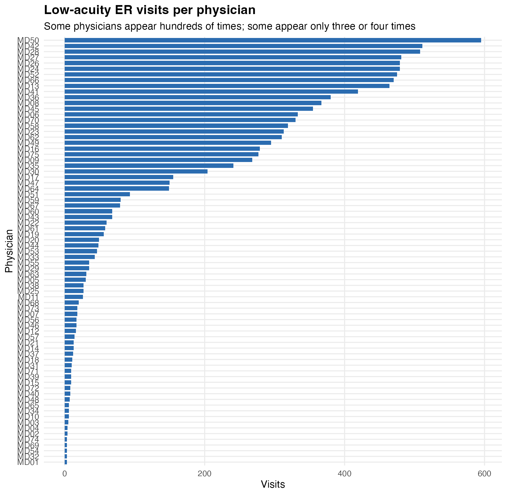{fig-alt="Low-acuity ER visits per physician. The group sizes are strongly unbalanced." width="95%"}

## What happens with ordinary regression?

A pooled model ignores physicians:

$$
\log(\text{DispositionMinutes}_i)
=
\beta_0 + \beta_1\text{Checklist}_i + e_i.
$$

A dummy-variable model gives every physician a separate offset:

$$
\log(\text{DispositionMinutes}_i)
=
\beta_0
+ \beta_1\text{Checklist}_i
+ \gamma_{\text{Physician}_i}
+ e_i.
$$

The dummy model is flexible, but it estimates a baseline for a 3-visit physician as if that estimate deserved the same trust as a 500-visit physician.

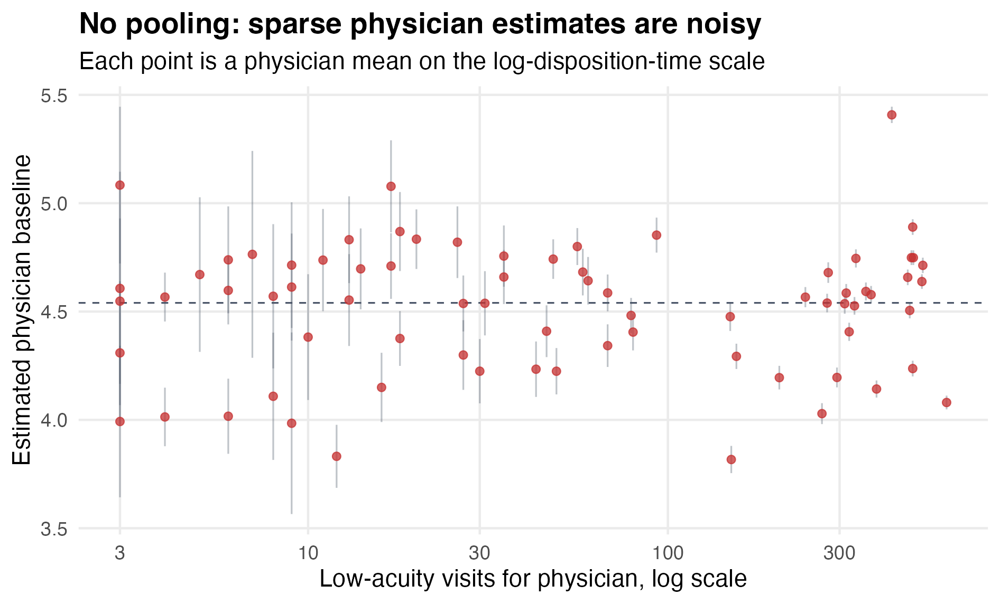{fig-alt="No-pooling physician baselines versus visits per physician. Small groups have noisy estimates." width="95%"}

## Random intercept model

The mixed model keeps physician baselines, but gives them a population distribution:

$$
\log(\text{DispositionMinutes}_i)
=
\beta_0
+ \beta_1\text{Checklist}_i
+ a_{\text{Physician}_i}
+ e_i,
$$

with

$$
a_j \sim N(0, \sigma_a^2).
$$

The `a_j` terms are random intercepts. They are physician-specific baseline shifts.

In `rstanarm`:

```{r}
#| echo: true
#| eval: false
library(rstanarm)

er_fit <- stan_lmer(
  logDispositionMinutes ~ Checklist + (1 | Physician),
  data = er_visits,
  chains = 4,
  iter = 2000,
  seed = 382
)
```

The syntax `(1 | Physician)` means: give each physician a random intercept.

## Partial pooling

Partial pooling is visible in the fitted physician baselines.

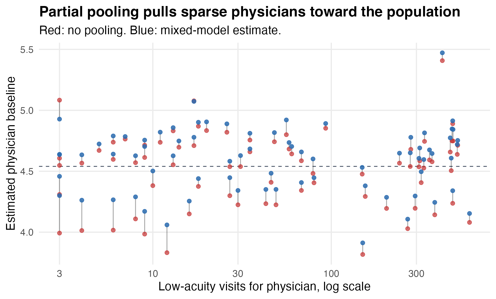{fig-alt="No-pooling and partial-pooling estimates for physician baselines. Small groups are pulled more strongly toward the population average." width="95%"}

Red points are no-pooling estimates. Blue points are mixed-model estimates. The small groups move most.

The fitted checklist effect is about -0.168 on the log scale:

$$
e^{-0.168} - 1 \approx -0.15.
$$

So visits with the checklist are fitted to reach disposition about 15% faster, after accounting for physician baselines.

## The Bayesian logic

A hierarchical model has at least two levels.

Observation level:

$$
y_i \mid a_j
\sim
N(\beta_0 + \beta_1x_i + a_j, \sigma^2).
$$

Group level:

$$
a_j \sim N(0, \sigma_a^2).
$$

For a small group, the group data are weak, so the population distribution matters more. For a large group, the group data are stronger, so the estimate is pulled less.

That is borrowing strength.

## Random slopes: legal document review

Now the group difference is not only the baseline. A numerical slope can vary too.

A large law firm wants better billing estimates for document review. Every year, new associates and staff reviewers join matters with very different document loads. Each row in this case is one review assignment: one reviewer, one matter, pages reviewed, and billed hours for document review.

The question is:

> If the assignment gets larger, how fast do billed hours grow?

```{r}
#| echo: true
legal_review <- read_csv(file.path(module_dir, "legal_review_assignments.csv")) |>
  mutate(
    DocumentType = factor(
      DocumentType,
      levels = c("Emails", "Contracts", "Financial records", "Technical documents", "Chat exports")
    ),
    ExperienceLevel = factor(
      ExperienceLevel,
      levels = c("New associate", "Associate", "Staff attorney", "Contract reviewer")
    )
  )
```

Pages reviewed and billed hours span orders of magnitude. That motivates the log transformation:

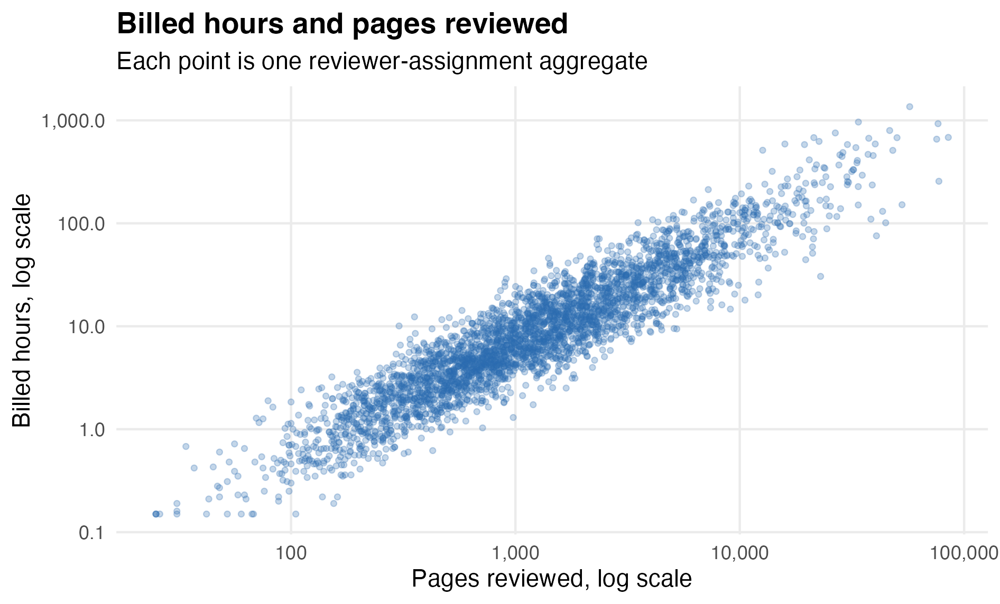{fig-alt="Log-log scatterplot of billed hours versus pages reviewed for legal document-review assignments." width="95%"}

On the log-log scale, the slope is an exponent:

$$
\log(\text{BilledHours})
=
\beta_0 + \beta_1\log(\text{PagesReviewed}) + e.
$$

If $\beta_1 = 1$, review time scales roughly linearly with pages. If $\beta_1 > 1$, review time scales faster than linearly. That is plausible here: large corpora require cross-referencing, issue coding, and drawing connections across the matter.

Reviewer histories are badly unbalanced. Some reviewers do document review constantly. Others rotate through once or twice.

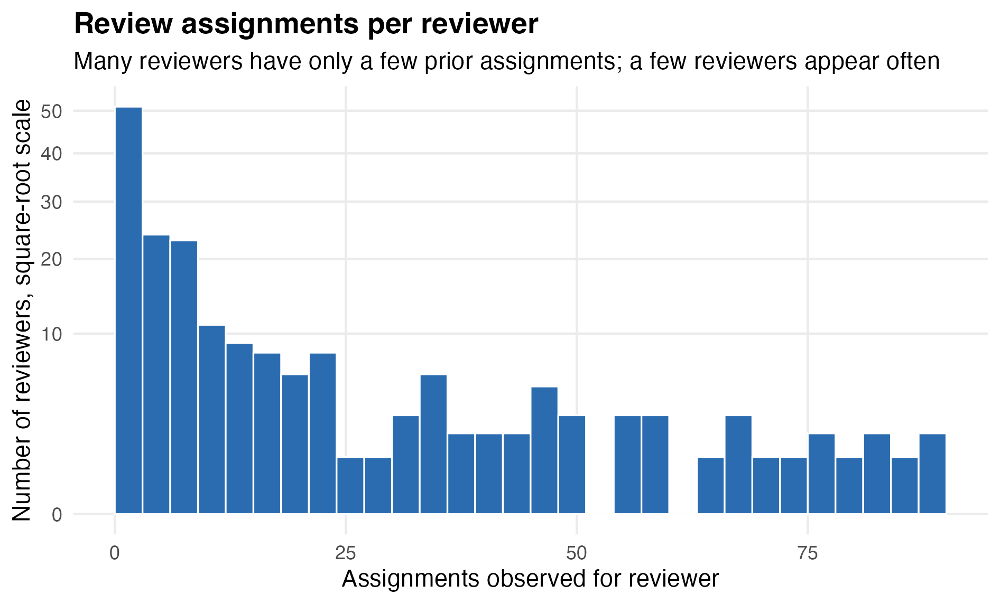{fig-alt="Histogram of legal document-review assignments per reviewer. Many reviewers have short histories and a few appear often." width="95%"}

The predictor of interest is `logPagesCentered`, which is

$$
\log(\text{PagesReviewed}) - \log(1000).
$$

So zero means about 1000 pages reviewed.

If we estimate a separate page-count exponent for every reviewer, short-history reviewers can look extreme.

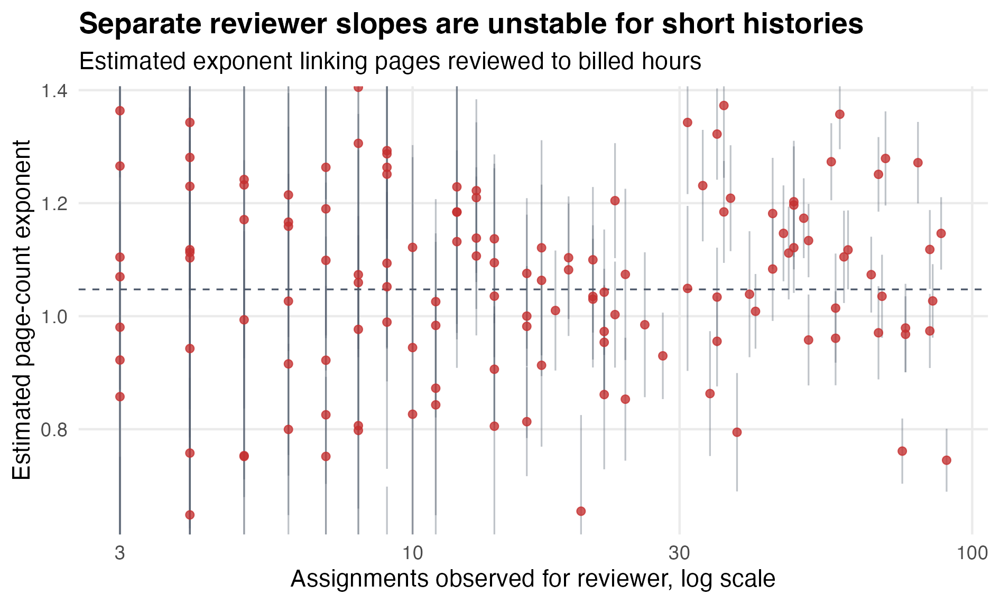{fig-alt="Separate reviewer page-count exponents versus assignments observed. Short-history reviewers have unstable slopes." width="95%"}

## Gaussian random slope model

Let the reviewer baseline and page-count slope vary:

$$
\begin{aligned}
\log(\text{BilledHours}_{ij})
=&\ \beta_0
+ \beta_1\log(\text{Pages}_{ij})
+ \text{document and experience controls}\\
&+ a_j
+ b_j\log(\text{Pages}_{ij})
+ e_{ij}.
\end{aligned}
$$

In `rstanarm`:

```{r}
#| echo: true
#| eval: false
legal_fit <- stan_lmer(
  logBilledHours ~ logPagesCentered + DocumentType +
    ExperienceLevel +
    (1 + logPagesCentered | ReviewerID),
  data = legal_review,
  chains = 4,
  iter = 2000,
  seed = 382
)
```

The syntax `(1 + logPagesCentered | ReviewerID)` gives each reviewer a random intercept and a random page-count slope.

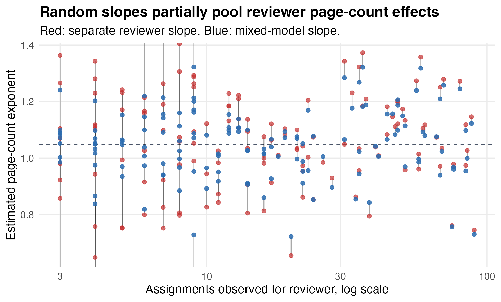{fig-alt="No-pooling and partial-pooling reviewer page-count slopes. Short-history reviewer slopes are pulled toward the population average." width="95%"}

The average page-count exponent is about 1.05. Roughly, 10% more pages predicts about 10.5% more billed hours. The reviewer-level slope standard deviation is about 0.14, so the page-count penalty varies across reviewers.

## Generalized mixed models: Spredfast support tickets

The legal review case is still ordinary Gaussian regression after the log transformation. The final case keeps the random-slope idea, but uses a count outcome.

Spredfast sold social media management software to brands, agencies, and media companies. Each row in this case is one customer-month from the high-growth SaaS years.

The natural data structure is badly unbalanced. Some customers have years of monthly history. Others are pilots, late arrivals, or churned accounts with only a few months.

```{r}
#| echo: true
spredfast <- read_csv(file.path(module_dir, "spredfast_support_months.csv")) |>
  mutate(
    PlanTier = factor(PlanTier, levels = c("Core", "Professional", "Enterprise", "Strategic")),
    AccountType = factor(AccountType, levels = c("Brand", "Agency", "Media"))
  )
```

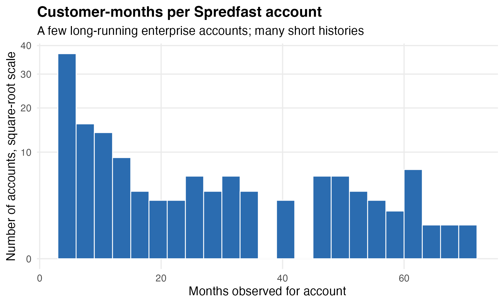{fig-alt="Histogram of customer-months per Spredfast account. Many accounts have short histories and a few have long histories." width="95%"}

The question is:

> As an account adds active seats, how much does support burden grow?

The outcome is `MonthlyTickets`. It is a count, so we use a generalized linear mixed model.

The predictor of interest is `logActiveSeatsCentered`, which is

$$
\log(\text{ActiveSeats}) - \log(100).
$$

So zero means about 100 active seats.

If we estimate a separate seat-to-ticket slope for every account, short-history accounts can look extreme.

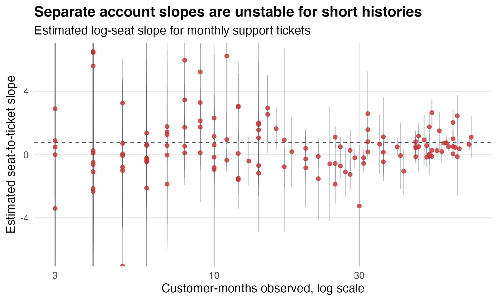{fig-alt="Separate account seat-to-ticket slopes versus customer-months observed. Short-history account slopes are unstable." width="95%"}

Let the account baseline and seat slope vary:

$$
\text{MonthlyTickets}_{ij}
\sim
\text{Poisson}(\lambda_{ij}),
$$

and

$$
\begin{aligned}
\log(\lambda_{ij})
=&\ \beta_0
+ \beta_1\log(\text{Seats}_{ij})
+ \text{plan/account controls}\\
&+ a_j
+ b_j\log(\text{Seats}_{ij}).
\end{aligned}
$$

In `rstanarm`:

```{r}
#| echo: true
#| eval: false
spredfast_fit <- stan_glmer(
  MonthlyTickets ~ logActiveSeatsCentered + PlanTier +
    AccountType + ConnectedProfiles10 + MonthsSinceLaunch12 +
    (1 + logActiveSeatsCentered | AccountID),
  data = spredfast,
  family = poisson(link = "log"),
  chains = 4,
  iter = 2000,
  seed = 382
)
```

The syntax `(1 + logActiveSeatsCentered | AccountID)` gives each account its own intercept and its own seat slope.

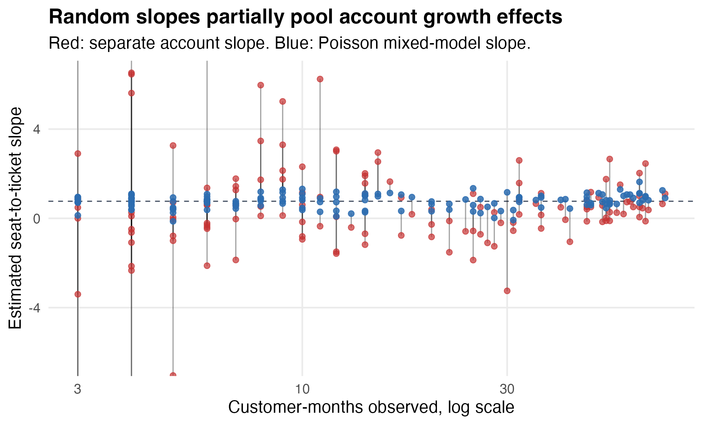{fig-alt="No-pooling and partial-pooling account seat slopes. Short-history account slopes are pulled toward the population average." width="95%"}

The average log-seat slope is about 0.76. Roughly, a 1% increase in active seats predicts about a 0.76% increase in monthly support tickets. The account-level slope standard deviation is about 0.45, so the support burden of growth varies substantially across accounts.

## Mean-variance diagnostic

A Poisson model assumes

$$
\text{variance} = \text{mean}.
$$

For support tickets, that is often too tight. Some customer-months have unusual bursts: product incidents, API changes, customer launches, reorgs, campaign season, and so on.

The diagnostic compares the observed ticket variance to the fitted mean:

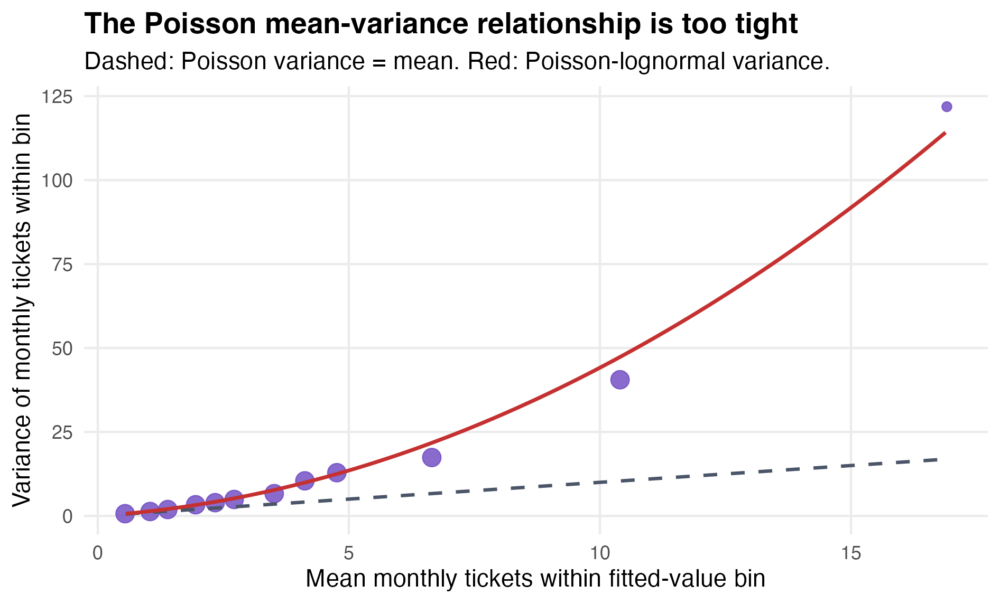{fig-alt="Observed ticket variance by fitted mean bin. The observed variance is above the Poisson variance equals mean line, and closer to a Poisson-lognormal curve." width="95%"}

The Pearson overdispersion ratio is about 2.15. The data are more variable than a plain Poisson model expects.

## Observation-level random effects

A simple correction is to add one random intercept per row:

$$
\log(\lambda_i)
=
\text{linear predictor}_i
+ u_i,
\qquad
u_i \sim N(0, \sigma_u^2).
$$

That gives a Poisson-lognormal model.

In `rstanarm`:

```{r}
#| echo: true
#| eval: false
spredfast_olre <- stan_glmer(
  MonthlyTickets ~ logActiveSeatsCentered + PlanTier +
    AccountType + ConnectedProfiles10 + MonthsSinceLaunch12 +
    (1 + logActiveSeatsCentered | AccountID) +
    (1 | ObsID),
  data = spredfast,
  family = poisson(link = "log"),
  chains = 4,
  iter = 2000,
  seed = 382
)
```

The `(1 | ObsID)` term is the observation-level random effect. It gives the model extra row-level variation beyond the Poisson mean.

## Why these models are useful in industry

Borrowing strength: groups with little data borrow from the population, instead of getting wild estimates.

Handling dependence: observations inside the same customer, store, agent, team, or market are not independent. Mixed models account for that clustering.

Unbalanced data: different group sizes are allowed. We do not have to throw away data to make a balanced table.

Generalizability: we can ask how much effects vary across the kinds of groups we expect to see again.

## What to carry forward

Mixed models are useful when three things happen together:

- many groups,
- uneven group sizes,
- group-specific baselines or effects that matter.

The practical lesson:

> estimate group differences, but do not trust tiny groups too much.
