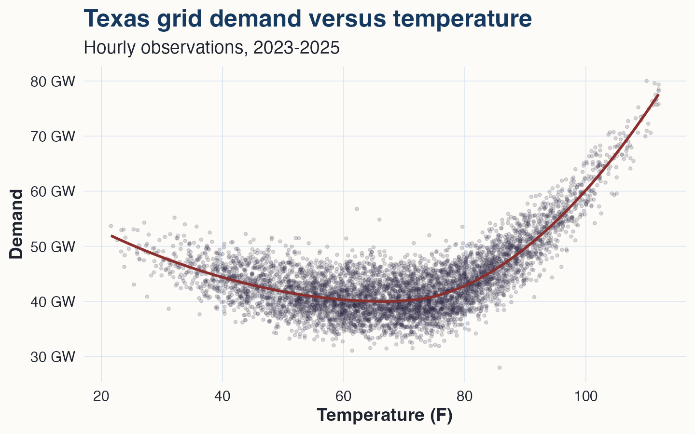
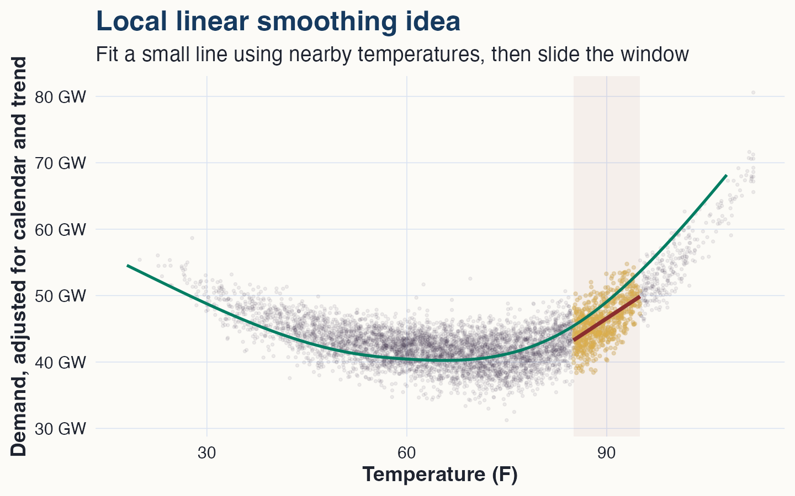
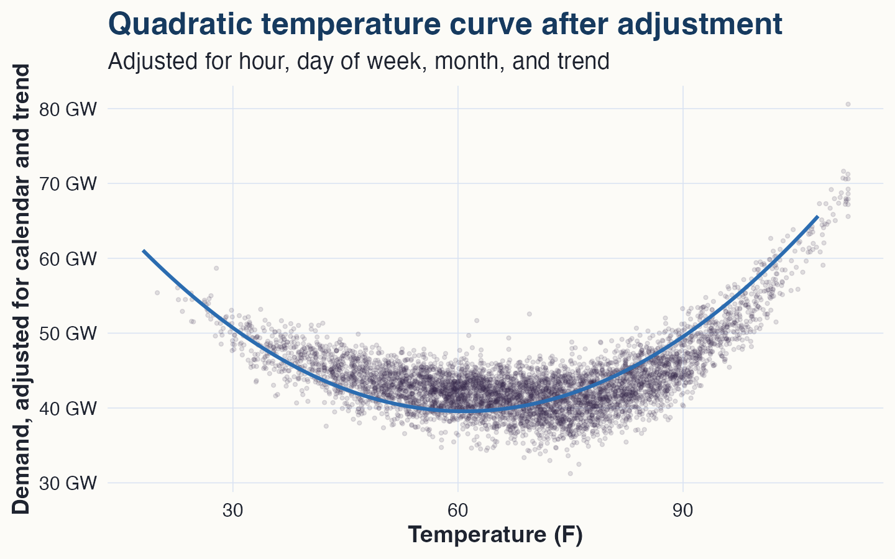
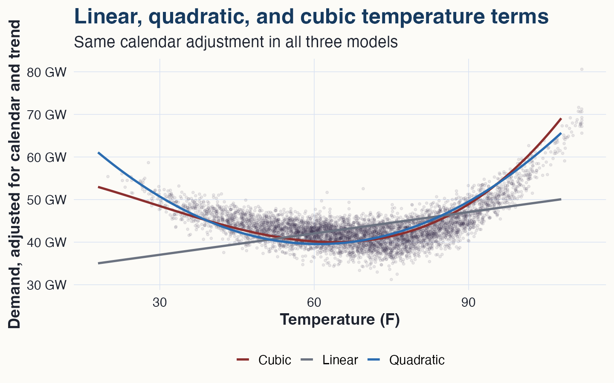
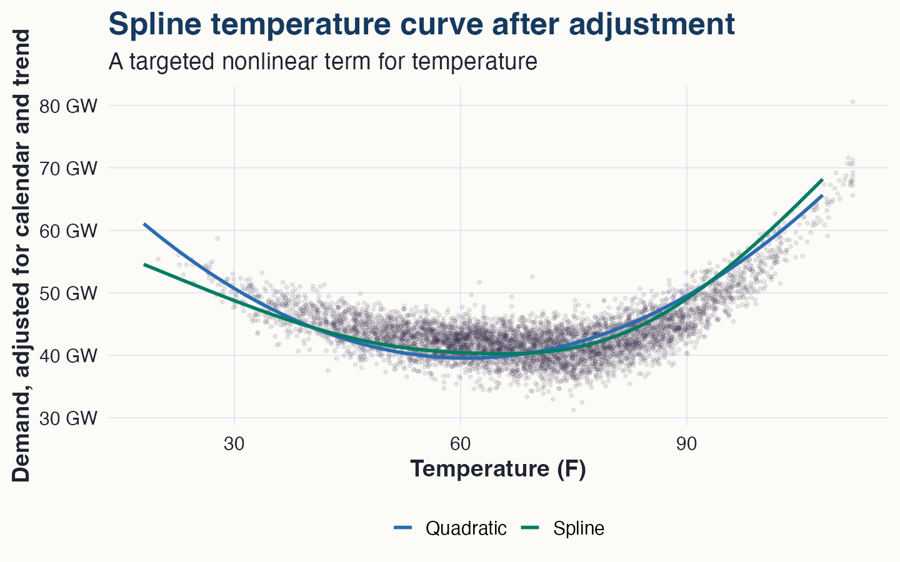
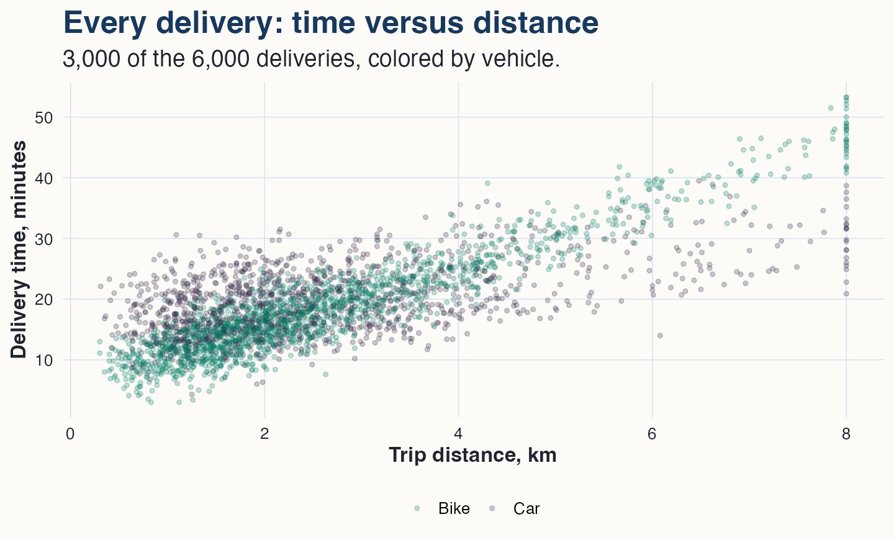
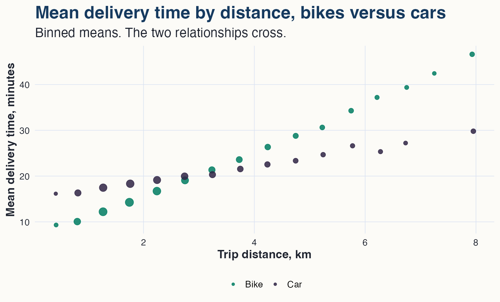
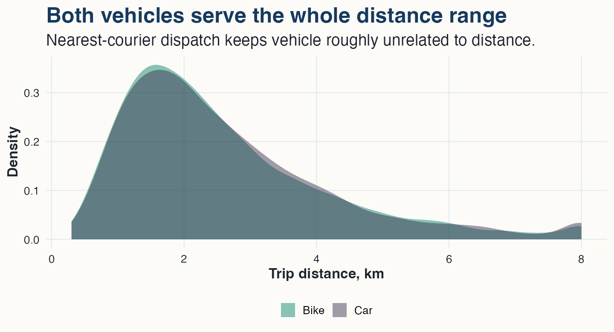
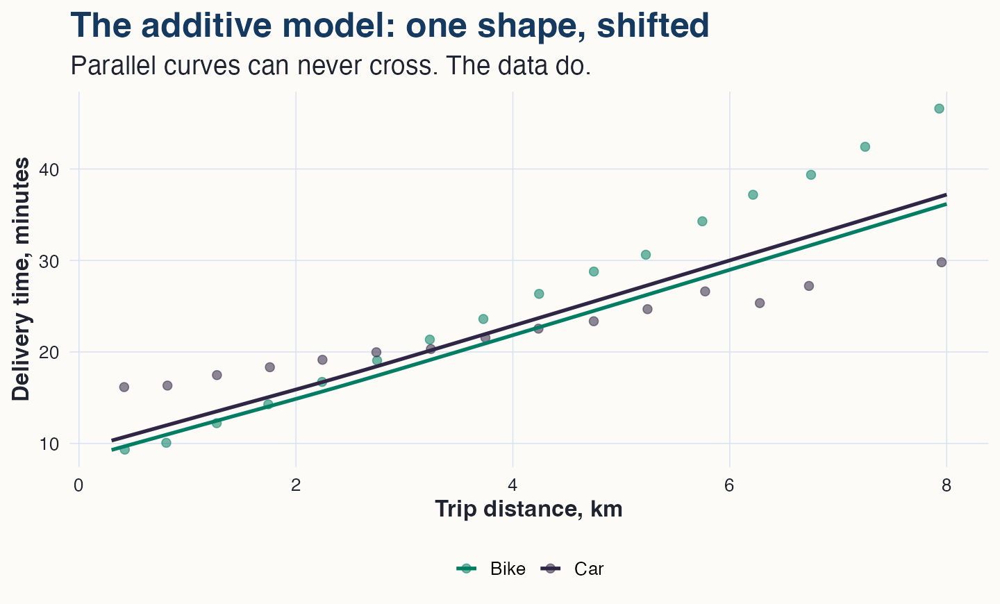
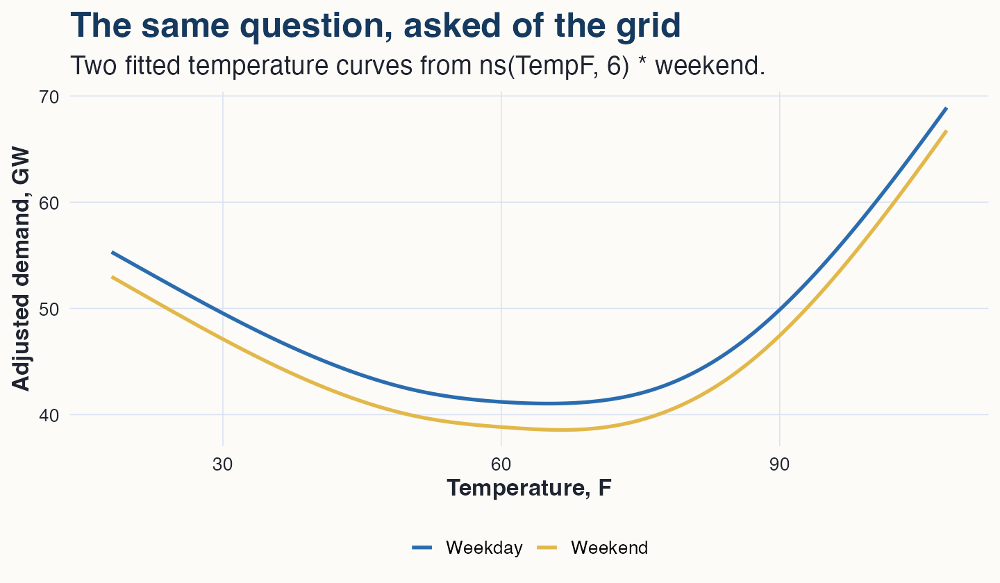

## The problem {.smaller}

Suppose ERCOT asks for a simple answer:

> How does temperature change power demand on the Texas grid?

Not a full production forecast.

Not "throw every possible feature into the largest model we can find."

A focused question:

> What is the temperature-demand curve, after adjusting for the calendar structure of electricity use?

## Why this is not a straight-line problem

Mild weather is easy on the grid.

Cold weather raises heating demand.

Hot weather raises cooling demand.

So the temperature effect should be **U-shaped**:

high demand in cold weather, low demand around mild temperatures, high demand in hot weather.

## The data

Hourly Texas grid observations, 2023-2025:

-   `DemandMW`: electricity demand on the grid,
-   `TempF`: statewide temperature index,
-   `Hour`: hour of day,
-   `DayOfWeek`: day of week,
-   `Month`: month of year,
-   `TrendYears`: time trend, in years since the start of the data.

That is 26,304 hourly observations.

## A few rows {.smaller}

``` r
grid %>% sample_n(8)
```

| timestamp           | month | day      | hour | temp | demand  |
|:--------------------|:------|:---------|-----:|-----:|:--------|
| 2024-11-03 05:00:00 | Nov   | Sunday   |    5 | 63.9 | 37.2 GW |
| 2023-10-16 23:00:00 | Oct   | Monday   |   23 | 76.8 | 42.7 GW |
| 2024-01-12 15:00:00 | Jan   | Friday   |   15 | 39.1 | 43.4 GW |
| 2025-06-13 02:00:00 | Jun   | Friday   |    2 | 80.3 | 45.7 GW |
| 2023-08-18 10:00:00 | Aug   | Friday   |   10 | 70.5 | 39.8 GW |
| 2024-11-12 21:00:00 | Nov   | Tuesday  |   21 | 73.0 | 48.7 GW |
| 2023-01-10 04:00:00 | Jan   | Tuesday  |    4 | 47.7 | 36.3 GW |
| 2023-01-14 04:00:00 | Jan   | Saturday |    4 | 47.8 | 37.4 GW |

## First look

{fig-alt="Hourly electricity demand is plotted against temperature. Demand is lowest around mild temperatures and rises in both cold and hot weather." width="88%"}

The curve is not subtle.

No straight line — and no formula we would guess in advance — has this shape.

## Draw the curve by hand

Forget models for a moment.

If someone asked "what is typical demand at 90F?", what would you actually do?

> Look at the hours where the temperature was *near* 90F, and average them.

That instinct — **nearby observations are the relevant ones** — is the whole idea of smoothing.

Every method in this module is a way of making it precise.

## K-nearest-neighbor smoothing

Make the instinct a rule. To estimate the curve at any temperature $t$:

1.  find the $k$ hours whose temperature is closest to $t$,
2.  average their demand,
3.  slide $t$ across the range and repeat.

``` r
knn_at <- function(t, k) {
  nearest <- order(abs(grid$TempF - t))[1:k]
  mean(grid$DemandAdj[nearest])
}
```

One choice to make: $k$, the number of neighbors.

## KNN in pictures

{fig-alt="Two panels. With k equal to 100 the KNN curve tracks the U shape but jitters. With k equal to 8,000 the curve is far too flat, missing both the cold and hot tails." width="98%"}

Both panels are the same rule with a different $k$.

Neither is wrong. They disagree about what counts as "nearby."

## The knob: how many neighbors

Small $k$: the curve listens to few hours — faithful to local shape, jittery from noise.

Large $k$: the curve averages half of Texas weather into every point — steady, but blurred. The tails vanish.

Every smoother has this dial. The tradeoff's name is **bias versus variance**, and no method escapes it — you only choose where to sit.

## Where KNN strains

{fig-alt="Above 85F, the KNN curve and a local linear curve agree until about 100F. Beyond that, KNN flattens while the local linear fit keeps rising with the points." width="88%"}

At 106F there are no hotter hours. Every "neighbor" is cooler.

So KNN averages in milder hours and **flattens exactly where the grid operator cares most**.

## Local linear smoothing

The fix: instead of averaging the neighbors, fit a small weighted **line** through them, and read off its value at the target.

- nearby hours get the most weight,
- the line follows the local *slope*, so a rising edge stays rising,
- slide the target and repeat.

The window width plays the role of $k$. Its usual name is the **bandwidth**.

You will meet this machinery again at the cutoff in the regression-discontinuity module.

## Local linear picture {.smaller}

{fig-alt="Adjusted demand is plotted against temperature. Points near 90F are highlighted, with a local fitted line and an overall smooth curve." width="88%"}

Local methods are intuitive: nearby temperatures matter more.

But they still need choices: how wide is nearby, and how much wiggle is too much?

## The catch

Smoothers answer the **one-variable** version of the question. Ours has a calendar in it:

> the same 95F hour means one thing at 5pm on a July weekday and another at 3am on a Sunday.

How do you hand a KNN smoother 23 hour dummies, 6 day dummies, 11 month dummies, and a trend? You do not. Adjustment is *regression's* home turf.

What we need is a **curve that lives inside `lm()`**.

## Basis functions {.smaller}

The general strategy. Choose a set of fixed building-block functions of $x$ in advance:

$$
f(x) = \beta_1 b_1(x) + \beta_2 b_2(x) + \cdots + \beta_K b_K(x).
$$

The $b_j(x)$ are the **basis functions**. They are known curves — data columns, once you evaluate them.

The $\beta_j$ enter *linearly*. So fitting $f$ is ordinary least squares with $K$ extra columns.

> The curve becomes columns. The columns go in the model matrix. Everything regression knows — adjustment, dummies, interactions, standard errors — now applies to the curve.

## The obvious basis: polynomials

The first basis anyone thinks of: $x, x^2, x^3, \ldots$

$$
\begin{aligned}
\text{Demand}_i
=\;& \alpha
+ \beta_1(\text{TempF}_i - 65)
+ \beta_2(\text{TempF}_i - 65)^2 \\
&+ \text{calendar effects}
+ \beta_3\text{TrendYears}_i + e_i.
\end{aligned}
$$

This is still ordinary least squares — the quadratic basis, plus the calendar.

## The fitted quadratic

{fig-alt="Demand adjusted for calendar and trend is plotted against temperature. A fitted quadratic curve has a U shape." width="88%"}

The right basic shape, from two basis columns.

And because the curve lives inside `lm()`, the calendar adjustment came along for free.

## Reading a curved fit {.smaller}

With a straight line, there is one slope.

With a curve, the slope changes with temperature:

$$
\frac{d}{dT}E(\text{Demand}\mid T)
=
\beta_1 + 2\beta_2(T - 65).
$$

For these data:

-   around 50F: about **0.25 GW lower** demand per extra degree,
-   around 90F: about **0.68 GW higher** demand per extra degree.

That is the point of the curve: not one slope, but the *right local slope everywhere*.

## Polynomials misbehave {.smaller}

{fig-alt="Adjusted demand is plotted against temperature. The linear fit misses the U shape. The quadratic and cubic fits capture the curve." width="80%"}

Obvious basis, real downsides. Polynomial basis functions are **global**:

- every coefficient touches every temperature,
- a bend added to fix the hot tail can create nonsense in the cold tail, and high degrees oscillate wildly at the edges.

We want basis functions that act *locally* — like the smoothers did.

## Splines

> A spline is piecewise polynomials, glued together smoothly.

Cut the temperature range at a few points — the **knots**.

Fit a low-degree polynomial on each piece.

Require the pieces to meet smoothly at the knots: no jumps, no kinks.

Local flexibility, without asking one polynomial to explain all of Texas weather.

## The spline basis

{fig-alt="Six overlapping curves across the temperature range, each one a localized bump. Together they span the range from cold to hot." width="88%"}

Each basis function is a localized bump.

Each coefficient moves the curve **only near its bump** — the local behavior of a smoother, delivered as regression columns.

## The spline model

``` r
library(splines)

spline_model <- lm(
  DemandMW ~ ns(TempF, df = 6) +
    factor(Hour) + DayOfWeek + Month + TrendYears,
  data = grid
)
```

`ns(TempF, df = 6)` manufactures the six basis columns.

`lm()` never knows it fitted a curve. It sees columns.

## The payoff: curves that compose {.smaller}

Because the spline is just columns in the model matrix, it combines with everything regression already does:

- **adjustment**: the calendar dummies sit beside the curve,
- **inference**: coefficients, contrasts, and intervals work unchanged,
- **interactions**: `ns(x, df) * group` lets the curve differ by group.

Smoothers stand alone. Splines **compose**.

That composability is why, later in the course, a spline can sit *inside a treatment interaction* and produce an effect curve with honest error bars.

## Quadratic versus spline

{fig-alt="Adjusted demand is plotted against temperature. The quadratic and spline curves agree near the middle, while the spline has more flexibility in the tails." width="88%"}

The spline agrees with the quadratic where the relationship is simple.

It has more freedom in the extreme temperatures.

That is exactly where grid planners care.

## The additive model {.smaller}

Putting the pieces together, the working model of this module:

$$
E(\text{Demand}_i)
=
\alpha
+ \underbrace{f(\text{TempF}_i)}_{\text{spline}}
+ \text{hour effects}
+ \text{day effects}
+ \text{month effects}
+ \text{trend}.
$$

An **additive model**: a sum of interpretable pieces, one of which is a targeted curve.

In the old telling, additive models were a cutting-edge prediction machine. Today, stronger tools exist if prediction is the only goal. Their modern role is narrower and more useful:

> a targeted nonlinear curve on the variable you care about, with ordinary regression adjustment for everything else.

## Model-based comparisons

Using the spline curve, after averaging over the same mix of hours, days, months, and trend:

| temperature | adjusted demand |
|------------:|----------------:|
|         45F |         42.9 GW |
|         65F |         40.2 GW |
|         95F |         53.6 GW |

Compared with 65F:

-   45F is about **2.7 GW higher**,
-   95F is about **13.4 GW higher**.

## A dispatch problem

The composition claim deserves a demonstration.

A courier marketplace delivers restaurant orders with a mixed fleet: **bikes** and **cars**.

The dispatcher's question, order by order:

> Which vehicle gets there faster?

"It depends on the trip," says intuition: bikes start moving immediately; cars are faster on the open road but pay a parking overhead at both ends.

"It depends" is a curve-by-group question.

## One row

Each row is one completed delivery.

| order  | distance (km) | vehicle | peak | minutes |
|:-------|--------------:|:--------|-----:|--------:|
| D20927 |          1.64 | bike    |    1 |    13.3 |
| D82486 |          2.34 | bike    |    0 |    19.5 |
| D67767 |          3.36 | car     |    0 |    14.9 |
| D40904 |          6.79 | bike    |    0 |    35.3 |

6,000 deliveries. Before any model, look at the data.

## First look: the fleet seems interchangeable

Start with the simplest possible comparison — mean delivery time by vehicle:

| vehicle | deliveries | mean minutes |
|:--------|-----------:|-------------:|
| bike    |      3,290 |         18.5 |
| car     |      2,710 |         19.8 |

A difference of about one minute.

At first glance, the vehicle hardly matters. That conclusion is about to fall apart.

## The same comparison, within distance bands

| distance | bike | car | faster |
|:-----------|------:|------:|:-------|
| under 2 km | 12.6 | 17.6 | **bike, by 5 minutes** |
| 2 to 4 km | 19.3 | 20.0 | roughly a tie |
| over 4 km | 32.8 | 25.1 | **car, by 8 minutes** |

The one-minute overall gap was an average of two large differences pointing in opposite directions — with a tie in between.

Somewhere in that middle band, the two vehicles trade places.

## Every delivery

{fig-alt="Scatter of delivery time versus distance. Bike points sit below car points at short distances and above them at long distances, with heavy overlap in the middle." width="82%"}

The raw data hint at the same story: bikes below at short range, above at long range.

To see it clearly, do what this module always does with a noisy relationship — average locally.

## Binned means

{fig-alt="Binned mean delivery times for bikes and cars. The bike means rise steeply and the car means rise gently; the two sequences cross near 3 km." width="84%"}

Binned means are the module's opening move — the crudest smoother — applied within each group.

The two relationships **cross** near 3 km. That is the fact any model must be able to represent.

## Before modeling, check the design

{fig-alt="Overlapping density curves of trip distance for bikes and cars, almost coincident across the range." width="80%"}

Nearest-courier dispatch keeps vehicle roughly unrelated to distance: mean trip 2.60 km for bikes, 2.64 km for cars, with similar peak shares.

So both curves are observed **across the whole range** — the comparison ahead never leans on extrapolation.

## The additive model

``` r
lm(delivery_min ~ ns(distance_km, 4) + vehicle + peak)
```

{fig-alt="Binned mean delivery times by distance for bikes and cars, which cross near 3 km, overlaid with two nearly identical parallel fitted curves from the additive model." width="76%"}

The additive model allows one shape, shifted — parallel curves **cannot cross**. The data do.

Worse: averaging a bike advantage at short range against a car advantage at long range, the model reports a vehicle effect near *one minute*. The averaging hides the story.

## One asterisk

Let the curve depend on the vehicle, and the peak penalty too:

``` r
lm(delivery_min ~ ns(distance_km, 4) * vehicle + vehicle * peak)
```

Two named claims, one term each:

- `ns(distance_km, 4) * vehicle` — each vehicle gets its own distance curve,
- `vehicle * peak` — rush hour is allowed to cost cars more than bikes.

This is the categorical-by-numerical interaction grammar of Module 3, applied to a *basis*.

## The picture

{fig-alt="Two panels of fitted curves. Off-peak, the bike and car curves cross at 2.4 km. At peak hours, the car curve shifts up more and the crossing moves to 4.1 km." width="96%"}

Each vehicle has its own shape.

And the crossing point is not one number.

## The crossover is the deliverable {.smaller}

Fitted delivery minutes at three distances:

| distance | bike, off-peak | car, off-peak | bike, peak | car, peak |
|---------:|------:|------:|------:|------:|
| 1 km | **10.3** | 14.3 | **12.3** | 21.4 |
| 3 km | 19.5 | **17.8** | **21.6** | 24.9 |
| 6 km | 34.8 | **23.4** | 36.9 | **30.5** |

Off-peak, the curves cross near **2.4 km**. At peak, near **4.1 km** — congestion taxes cars far more than bikes, so bikes stay competitive farther out.

Look at the 3 km row: the better vehicle *flips with the time of day*.

The dispatch rule is not one cutoff. It is a cutoff **per regime** — and the interaction model is what estimated both.

## The same question, asked of the grid

{fig-align="center" fig-alt="Two U-shaped temperature curves, weekday and weekend. The weekend curve sits about two gigawatts lower with essentially the same shape." width="74%"}

Fit `ns(TempF, 6) * weekend` and the two curves come back **parallel**: the weekend effect is a level shift, not a change of shape.

Here, the additive model was the right model all along.

An interaction is a question you ask of the data — not a default you assume.

## One idea, four tools {.smaller}

| tool | how it works | lives inside `lm()`? |
|:------------|:----------------------------------|:--------------------|
| KNN | average the $k$ nearest | no |
| local linear | weighted mini-line near each target | no |
| polynomials | global basis functions | yes — but global |
| splines | local basis functions, glued smoothly | **yes — and local** |

The question never changed:

> How does demand vary with temperature, after adjusting for the calendar and trend?

Smoothers build the intuition. The spline basis brings that intuition into the regression, where the adjustment variables already live.

## What this is not {.smaller}

This is not the final word in grid forecasting.

A production forecast would use:

-   weather forecasts by region,
-   holidays and school calendars,
-   lagged demand,
-   outages and market events,
-   forecast validation.

Here we are doing something narrower:

> estimating an interpretable partial curve.

## Practical lesson

Use an additive model when:

-   one numerical predictor has a relationship you need to see as a curve,
-   other variables must be adjusted for,
-   many of those other variables are categorical,
-   you still want a plot and an interpretation.

Target the nonlinearity. Represent it with a basis. Let `lm()` do the rest.

Do not make the whole model mysterious unless prediction is truly the whole job.
