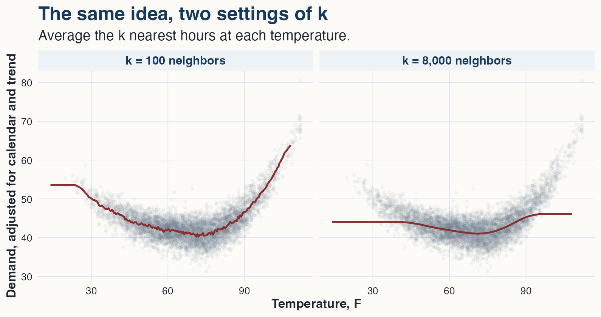
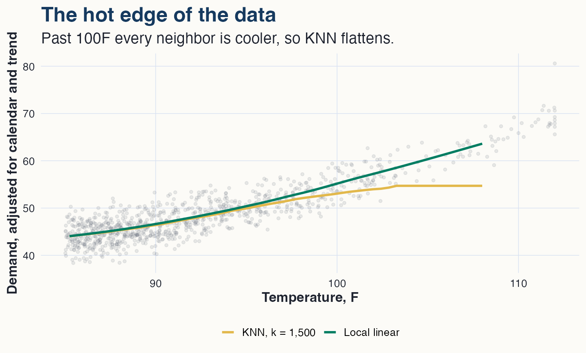
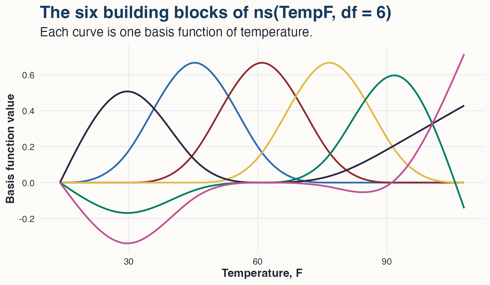
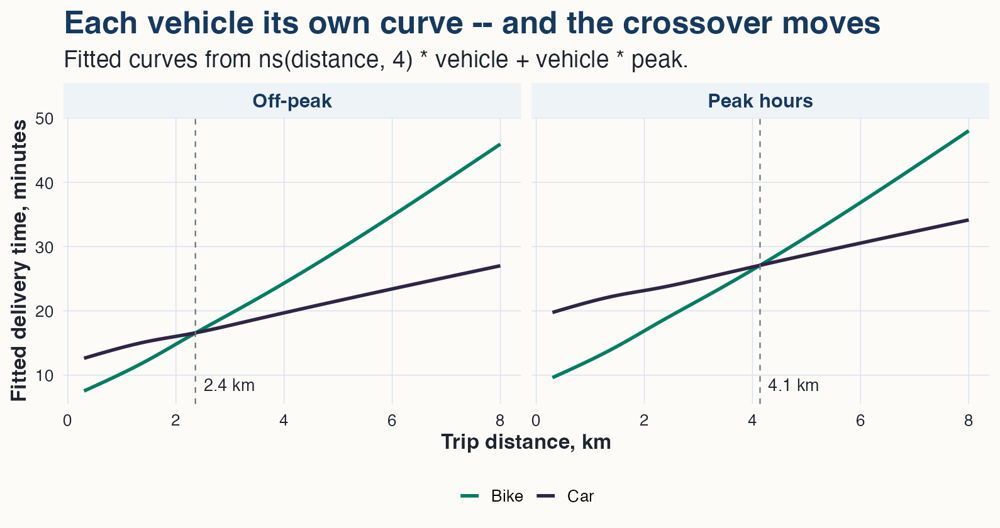

## The point of the module

In this module, additive models are not presented as a miracle prediction machine. If the goal is pure prediction, modern practice has many flexible tools: random forests, boosted trees, neural nets, and other machine-learning systems.

The point here is narrower and, for regression, more useful:

> we often care about the shape of one partial relationship, while still needing to adjust for many other variables.

The Texas grid example asks how power demand varies with temperature. Temperature is the variable of interest. Hour of day, day of week, month, and long-run trend are adjustment variables. They matter, but they are not the main thing we are trying to interpret.

The module builds the answer in the order a data scientist would actually discover it: start with the by-hand instinct for estimating a curve (nearest-neighbor smoothing), fix its flaws (local linear smoothing), then move the whole idea inside the regression model, where the adjustment variables already live (basis functions, splines, and additive models).

## Why temperature needs a curve

Electricity demand is usually lowest at mild temperatures. It rises when temperatures are cold because of heating demand. It rises when temperatures are hot because of cooling demand.

That means the temperature-demand relationship should be U-shaped. A straight-line model cannot capture this. A single positive slope would say warmer temperatures always raise demand. A single negative slope would say warmer temperatures always lower demand. Both are wrong — and no formula we would guess in advance has exactly the right shape either. The shape has to come from the data.

## K-nearest-neighbor smoothing

Forget models for a moment. If someone asked "what is typical demand at 90F?", the natural move is to look at the hours where the temperature was *near* 90F and average them. That instinct — nearby observations are the relevant ones — is the whole idea of smoothing, and every method in this module is a way of making it precise.

K-nearest-neighbor (KNN) smoothing turns the instinct into a rule. To estimate the curve at temperature $t$: find the $k$ hours whose temperature is closest to $t$, average their demand, then slide $t$ across the range and repeat. The only choice is $k$, the number of neighbors.

{fig-alt="KNN fits at k equal to 100 and k equal to 8,000. The small-k curve tracks the U shape but jitters; the large-k curve is far too flat and misses both tails." width="97%"}

The two panels are the same rule with different $k$, and they disagree about what counts as "nearby." With a small $k$ the curve listens to few hours: faithful to local shape, jittery from noise. With a huge $k$ the curve averages half of Texas weather into every point: steady but blurred, with the cold and hot tails flattened away. Every smoother has this dial. The tradeoff's name is bias versus variance, and no method escapes it; a tuning choice only decides where on the tradeoff to sit.

KNN also has a structural weakness that matters exactly where the grid operator cares most. At 106F there are no hotter hours, so every "neighbor" is cooler, and the average gets dragged toward milder conditions. The estimated curve flattens at the boundary even though the true relationship keeps rising.

## Local linear smoothing

The fix for both the jitter and the boundary problem: instead of *averaging* the neighbors, fit a small weighted *line* through them and read off its value at the target. Nearby hours get the most weight; the little line follows the local slope, so a rising edge stays rising — including at the boundary, where KNN flattens.

{fig-alt="Above 85F, KNN and local linear fits agree until about 100F; beyond that KNN flattens while the local linear fit keeps rising with the data." width="90%"}

The window width plays the role of $k$; its usual name is the **bandwidth**. A very small bandwidth gives a wiggly curve, a very large one oversmooths — the same dial as before. This machinery returns at the cutoff in the regression-discontinuity module, where local lines on either side of a threshold estimate a treatment jump.

## The catch: smoothers do not adjust

Smoothers answer the one-variable version of the question. Ours has a calendar in it: the same 95F hour means one thing at 5pm on a July weekday and something else at 3am on a Sunday. There is no natural way to hand a KNN smoother 23 hour dummies, 6 day-of-week dummies, 11 month dummies, and a trend. Adjustment is regression's home turf.

What we need is a curve that lives *inside* `lm()`.

## Basis functions

The general strategy is to represent the curve as a weighted sum of fixed building-block functions of $x$, chosen in advance:

$$
f(x) = \beta_1 b_1(x) + \beta_2 b_2(x) + \cdots + \beta_K b_K(x).
$$

The $b_j(x)$ are called **basis functions**. They are known curves, and once evaluated at the data they are just columns. The coefficients $\beta_j$ enter linearly, so fitting $f$ is ordinary least squares with $K$ extra columns in the model matrix. That is the whole trick: the curve becomes columns, the columns go in the regression, and everything regression knows — adjustment variables, dummies, interactions, standard errors, contrasts — now applies to the curve.

**The obvious basis is polynomials**: $x, x^2, x^3, \ldots$ The quadratic version of the grid model is

$$
\begin{aligned}
\text{Demand}_i
=\;& \alpha
+ \beta_1(\text{TempF}_i - 65)
+ \beta_2(\text{TempF}_i - 65)^2 \\
&+ \text{hour effects}
+ \text{day effects}
+ \text{month effects}
+ \beta_3\text{TrendYears}_i
+ e_i,
\end{aligned}
$$

still fit by ordinary least squares, and it captures the basic U while the calendar adjustment comes along for free. A curve also changes how slopes are read. The derivative

$$
\frac{d}{dT}E(\text{Demand}\mid T)
=
\beta_1 + 2\beta_2(T - 65)
$$

gives a different local slope at every temperature: in the lecture data, about 0.25 GW *lower* demand per extra degree near 50F, and about 0.68 GW *higher* per extra degree near 90F. That is the point of the curve — not one slope, but the right local slope everywhere.

But polynomials, though obvious, have real downsides as a basis. Polynomial basis functions are *global*: every coefficient touches every temperature, a bend added to fix the hot tail can create nonsense in the cold tail, and high-degree polynomials oscillate wildly near the edges of the data. The practical rule is: low-degree polynomials are fine when they match the shape you need; be suspicious of high degrees used as a generic wiggle machine. What we would rather have is a basis whose functions act *locally* — like the smoothers did.

## Splines: piecewise polynomials, glued smoothly

A spline delivers exactly that:

> cut the range of $x$ at a few points (the **knots**), fit a low-degree polynomial on each piece, and require the pieces to meet smoothly at the knots — no jumps, no kinks.

The result is local flexibility without asking one polynomial to explain the whole range. And crucially, a spline can be written as a basis: software constructs a set of basis functions, each a localized bump over part of the range.

{fig-alt="The six basis functions of a natural spline in temperature, each a localized bump spanning part of the range." width="90%"}

Each coefficient moves the fitted curve only near its bump — the local behavior of a smoother, delivered as regression columns. In R:

``` r
library(splines)

spline_model <- lm(
  DemandMW ~ ns(TempF, df = 6) +
    factor(Hour) + DayOfWeek + Month + TrendYears,
  data = grid
)
```

The `ns()` function manufactures the six natural-spline basis columns; `lm()` never knows it fitted a curve. Because the spline is just columns in the model matrix, it *composes* with everything regression already does: the calendar dummies sit beside the curve, coefficients and intervals work unchanged, and `ns(x, df) * group` lets the curve differ by group. Standalone smoothers cannot do any of that. This composability is why, later in the course, a spline can sit inside a treatment interaction and produce a treatment-effect curve with honest error bars.

## The additive model

Putting the pieces together gives the working model of this module:

$$
\begin{aligned}
E(\text{Demand}_i)
=\;& \alpha
+ f(\text{TempF}_i) \\
&+ \text{hour effects}
+ \text{day-of-week effects}
+ \text{month effects}
+ \text{trend},
\end{aligned}
$$

with $f$ represented by the spline basis. This is an **additive model**: the conditional mean is a sum of interpretable pieces, one of which is a targeted curve. The word additive means the terms are added; it does not mean every term is a straight line.

The fitted spline is interpreted by plotting the model-based temperature curve, computed by averaging predictions over the same mix of hours, days, months, and trend values — a model-based adjusted comparison. For example:

| temperature | adjusted demand |
|------------:|----------------:|
|         45F |         42.9 GW |
|         65F |         40.2 GW |
|         95F |         53.6 GW |

Compared with 65F, demand is about 2.7 GW higher at 45F and about 13.4 GW higher at 95F, after adjustment.

## Case 2: courier dispatch, and why composition matters

The composability claim deserves a demonstration on a real decision. A courier marketplace delivers restaurant orders with a mixed fleet of bikes and cars, and the dispatcher faces the same question on every order: which vehicle gets there faster? Intuition says it depends on the trip — bikes start moving immediately, while cars are faster on the open road but pay a parking overhead at both ends. "It depends on the trip" is a curve-by-group question.

Each row of the data is one completed delivery: trip distance, vehicle, a peak-hour indicator, and delivery time in minutes.

The exploratory work builds the intuition before any model appears. The simplest possible comparison — mean delivery time by vehicle — says the fleet is interchangeable: bikes average 18.5 minutes and cars 19.8, a one-minute gap. Repeating the same comparison within distance bands dismantles that conclusion. Under 2 km, bikes win by about 5 minutes; from 2 to 4 km the two are roughly tied; beyond 4 km, cars win by about 8 minutes. The overall gap was an average of two large differences pointing in opposite directions, and somewhere in the middle band the vehicles trade places. A scatterplot of the raw deliveries hints at the same pattern, and binned means — the module's opening move, the crudest smoother, applied within each group — make it plain: the two relationships cross near 3 km. That crossing is the fact any model of these data must be able to represent.

One design check matters before modeling: the marketplace assigns whichever courier is nearest, so vehicle is roughly unrelated to distance (mean trip 2.60 km for bikes, 2.64 km for cars, with similar peak shares), and both curves are observed across the whole range. Had dispatchers already been routing long trips to cars, the two curves would be estimated on disjoint stretches of distance, and the comparison would lean on extrapolation.

The additive model is the natural first try:

$$
\text{Minutes}_i = f(\text{Distance}_i) + \beta_1\,\text{Car}_i + \beta_2\,\text{Peak}_i + e_i,
$$

with $f$ a spline. Its promise is one shape, shifted: whatever the distance, a car costs the same $\beta_1$ minutes relative to a bike. Parallel curves can never cross — and the binned means plainly do, near 3 km. The failure is worse than imprecision. Averaging a bike advantage at short range against a car advantage at long range, the additive model reports a vehicle effect of about one minute; the averaging hides the story entirely.

Because the spline is columns, the fix costs one asterisk per claim:

``` r
lm(delivery_min ~ ns(distance_km, 4) * vehicle + vehicle * peak)
```

The first interaction gives each vehicle its own distance curve; the second allows rush hour to cost cars more than bikes. This is the categorical-by-numerical interaction grammar of Module 3, applied to a basis.

{fig-alt="Fitted curves by vehicle in off-peak and peak panels. The curves cross at 2.4 km off-peak and 4.1 km at peak." width="97%"}

The fitted curves cross — and the crossing point is the deliverable. Off-peak, bikes are faster below about 2.4 km and cars beyond it. At peak hours, congestion taxes cars far more than bikes, and the crossover moves out to about 4.1 km. At 3 km, the better vehicle flips with the time of day: car off-peak, bike at peak. The dispatch rule is therefore not one cutoff but a cutoff per regime, and the interaction model is what estimated both. This is the payoff of putting curves inside the regression: the crossover itself became a modeled quantity that depends on other features of the order.

## The same question, asked of the grid

Interactions are a question to ask, not a default to assume, and it is worth seeing a case where the answer is no. Asking whether the grid's temperature curve changes on weekends — `ns(TempF, 6) * weekend` plus the usual adjusters — returns two curves that are parallel to the eye: the weekend effect is a level shift of about two gigawatts, not a change of shape. For the grid, the additive model was the right model all along. The discipline this pair of examples teaches: fit the interaction when the question calls for it, and let the data say whether the shape actually changes.

## One idea, four tools

| tool | how it works | lives inside `lm()`? |
|:---|:---|:---|
| KNN | average the $k$ nearest observations | no |
| local linear | weighted mini-line near each target | no |
| polynomials | global basis functions | yes, but global |
| splines | local basis functions, glued smoothly | yes, and local |

The question never changed: how does demand vary with temperature, after adjusting for the calendar and trend? The smoothers build the intuition and make the bias-variance dial visible. The basis-function strategy brings that intuition into the regression, where the adjustment variables already live, and the spline is the basis that keeps the smoothers' local character.

## What to carry forward

The central question in this module is not "which curve-fitting method is fanciest?"

The central question is:

> what partial relationship do we need to see as a curve?

Once that is clear, the regression grammar is the same as before. Represent the curve with a basis, put it where it belongs, keep the adjustment variables in the model, and plot the fitted relationship in units that mean something.
