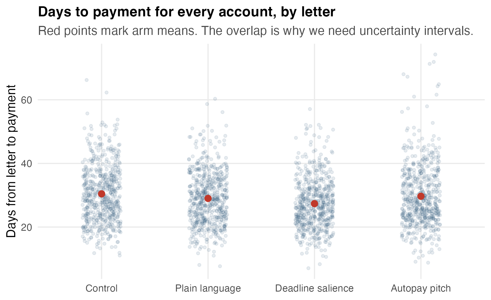
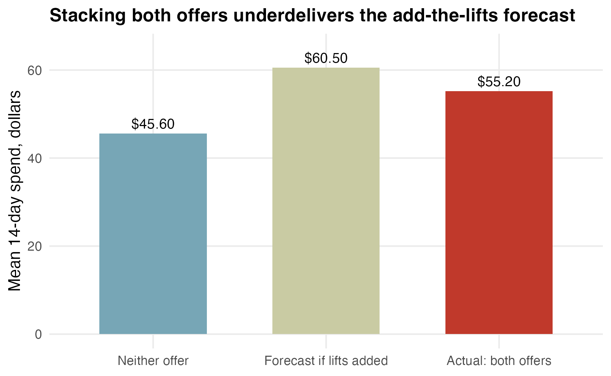
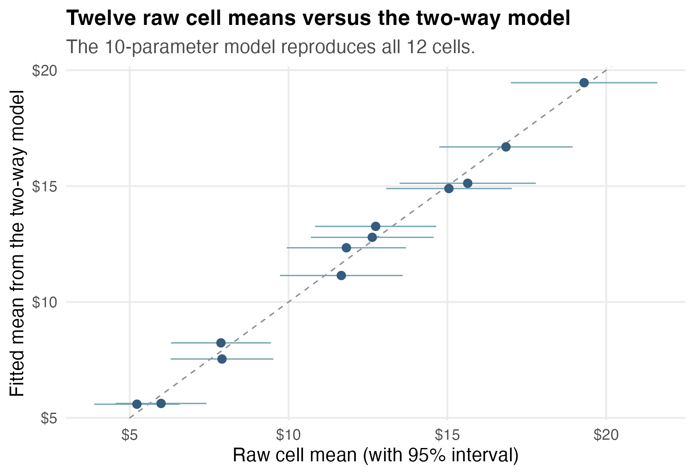
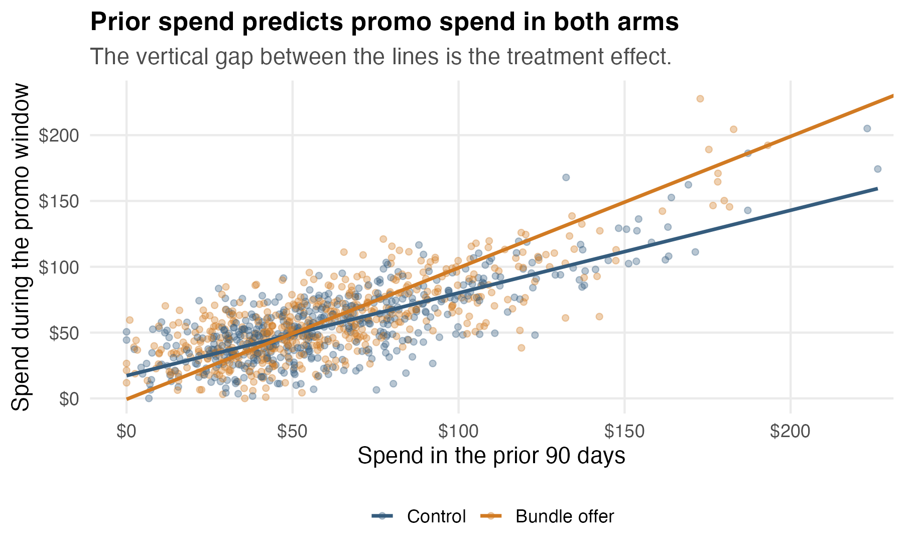

## Today {.smaller}

So far, regression has been a tool for making fair comparisons out of messy observational data.

Today the comparison is built in advance.

We will:

- analyze a two-group A/B test as a regression,
- handle many treatment arms with dummies,
- answer specific questions with planned contrasts,
- analyze two crossed treatments and their interaction,
- scale up to a three-factor experiment and read it entirely through contrasts,
- sharpen a too-small experiment with a pre-treatment covariate,
- flag the practical issues that break real experiments.

## A late-payment problem

A Texas electric utility has a collections problem.

Every month, tens of thousands of residential accounts go more than 10 days past due.

Late payments tie up working capital.

Every extra day costs real money.

The main collections tool is a paper reminder letter.

Question:

> Can a better-written letter get people to pay sooner?

## Three new letters

The collections team drafted three candidates:

- **Plain language**: shorter sentences, no billing jargon.
- **Deadline salience**: the payment deadline in large type, with what happens after it.
- **Autopay pitch**: the standard letter plus a pitch to enroll in autopay.

Plus the incumbent:

- **Control**: the letter the utility already sends.

## The experiment

2,400 past-due accounts entered the study in one billing cycle.

Each account was randomly assigned to one of the four letters.

600 accounts per arm.

The outcome:

> days from the letter going out to the payment arriving.

Lower is better.

## One row

Each row is one past-due account.

| account | letter | amount due | late payments, last 12 mo | days to payment |
|:--------|:---------------|-----------:|-----------------:|----------:|
| A91879  | control        |      79.01 |                2 |        46 |
| A54436  | plain_language |      90.66 |                1 |        41 |
| A66114  | deadline       |     138.83 |                1 |        26 |
| A33824  | deadline       |      79.87 |                2 |        39 |
| A92661  | autopay        |      93.99 |                1 |        32 |

The letter is the treatment.

Days to payment is the response.

## Why randomization matters

In the Airbnb data, listings near La Rambla differed from listings far away in many ways at once.

We had to adjust for those differences ourselves.

Here, a random number generator decided who got which letter.

So the four groups are alike, on average, in every way — amount owed, payment history, income, attention, mail-reading habits...

...including everything we never measured.

## Check anyway

Randomization is a promise about averages, so check it.

| letter | accounts | mean amount due | mean late payments, 12 mo |
|:---------------|-----:|--------:|-----:|
| control        |  600 | \$141.93 | 1.05 |
| plain_language |  600 | \$142.33 | 1.08 |
| deadline       |  600 | \$139.59 | 1.04 |
| autopay        |  600 | \$140.49 | 1.10 |

The arms look alike on what we can see.

Randomization argues they are alike on what we cannot see.

## Start with two arms

Ignore the other letters for a moment.

Control versus deadline salience:

| letter   | accounts | mean days to payment |
|:---------|---------:|---------------------:|
| control  |      600 |                30.44 |
| deadline |      600 |                27.36 |

The difference is $-3.08$ days.

That subtraction is the whole analysis.

Regression just gives it a grammar.

## The two-group regression

Define a dummy: $\text{Deadline}_i = 1$ if account $i$ got the deadline letter.

$$
\widehat{\text{Days}}
= 30.44 - 3.08 \, (\text{Deadline}).
$$

- Intercept: the control-group mean.
- Coefficient: the treatment effect. Deadline-letter accounts paid about 3.1 days sooner.

Because assignment was random, "effect" is the right word.

## The same comparison, three ways

``` r
# difference in means
mean(days[deadline == 1]) - mean(days[deadline == 0])

# two-sample t-test
t.test(days_to_payment ~ deadline_letter, var.equal = TRUE)

# regression
lm(days_to_payment ~ deadline_letter)
```

Same estimate.

Same standard error.

Same t statistic.

The regression version is the one that scales to more arms, more factors, and adjustment variables.

## Uncertainty

The fitted effect is $-3.08$ days, with a 95% confidence interval of

$$
[-4.02,\ -2.14].
$$

A different random draw of 1,200 accounts would give a different estimate.

The interval says the true effect is unlikely to be zero, and unlikely to be $-8$.

## All four arms

Now use everything.

One categorical variable with four levels needs three dummies:

``` r
lm(days_to_payment ~ arm)
```

Control is the baseline. Each coefficient compares one letter against control.

This is Module 3's dummy-variable machinery, unchanged: one baseline group, $K-1$ offsets.

What is new is the design behind the data. The randomization is what upgrades the interpretation.

## The fitted model

$$
\begin{aligned}
\widehat{\text{Days}}
= 30.44
&- 1.44 \, (\text{Plain language}) \\
&- 3.08 \, (\text{Deadline}) \\
&- 0.76 \, (\text{Autopay pitch}).
\end{aligned}
$$

Read each coefficient as a comparison:

> accounts that got the plain-language letter paid about 1.4 days sooner than control accounts.

## The raw data first

{fig-alt="Jittered points showing days to payment for all 2,400 accounts across the four letters. The four clouds overlap heavily; red points mark the arm means." width="88%"}

Individual accounts vary enormously.

The four clouds overlap almost completely.

The treatment effect lives in the means, not in any single account.

## The picture

{fig-alt="Mean days to payment with 95 percent intervals for four letters. Control is about 30.4 days, plain language about 29.0, deadline salience about 27.4, and autopay pitch about 29.7, with the autopay interval reaching nearly to the control mean." width="88%"}

The deadline letter is the clear winner.

The autopay pitch barely moved.

## Not everything works

The autopay coefficient is $-0.76$ days, with interval

$$
[-1.74,\ 0.22].
$$

The interval includes zero. The honest summary:

> the autopay pitch may have helped a little, or not at all.

A well-run experiment is allowed to return that answer. That is a feature, not a failure.

## The omnibus question

Classical one-way ANOVA asks:

> are the four letter means all equal?

``` r
anova(lm(days_to_payment ~ arm))
```

For these data: $F(3,\ 2396) = 13.9$, $p < 0.0001$.

So no, the letters are not all the same.

ANOVA is just this regression model plus an F test.

## Omnibus answers are vague

"The letters differ" does not tell the collections team what to print next month.

The questions that matter were written before the experiment ran:

1. Is redesigning the letter worth anything at all?
2. Does deadline salience beat plain language?

Each question is a specific comparison of arm means.

Specific comparisons are called **contrasts**.

## Contrast 1: was the redesign worth it?

Average the three new-letter effects:

$$
\frac{(-1.44) + (-3.08) + (-0.76)}{3} = -1.76 \text{ days}.
$$

A contrast is a linear combination of coefficients, so it has a standard error too:

$$
-1.76 \text{ days}, \quad [-2.56,\ -0.96].
$$

Redesigned letters got payments about 1.8 days sooner on average.

## Contrast 2: deadline versus plain language

Neither arm is the baseline, so use Module 3's releveling move:

``` r
lm(days_to_payment ~ relevel(arm, ref = "plain_language"))
```

The deadline coefficient is now the deadline-versus-plain comparison,

$$
-1.64 \text{ days}, \quad [-2.62,\ -0.67].
$$

Deadline salience beats plain language, not just control. And as in Module 3, releveling changes none of the fitted means — only which comparisons are displayed.

## What to report {.smaller}

Weak report:

> ANOVA showed a significant effect of letter type (p \< 0.0001).

Better report:

> The deadline-salience letter brought payment in about 3.1 days sooner than the current letter (95% CI: 2.1 to 4.0 days). It also beat the plain-language rewrite by about 1.6 days. The autopay pitch showed no clear effect. At our volume, 3 days of float is worth an estimated \$180K per year.

The second one ends with a decision.

## Case 2: two promotions

An Austin-based online pet-supply retailer has two promotion ideas for its existing customers:

- a **10% discount** code,
- a **free shipping** offer, no minimum.

Email tests last year suggested each one lifts spending.

The CMO's question:

> If each offer works alone, do we get both lifts by sending both?

## The tempting arithmetic

Last year's tests, run months apart:

- discount alone: about $+\$7$ per customer,
- free shipping alone: about $+\$6$ per customer.

Tempting forecast:

$$
+\$7 + \$6 = +\$13 \text{ per customer for both.}
$$

That forecast assumes the effects add.

Nobody has checked.

## The factorial design

This time, run one experiment that crosses the two offers:

| cell | discount | free shipping | customers |
|:-----|:--------:|:-------------:|----------:|
| 1    |    no    |      no       |       700 |
| 2    |    no    |      yes      |       700 |
| 3    |   yes    |      no       |       700 |
| 4    |   yes    |      yes      |       700 |

2,800 customers, randomized to one of four cells.

Outcome: total spend over the 14-day promotion window.

## One row

Each row is one customer.

| customer | discount | free_shipping | spend_14d |
|:---------|---------:|--------------:|----------:|
| C59142   |        0 |             0 |     43.41 |
| C19155   |        0 |             1 |     54.10 |
| C21897   |        1 |             0 |     66.03 |
| C69253   |        1 |             1 |     73.58 |
| C49230   |        1 |             1 |     19.65 |

Two treatment dummies per row, not one.

## The four cell means

| discount | free shipping | mean spend |
|:--------:|:-------------:|-----------:|
|    no    |      no       |    \$45.60 |
|    no    |      yes      |    \$53.09 |
|   yes    |      no       |    \$53.01 |
|   yes    |      yes      |    \$55.20 |

Each offer alone lifts spend by about \$7.50.

Both offers together: \$55.20.

That is about \$9.60 above baseline, not \$15.

## The interaction picture

{fig-alt="Interaction plot of mean spend. With standard shipping, the discount raises mean spend from about 45.6 to 53 dollars. With free shipping, the discount raises spend only from about 53.1 to 55.2 dollars. The lines are clearly not parallel." width="88%"}

If the effects added, the lines would be parallel.

They are not.

## The interaction model

``` r
lm(spend_14d ~ discount * free_shipping)
```

$$
\begin{aligned}
\widehat{\text{Spend}}
= 45.60
&+ 7.41 \, (\text{Discount})
+ 7.49 \, (\text{Shipping}) \\
&- 5.30 \, (\text{Discount} \times \text{Shipping}).
\end{aligned}
$$

Four cells, four parameters. The model re-describes the cell means in comparison form.

The dummy-by-dummy interaction is the same construction as Module 3's interactions — here, both dummies happen to be randomized treatments.

## Reading the interaction coefficient

The discount effect depends on the shipping offer:

- with standard shipping: $+\$7.41$,
- with free shipping: $7.41 - 5.30 = +\$2.11$.

The interaction coefficient is the **difference between those two treatment effects**:

$$
-5.30, \quad 95\% \text{ CI } [-7.97,\ -2.62].
$$

The falloff is real, not noise.

## The forecast versus the data

{fig-alt="Three bars. Baseline spend is 45.60 dollars. The add-the-lifts forecast for both offers is 60.50 dollars. The actual mean with both offers is 55.20 dollars." width="82%"}

Add-the-lifts forecast: \$60.50.

Actual: \$55.20.

Stacking both offers leaves about \$5.30 per customer on the table, and the retailer pays for both incentives.

## Why offers cannibalize

No statistical mystery. Some candidate stories:

- One nudge is enough. A customer moved by the discount did not need free shipping too.
- Budgets bind. A \$60-a-month pet owner does not become a \$75-a-month pet owner because shipping is free.
- Overlapping audiences. Both offers work best on the same fence-sitters.

The experiment cannot pick among these.

It can price the overlap: about \$5.30 per customer.

## The model that misses it

A main-effects-only model forces the lifts to add:

$$
\widehat{\text{Spend}} = 46.92 + 4.76 \, (\text{Discount}) + 4.84 \, (\text{Shipping}).
$$

It splits the difference: too low for each offer alone, too high for both together.

If you crossed the factors, let the model use the crossing.

The interaction term is the entire reason to run a factorial experiment.

## Case 3: three teams, one cart {.smaller}

Same retailer. About 70% of loaded carts never check out, and a recovery email goes to each abandoned cart.

Three teams each own one knob on that email:

- **Retention**: the incentive — nothing, a 10% code, or free shipping.
- **Copy**: the subject line — plain, or urgency ("Your cart expires tonight").
- **Lifecycle**: the timing — 1 hour after abandonment, or 24 hours.

> What should the recovery email actually be?

## The one-at-a-time plan {.smaller}

Each team tests its own knob against the house default — no incentive, plain subject, 1-hour send. Three tidy answers come back:

1. *Incentive test:* the discount performs best — adopt it.
2. *Subject test:* urgency lowers recovery by about \$2.28 per cart — drop it.
3. *Timing test:* no detectable difference — keep the 1-hour send.

Assembled recipe: **discount, plain subject, send at 1 hour.**

Two of these three conclusions will turn out to be wrong.

## What one-at-a-time cannot see

Every one-at-a-time answer was measured **in one context**: the house default.

- Urgency was tested on an email with *nothing urgent in it*.
- Timing was tested on an email with *no code worth returning for*.

If a knob's effect depends on another knob's setting, one-at-a-time testing is blind **by construction**.

The fix: **cross everything, in one experiment.**

## The factorial design

$3 \times 2 \times 2 = 12$ versions of the email.

6,600 abandoned carts, randomized: 550 carts per cell.

Outcome: revenue recovered from the cart within 7 days (zero if it never checks out).

Every cart does **triple duty** — it carries information about the incentive, the subject line, and the timing simultaneously.

That is why one factorial beats three sequential tests even *before* interactions enter the story.

## One row

| cart   | incentive     | subject | send delay | recovered revenue |
|:-------|:--------------|:--------|:-----------|------------------:|
| K57517 | none          | plain   | 1h         |              0.00 |
| K14659 | discount10    | plain   | 1h         |             22.90 |
| K94629 | free_shipping | plain   | 24h        |             47.60 |
| K36004 | free_shipping | urgency | 1h         |              0.00 |

Most carts recover nothing.

The means still carry the signal — that is all the model needs.

## The whole experiment in one picture

{fig-alt="Two panels of interaction plots. In both panels, urgency sits below plain at no incentive but above plain with the discount and free shipping — the lines cross. The 24-hour panel runs higher for the discount cells, peaking near 19 dollars at discount, urgency, 24 hours." width="94%"}

Look at the crossing lines: urgency sits **below** plain with no incentive, **above** it with either incentive.

No one-at-a-time test could have drawn this picture.

## The model: stop at the two-ways {.smaller}

``` r
lm(recovered_revenue_7d ~ (incentive + subject + send_delay)^2)
```

Ten coefficients for twelve cells: main effects plus all three **two-way** interactions.

Deliberately left out: the three-way interaction. Three reasons to stop:

- each three-way estimate rests on a single thin cell, so it is poorly estimated,
- a three-way interaction is difficult to interpret and rarely maps onto a decision,
- in practice, higher-order interactions are seldom substantial: main effects carry most of the signal, two-way interactions most of the rest.

## The fitted coefficients {.smaller}

| | estimate |
|:----------------------------|-----:|
| Intercept *(none, plain, 1h)* | 8.24 |
| discount10 | +4.55 |
| free_shipping | +2.91 |
| urgency | $-2.61$ |
| 24h | $-0.70$ |
| discount10 × urgency | +6.51 |
| free_shipping × urgency | +4.73 |
| discount10 × 24h | +2.80 |
| free_shipping × 24h | +1.89 |
| urgency × 24h | +0.66 |

Read the warning label first:

> With interactions, **no coefficient is an answer by itself**.

## Mechanics: price any version {.smaller}

What does the model predict for **discount + urgency + 24h**?

Add every coefficient that version switches on:

$$
\begin{aligned}
8.24 &\;\ (\text{baseline})\\
+\ 4.55 &\;\ (\text{discount})\\
-\ 2.61 &\;\ (\text{urgency})\\
-\ 0.70 &\;\ (\text{24h})\\
+\ 6.51 &\;\ (\text{discount} \times \text{urgency})\\
+\ 2.80 &\;\ (\text{discount} \times \text{24h})\\
+\ 0.66 &\;\ (\text{urgency} \times \text{24h})\\
=\ 19.46 &\;\ \text{dollars per cart.}
\end{aligned}
$$

Seven coefficients participate. Every business question below is built from sums like this one — which makes every answer a **contrast**, with a standard error.

## Question 1: which incentive?

"Which incentive?" averaged over subject lines and send times is a **marginal mean**: the average of that incentive's four predicted cells.

| incentive | marginal mean |
|:----------|--------------:|
| none | \$6.75 |
| 10% discount | \$15.96 |
| free shipping | \$12.97 |

The head-to-head contrast:

$$
\text{discount} - \text{free shipping} = +\$2.99, \quad [1.67,\ 4.31].
$$

The discount wins outright — and both incentives crush doing nothing.

## Question 2: does urgency help?

The model refuses to give one number, and it is right to refuse.

Urgency effect, by incentive (each a contrast, pooling the send times):

- no incentive: $-\$2.28$, $[-4.15,\ -0.42]$ — **backfires**,
- with the discount: $+\$4.23$, $[2.37,\ 6.10]$,
- with free shipping: $+\$2.45$, $[0.58,\ 4.32]$.

One question. Three answers, because the answer genuinely depends.

## Why urgency backfires without an incentive

"Your cart expires tonight" with nothing in it but a reminder reads as spam.

Give the deadline something to protect — a code, an offer — and the same subject line earns money.

> Urgency needs something to be urgent *about*. That sentence **is** the interaction coefficient.

## Question 3: send now or wait a day? {.smaller}

The 24-hour effect, by incentive:

- no incentive: $-\$0.36$, $[-2.23,\ 1.50]$ — no detectable timing effect,
- with the discount: $+\$2.44$, $[0.57,\ 4.30]$ — **waiting helps**,
- with free shipping: $+\$1.53$, $[-0.34,\ 3.39]$ — likely positive, not yet settled.

A day-old cart is cold, and a discount code is a reason to come back. The bare reminder gives a cold cart nothing.

One contrast stays honest-uncertain: free shipping's timing. That is a finding too.

## Six contrasts, two pictures

{fig-alt="Two panels of contrast estimates. Does urgency help: negative at no incentive, clearly positive with the discount and with free shipping. Is it worth waiting 24 hours: near zero at no incentive, positive with the discount, positive but crossing zero with free shipping." width="94%"}

This plot is the deliverable.

Not the coefficient table — the **named business questions**, each answered by a contrast with an interval.

## The recommendation

**Send the 10% code, with the urgency subject, at 24 hours.**

- Predicted: \$19.46 per abandoned cart.
- Margin over the runner-up (same email at 1 hour): $+\$2.77$, $[0.61,\ 4.92]$.
- Margin over the one-at-a-time recipe (discount, plain, 1h = \$12.79): $+\$6.67$ per cart — **52% more recovered revenue**.

At 100,000 abandoned carts a year, that margin is worth about \$667K more than the one-at-a-time recipe would have recovered.

## Did stopping at two-ways cost us?

{fig-alt="Twelve points lying along the dashed 45-degree line, each with a horizontal 95 percent interval crossing the line. The two-way model's fitted means match the raw cell means." width="80%"}

The 10-parameter model reproduces all 12 cell means within noise.

The formal check agrees: adding the three-way terms gives $F(2,\ 6588) = 0.94$, $p = 0.39$.

## Case 4: sharpening a small experiment

Same retailer, two months later: a **holiday bundle** offer.

This time the merchandising calendar left room for only **1,000 customers**, randomized 50/50.

Outcome: spend during the promo window.

``` r
lm(spend_promo ~ treat)
```

$$
+\$5.22, \quad 95\%\ \text{CI: } [-0.03,\ 10.47], \quad p = 0.051.
$$

After two months of planning, the interval straddles zero. As it stands, the experiment is inconclusive.

## The data the experiment ignored

Each row already carried a column nobody used:

| customer | treat | prior 90-day spend | promo visits | promo spend |
|:---------|------:|-------------------:|-------------:|------------:|
| H31175   |     0 |              44.15 |            2 |       29.09 |
| H19733   |     0 |              33.81 |            1 |       25.55 |
| H91096   |     1 |              44.04 |            3 |       38.01 |
| H86578   |     1 |              69.36 |            3 |       92.52 |

**Prior 90-day spend** was measured before anyone was randomized.

Heavy spenders stayed heavy. Light spenders stayed light.

## Randomization already balanced it

``` r
lm(spend_prior_90d ~ treat)
```

$$
\text{difference} = \$0.004, \quad p = 0.999.
$$

Prior spend is not a confounder. There is nothing to *de-bias*.

So why put it in the model?

Because confounding is not the only obstacle to a clear answer. The naive analysis is unbiased — and too **noisy** to be useful.

## Adjust for the past

``` r
lm(spend_promo ~ treat + spend_prior_90d)
```

$$
+\$5.22, \quad 95\%\ \text{CI: } [1.81,\ 8.62], \quad p = 0.003.
$$

The estimate did not move: $5.2198$ became $5.2164$.

The standard error fell from $2.68$ to $1.74$.

Same experiment. Same data. A conclusive answer.

## Why that works

{fig-alt="Scatter of promo spend versus prior spend for control and treated customers. Both arms rise steeply with prior spend; the treated line sits above the control line by a small vertical gap." width="76%"}

Prior spend explains most of the outcome's spread ($r = 0.76$). Whatever it explains **leaves the error term** — and the treatment coefficient's noise shrinks with it.

Randomization guarantees the covariate cannot move the estimate. It can only sharpen it.

## Free sample size {.smaller}

The precision gain is worth $1/(1 - r^2) \approx 2.4$.

> Adjusting for prior spend was worth running the experiment on **2,400 customers instead of 1,000**.

The big platforms run this on every experiment — they call it **CUPED**. The whole recipe:

> take your best *pre-treatment* predictor of the outcome, and put it in the model.

The restriction to *pre-treatment* variables is essential, as the next example shows.

## The post-treatment pitfall

The data also contain **visits during the promo window**.

It predicts spend even better than prior spend does. More adjustment, more precision?

``` r
lm(spend_promo ~ treat + spend_prior_90d + visits_promo)
```

$$
\widehat{\text{treat}} = \$0.03, \quad 95\%\ \text{CI: } [-2.06,\ 2.13].
$$

The estimated treatment effect collapses to zero.

## What just happened

The offer works **by causing visits**: treated customers came to the site more, and visitors spend.

Promo-window visits are a *consequence* of the treatment. "Holding visits fixed" asks:

> what does the offer do, among people whose visiting behavior it failed to change?

Almost nothing — not because the offer failed, but because the model is now answering a different question from the one we asked.

## One picture, both lessons

{fig-align="center" fig-alt="Three estimates with intervals. Treatment only: 5.22 with an interval touching zero. Plus prior spend: 5.22 with a much tighter interval. Plus promo-window visits, in red: 0.03 with an interval centered on zero." width="66%"}

Same rule module 5 gave you, now with an experiment attached:

> adjust for the **past**, never for the **aftermath**.

The clock decides: measured before randomization, safe. Measured after, off limits.

## Running experiments in practice

The regression is the easy part.

Four things that decide whether the coefficient means anything:

1. the assignment unit,
2. exposure and logging,
3. guardrail metrics,
4. noncompliance.

## The assignment unit

What got randomized? The utility randomized **accounts**: one row per account, clean.

If stores, sessions, or teams were randomized instead, the rows inside a unit all share one coin flip. They are not independent evidence.

**Analyze at the level you randomized** — aggregate the rows to that unit; otherwise the standard errors overstate the precision.

Next module shows the damage in numbers.

## Exposure and logging

Assignment is not exposure.

- Some reminder letters go to stale addresses.
- Some promotion emails land in spam.

Log three things, separately:

- who was **assigned**,
- who was **exposed**,
- what the outcome was.

If you only log exposure, the unexposed vanish, and the comparison quietly stops being randomized.

## Guardrail metrics

The outcome you optimize is not the only thing that moves.

- The deadline letter speeds payment. Does it also spike complaint calls?
- The discount lifts spend. What did it do to margin? To unsubscribes?

Decide the guardrails before launch.

A treatment can win its primary metric and still lose.

## Noncompliance and intent to treat

Some accounts assigned the deadline letter never opened it.

Tempting: compare only the openers against control. But openers are not a random subset — they are the attentive people.

The clean estimate is **intent to treat**: compare by *assignment*, everyone included.

> ITT answers the question the business controls: what happens if we *send* this letter?

## What to carry forward {.smaller}

1. A randomized comparison turns a coefficient into a treatment effect.
2. Two-group A/B test = regression with one dummy = t-test.
3. Many arms = the dummy-variable machinery of Module 3: a baseline, offsets, and releveling for the comparisons you want displayed.
4. The omnibus F test answers a vague question. Contrasts answer real ones.
5. Crossed treatments need the interaction term. Effects need not combine additively.
6. Testing knobs one at a time measures each in a single context.
7. Crossing the factors is the design that can see effects change.

## What to carry forward, continued

1. In a factorial, answer business questions as contrasts.
2. A strong pre-treatment covariate is free sample size: it sharpens the estimate.
3. A post-treatment variable can erase a real effect.
4. Assignment unit, exposure logging, guardrails, and ITT decide trustworthiness.

Next module: nuisance variation — stores, batches, evaluators, repeated measurements.
