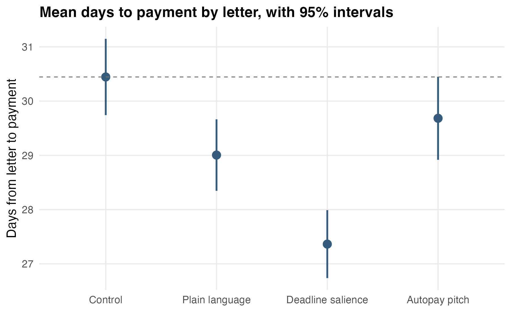
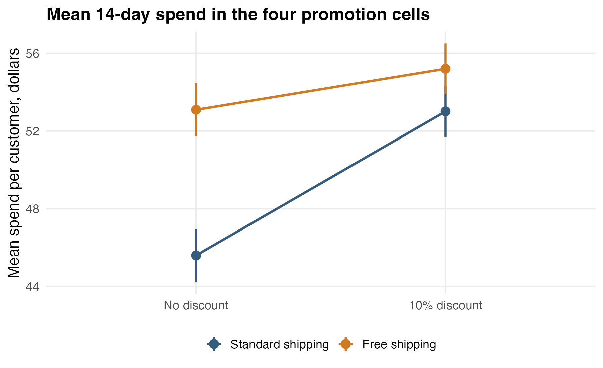
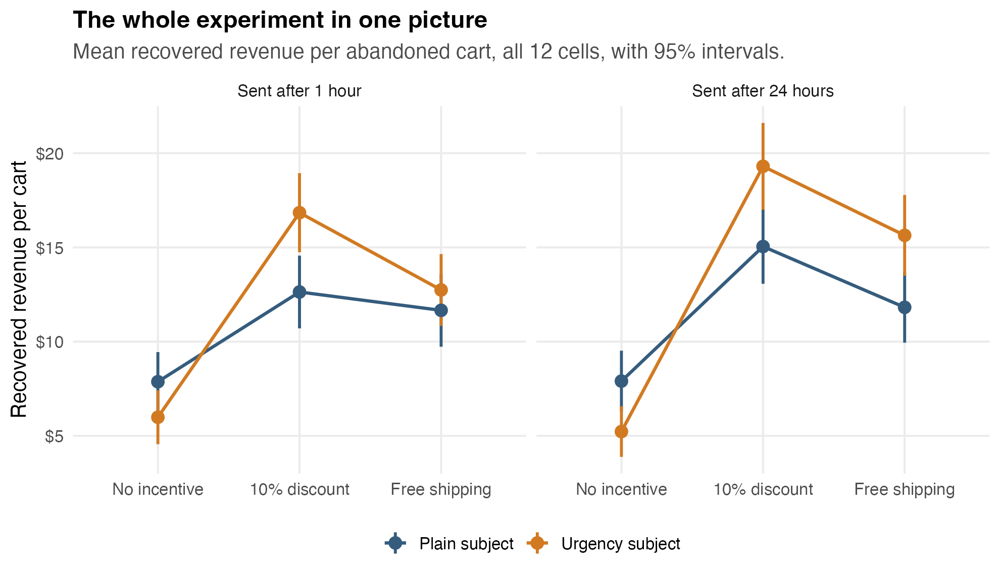
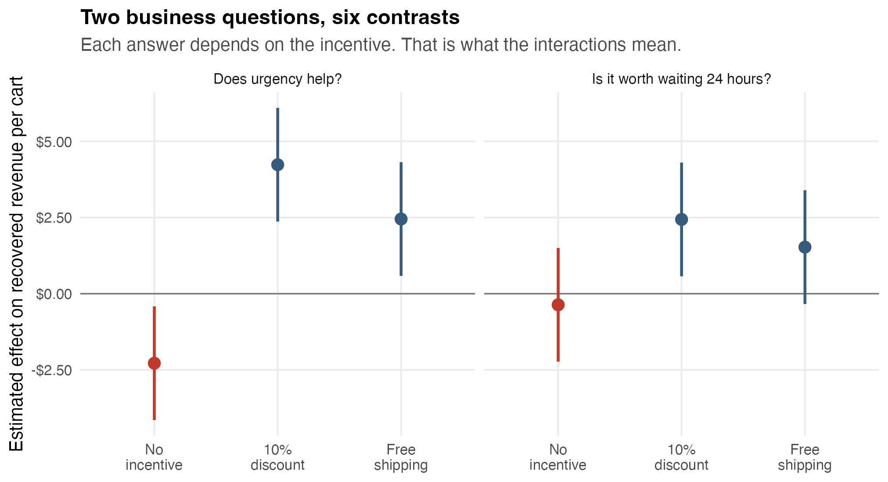
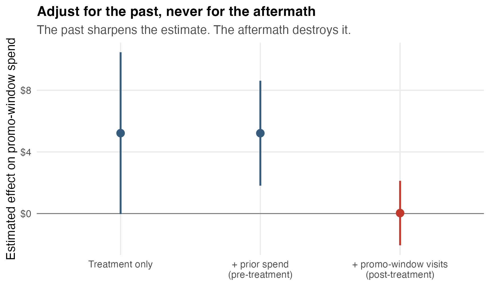

```{r}
#| label: setup
#| include: false
library(tidyverse)
library(broom)
set.seed(382)

module_dir <- if (file.exists("reminder_letters.csv")) {
  "."
} else {
  "modules/09_experiments_as_regression"
}
```

## What changes when the data come from an experiment

Everything in this course so far has been about making fair comparisons. With observational data, fairness is something you have to construct: you identify confounders, adjust for them, and then argue that the adjusted comparison is close enough to the one you wanted.

A randomized experiment builds the fair comparison in advance. When a random number generator decides who gets which treatment, the treatment groups are alike on average in every respect: every variable you measured, and every variable you did not. There is nothing to adjust for, because assignment is unrelated to everything.

That changes the interpretation of a regression coefficient. In observational data, a coefficient is an association, possibly distorted by whatever you failed to adjust for. In a randomized experiment, the coefficient on the treatment variable estimates the causal effect of the treatment.

The model does not change. The `lm()` call does not change. What changes is the design behind the data, and therefore what you are entitled to say about the output.

## The reminder-letter experiment

A Texas electric utility sends a paper reminder letter to residential accounts that are more than 10 days past due. Late payments tie up working capital, so the collections team wants payments to arrive sooner. They drafted three new letters:

- **Plain language.** Shorter sentences, no billing jargon.
- **Deadline salience.** The payment deadline printed in large type, with the consequences of missing it.
- **Autopay pitch.** The standard letter plus a pitch to enroll in autopay.

In one billing cycle, 2,400 past-due accounts were randomly assigned to one of the four letters (the three new ones plus the current letter as control), 600 accounts per arm. The outcome is the number of days from the letter going out to the payment arriving.

Each row is one account:

```{r}
#| echo: true
reminders <- read_csv(file.path(module_dir, "reminder_letters.csv")) |>
  mutate(arm = factor(arm,
    levels = c("control", "plain_language", "deadline", "autopay")
  ))

reminders |> head(5)
```

The letter is the treatment. Days to payment is the response. The other two columns — amount due and the number of late payments in the last 12 months — were measured *before* assignment, which makes them useful for one thing: checking that the randomization worked.

## Checking balance

Randomization is a promise about averages, and it is cheap to verify:

```{r}
#| echo: true
reminders |>
  group_by(arm) |>
  summarize(
    accounts = n(),
    mean_amount_due = mean(amount_due),
    mean_prior_late = mean(prior_late_12mo)
  )
```

The four arms owe about the same amount and have about the same payment history. The differences are the size that chance produces. The point of the balance table is not to prove balance on these two variables; it is a spot-check on the claim that assignment was really random. If the deadline arm somehow owed twice as much as control, you would want to know before interpreting anything.

## Two arms: the A/B test

Start with just two of the arms: control versus deadline salience. This is the classic A/B test.

The entire analysis is a subtraction:

```{r}
#| echo: true
two_group <- reminders |>
  filter(arm %in% c("control", "deadline")) |>
  mutate(deadline_letter = as.integer(arm == "deadline"))

two_group |>
  group_by(deadline_letter) |>
  summarize(mean_days = mean(days_to_payment))
```

Deadline-letter accounts paid about 3.1 days sooner. Regression expresses the same subtraction with a dummy variable:

$$
\text{Days}_i = \beta_0 + \beta_1 \, \text{Deadline}_i + e_i.
$$

```{r}
#| echo: true
two_group_model <- lm(days_to_payment ~ deadline_letter, data = two_group)
tidy(two_group_model, conf.int = TRUE)
```

The intercept is the control-group mean. The coefficient on the dummy is the difference in means, with a standard error and a confidence interval attached. And it is identical to the two-sample t-test:

```{r}
#| echo: true
t.test(days_to_payment ~ deadline_letter, data = two_group, var.equal = TRUE)
```

Same estimate, same standard error, same t statistic, same p-value. A two-group randomized experiment, a pooled t-test, and a one-dummy regression are the same analysis wearing three outfits. The reason to prefer the regression outfit is that it scales: more arms, crossed factors, and adjustment variables all fit in the same framework.

Because assignment was random, the coefficient deserves a causal reading: *sending* the deadline letter causes payment to arrive about 3.1 days sooner on average, with a 95% confidence interval of about 2.1 to 4.0 days.

## Four arms: dummies for a multi-arm experiment

Using all four arms requires nothing new. A categorical variable with four levels enters the regression as three dummies — Module 3's machinery exactly: one baseline group and $K-1$ offsets:

```{r}
#| echo: true
four_arm_model <- lm(days_to_payment ~ arm, data = reminders)
tidy(four_arm_model, conf.int = TRUE)
```

Control is the baseline, so each coefficient compares one letter against control:

- Plain language: about $-1.4$ days.
- Deadline salience: about $-3.1$ days.
- Autopay pitch: about $-0.8$ days, with a confidence interval that includes zero.

The autopay result is worth pausing on. The interval $[-1.74, 0.22]$ says the data are consistent with a small benefit and also with no benefit at all. A well-run experiment is allowed to return that answer, and it is one of the most useful answers an experiment can give: it stops the team from rolling out a letter that probably does nothing.

{fig-alt="Mean days to payment with 95 percent intervals for the four letters. Deadline salience is lowest at about 27.4 days; the autopay interval nearly reaches the control mean." width="90%"}

## One-way ANOVA is this regression

Classical one-way ANOVA asks the omnibus question: are the four group means all equal?

```{r}
#| echo: true
anova(four_arm_model)
```

For these data, $F(3, 2396) = 13.9$ with $p < 0.0001$: the letters are not all the same. That is worth knowing, but notice how little it tells the collections team. "Not all the same" does not say which letter to print next month, or by how much it wins.

ANOVA is not a separate technique. It is the dummy-variable regression above, plus an F test on the group dummies as a set. The regression coefficients are where the actionable content lives.

## Planned contrasts

The questions the experiment was built to answer were written down before it ran:

1. **Is redesigning the letter worth anything at all?** Compare the average of the three new-letter effects against control.
2. **Does deadline salience beat plain language?** Compare those two arms directly.

Each is a specific linear combination of coefficients — a *contrast*.

The first contrast averages the three treatment coefficients. A linear combination of estimates has a standard error that comes from the coefficient covariance matrix:

```{r}
#| echo: true
b <- coef(four_arm_model)
V <- vcov(four_arm_model)

L <- c(0, 1 / 3, 1 / 3, 1 / 3)
est <- sum(L * b)
se <- sqrt(drop(t(L) %*% V %*% L))
c(estimate = est, lower = est - 1.96 * se, upper = est + 1.96 * se)
```

Redesigned letters brought payment in about 1.8 days sooner on average, with an interval of roughly 1.0 to 2.6 days.

The second contrast compares two non-baseline arms. The everyday way to get it is Module 3's releveling move: refit with one of them as the baseline:

```{r}
#| echo: true
releveled <- lm(
  days_to_payment ~ relevel(arm, ref = "plain_language"),
  data = reminders
)
tidy(releveled, conf.int = TRUE) |>
  filter(str_detect(term, "deadline"))
```

Deadline salience beats plain language by about 1.6 days (interval roughly 0.7 to 2.6). Releveling changes nothing about the fitted model — the four fitted group means are identical — it only changes which comparisons are displayed.

A note on reporting. "ANOVA showed a significant effect of letter type" is a weak sentence. A useful report names the winning arm, gives the effect with its units and its interval, and connects it to the decision: at the utility's volume, three days of float has a dollar value, and that number is what gets the letter changed.

## The factorial experiment: two crossed treatments

The second case is an Austin-based online pet-supply retailer with two promotion ideas: a 10% discount code, and a free-shipping offer with no minimum. Email tests run months apart suggested the discount alone lifts 14-day spend by about \$7 per customer and free shipping alone by about \$6.

The CMO's question is about *stacking*: if each offer works alone, does sending both get both lifts? The tempting arithmetic is $7 + 6 = 13$. That forecast assumes the effects add, and nobody has checked.

The right design crosses the two factors. Each of 2,800 customers was randomized to one of four cells — neither offer, discount only, shipping only, or both — with 700 customers per cell:

```{r}
#| echo: true
promo <- read_csv(file.path(module_dir, "promo_experiment.csv"))

promo |>
  group_by(discount, free_shipping) |>
  summarize(n = n(), mean_spend = mean(spend_14d), .groups = "drop")
```

Each offer alone lifts mean spend by about \$7.50. Both offers together produce \$55.20 — about \$9.60 above baseline, not \$15. The interaction plot makes the shortfall visible: if the effects added, the two lines would be parallel, and they are not.

{fig-alt="Interaction plot. With standard shipping, the discount lifts mean spend from about 45.6 to 53 dollars; with free shipping, only from about 53.1 to 55.2. The lines are not parallel." width="90%"}

## The interaction model

The factorial structure calls for a dummy-by-dummy interaction:

$$
\text{Spend}_i = \beta_0
+ \beta_1 \text{Discount}_i
+ \beta_2 \text{Shipping}_i
+ \beta_3 (\text{Discount}_i \times \text{Shipping}_i)
+ e_i.
$$

```{r}
#| echo: true
interaction_model <- lm(spend_14d ~ discount * free_shipping, data = promo)
tidy(interaction_model, conf.int = TRUE)
```

Four cells, four parameters: the model is just the cell means rewritten as comparisons.

- Intercept: baseline spend with neither offer, about \$45.60.
- `discount`: the discount effect *when shipping is standard*, about $+\$7.41$.
- `free_shipping`: the shipping effect *when there is no discount*, about $+\$7.49$.
- `discount:free_shipping`: the difference between the discount effect with free shipping and the discount effect without it, about $-\$5.30$.

So the discount is worth about \$7.41 on its own but only $7.41 - 5.30 = \$2.11$ on top of free shipping. The interaction coefficient's interval, roughly $-8.0$ to $-2.6$, keeps the falloff clearly away from zero. The add-the-lifts forecast of \$60.50 misses the observed \$55.20 by exactly this interaction.

Why offers cannibalize is a business question, not a statistical one — one nudge may be enough to move a fence-sitter, pet-food budgets bind, and both offers may work on the same customers. The experiment cannot distinguish these stories, but it prices the overlap: stacking costs about \$5.30 per customer in forecast error, and the retailer pays for both incentives.

One warning about the main-effects-only model, `spend_14d ~ discount + free_shipping`. It forces the lifts to add, so it splits the difference: it understates each offer alone and overstates the two together. If the design crossed the factors, let the model use the crossing. The interaction term is the entire reason to run a factorial experiment instead of two separate ones.

## Practical issues that decide whether the coefficient means anything

**The assignment unit.** Analyze at the level you randomized. The utility randomized accounts, so one row per account is right. If a company randomizes stores, sessions, or teams, then rows within a unit move together and are not independent observations; treating them as independent overstates the precision. That problem — and its fix — is the subject of the next module.

**Exposure and logging.** Assignment is not exposure: some letters go to stale addresses, some emails land in spam. Log who was assigned, who was exposed, and the outcome, as three separate facts. Pipelines that only record exposure silently drop the unexposed, and the comparison stops being randomized without anyone deciding that.

**Guardrail metrics.** The primary outcome is not the only thing the treatment moves. A deadline letter that speeds payment but doubles complaint calls is not a win; a discount that lifts spend but craters margin is not either. Decide the guardrails before launch, because after launch every metric choice looks like advocacy.

**Noncompliance and intent to treat.** Some accounts assigned the deadline letter never opened it. Comparing only the openers against control breaks the randomization, because openers are the attentive people, not a random subset. The clean estimate is intent to treat: compare groups by assignment, everyone included. ITT answers the question the business actually controls — what happens if we *send* this letter — since you can send letters but cannot make people read them.

## The abandoned-cart factorial: three factors, read through contrasts

The retailer's next problem is bigger than one knob. About 70% of loaded carts never check out, and a recovery email goes to each abandoned cart. Three teams each own one dial on that email: retention owns the incentive (nothing, a 10% code, or free shipping), copy owns the subject line (a plain reminder or an urgency framing), and lifecycle owns the timing (send after 1 hour or after 24 hours).

The tempting plan is for each team to test its own knob against the house default — no incentive, plain subject, 1-hour send. Run on these data, those three tests return three tidy answers: the discount wins; urgency *hurts* (about $-\$2.28$ per cart); timing makes no detectable difference. The assembled recipe is discount, plain subject, sent at 1 hour. Two of those three answers are wrong, and the reason is structural: every one-at-a-time answer is measured in a single context. Urgency was tested on an email with nothing urgent in it; timing was tested on an email with no code for a cold cart to come back for. If a knob's effect depends on another knob's setting, one-at-a-time testing is blind by construction.

The factorial crosses everything: $3 \times 2 \times 2 = 12$ versions, 6,600 abandoned carts, 550 per cell, with revenue recovered within 7 days as the outcome. Every cart informs all three questions simultaneously, which is why one factorial beats three sequential tests even before interactions enter the story.

```{r}
#| echo: true
cart <- read_csv(file.path(module_dir, "cart_recovery.csv")) |>
  mutate(
    incentive = factor(incentive, levels = c("none", "discount10", "free_shipping")),
    subject = factor(subject, levels = c("plain", "urgency")),
    send_delay = factor(send_delay, levels = c("1h", "24h"))
  )
```

{fig-alt="All 12 cell means, faceted by send delay. The urgency and plain lines cross: urgency sits below plain with no incentive and above it with either incentive." width="95%"}

The crossing lines are the headline: urgency sits below plain when the email carries no incentive, and above it when the email carries either one. No sequence of single-knob tests could have drawn this picture.

## Stopping at two-way interactions

The model fits main effects plus all three two-way interactions — ten coefficients for twelve cells:

```{r}
#| echo: true
two_way <- lm(recovered_revenue_7d ~ (incentive + subject + send_delay)^2, data = cart)
tidy(two_way, conf.int = TRUE)
```

Deliberately excluded: the three-way interaction, which would ask whether the subject-by-delay interaction itself differs by incentive. Three reasons to stop. Each three-way estimate rests on a single thin cell, so it is poorly estimated; a three-way interaction is difficult to interpret and rarely maps onto a decision; and in practice higher-order interactions are seldom substantial — main effects carry most of the signal, and two-way interactions most of the rest. Whether stopping cost anything is checkable:

```{r}
#| echo: true
full_fact <- lm(recovered_revenue_7d ~ incentive * subject * send_delay, data = cart)
anova(two_way, full_fact)
```

$F(2, 6588) = 0.94$, $p = 0.39$: the two degrees of freedom sitting in the three-way terms had nothing to say, and a plot of raw cell means against the two-way model's fitted means shows all twelve cells reproduced within noise.

One warning governs the coefficient table: with interactions present, no coefficient is an answer by itself. Each main effect is the effect at the baseline of the other factors — the `subjecturgency` coefficient of $-2.61$ is the urgency effect for a no-incentive email sent at 1 hour, not "the urgency effect."

## Business questions as contrasts

Every prediction from the model is a sum of coefficients, so every comparison of predictions is a linear combination of coefficients — a contrast, with a standard error from the covariance matrix. The machinery is the same `cell_row()` / $L^\top\beta$ arithmetic used for the reminder letters, now doing all the interpretive work.

**Which incentive?** Averaging each incentive's four predicted cells gives its marginal mean: about \$6.75 for no incentive, \$15.96 for the discount, \$12.97 for free shipping. The head-to-head contrast is $+\$2.99$ with interval $[1.67, 4.31]$: the discount wins outright.

**Does urgency help?** The model refuses to give one number, and it is right to refuse. Estimated within each incentive (pooling send times): $-\$2.28$ $[-4.15, -0.42]$ with no incentive; $+\$4.23$ $[2.37, 6.10]$ with the discount; $+\$2.45$ $[0.58, 4.32]$ with free shipping. "Your cart expires tonight" with nothing in it but a reminder reads as spam; give the deadline something to protect and the same subject line earns money. Urgency needs something to be urgent about — that sentence is the interaction coefficient, translated.

**Send now or wait a day?** By incentive: $-\$0.36$ $[-2.23, 1.50]$ with no incentive (a shrug); $+\$2.44$ $[0.57, 4.30]$ with the discount (wait — a day-old cart is cold, and the code is a reason to return); $+\$1.53$ $[-0.34, 3.39]$ with free shipping (probably wait; not settled — an honest leftover uncertainty, which is itself a finding).

{fig-alt="Six contrasts in two panels: urgency effects and 24-hour effects, each within incentive. Urgency is negative with no incentive and positive with both incentives; waiting is positive with the discount and unresolved with free shipping." width="95%"}

That figure, not the coefficient table, is the deliverable: named business questions, each answered by a contrast with an interval.

**The recommendation.** Discount, urgency subject, sent at 24 hours: predicted recovery about \$19.46 per cart, a margin of $+\$2.77$ $[0.61, 4.92]$ over the runner-up (the same email at 1 hour), and $+\$6.67$ per cart — 52% — over the one-at-a-time recipe. At 100,000 abandoned carts a year, that margin is worth roughly \$667K more than the one-at-a-time recipe would have recovered — a gap that arises because two of the three one-at-a-time answers were measured in a context the final email was never going to use.

## Covariate adjustment: sharpening a small experiment

Two months after the factorial test, the same retailer ran a holiday bundle offer. The merchandising calendar left room for only 1,000 customers, randomized 50/50, with spend during the promo window as the outcome.

```{r}
#| echo: true
holiday <- read_csv(file.path(module_dir, "holiday_promo.csv"))

naive_model <- lm(spend_promo ~ treat, data = holiday)
tidy(naive_model, conf.int = TRUE)
```

The estimate is $+\$5.22$ with a 95% interval of $[-0.03, 10.47]$ and $p = 0.051$. After two months of planning, the interval straddles zero, and the experiment is inconclusive as it stands.

The rescue was sitting in the data all along. Each row carries the customer's spend in the 90 days *before* the experiment, and heavy spenders stayed heavy: prior spend correlates with the outcome at about $r = 0.76$. Because it was measured before randomization, it is balanced across arms by design — regressing it on treatment gives a difference of half a cent with $p = 0.999$. There is no confounding to fix. That is precisely why it is safe to use:

```{r}
#| echo: true
adjusted_model <- lm(spend_promo ~ treat + spend_prior_90d, data = holiday)
tidy(adjusted_model, conf.int = TRUE)
```

The treatment estimate does not move — $5.2198$ becomes $5.2164$ — but the standard error falls from $2.68$ to $1.74$, and the interval becomes $[1.81, 8.62]$ with $p = 0.003$. Whatever the covariate explains about the outcome leaves the error term, and the treatment coefficient's noise shrinks with it. Randomization guarantees a pre-treatment covariate cannot move the estimate; it can only sharpen it.

The precision gain is worth $1/(1 - r^2) \approx 2.4$: adjusting for prior spend was equivalent to running the experiment on 2,400 customers instead of 1,000. Large experimentation platforms apply this to every test they run under the name CUPED, and the whole recipe is one line of regression: take your best *pre-treatment* predictor of the outcome and put it in the model.

The italics carry the warning. The data also contain visits during the promo window, which predict spend even better than prior spend does. Adding them looks like more free precision:

```{r}
#| echo: true
posttreat_model <- lm(spend_promo ~ treat + spend_prior_90d + visits_promo, data = holiday)
tidy(posttreat_model, conf.int = TRUE)
```

The treatment effect collapses to $\$0.03$ with an interval of $[-2.06, 2.13]$. Nothing went wrong with the offer; something went wrong with the question. The offer works largely *by causing visits* — treated customers came to the site more, and visitors spend. Promo-window visits are a consequence of the treatment, so holding them fixed asks what the offer does among people whose visiting behavior it failed to change. The answer to that question really is close to zero — but it was not the question the experiment was run to answer.

This is the model-building module's post-treatment rule with an experiment attached, and the operational version is simple: the clock decides. Variables measured before randomization are safe and often valuable; variables measured after randomization are off limits, no matter how well they predict the outcome.

{fig-alt="Three treatment-effect estimates: naive at 5.22 with an interval touching zero, prior-spend adjusted at 5.22 with a tight interval, and post-treatment adjusted at 0.03 centered on zero." width="90%"}

## Summary

- Randomization makes the treatment groups alike on average in everything, measured and unmeasured, so the treatment coefficient estimates a causal effect.
- A two-group experiment, a pooled t-test, and a one-dummy regression are the same analysis. The regression version scales.
- Multi-arm experiments use the dummy-variable machinery of Module 3; each coefficient compares an arm to the baseline, and releveling changes which comparisons are displayed without changing the fitted means.
- The omnibus ANOVA F test answers a vague question. Planned contrasts — linear combinations of coefficients, often obtained by releveling — answer the questions the experiment was designed for.
- Crossed treatments need an interaction term, and the interaction coefficient is a difference of treatment effects. Effects need not combine additively.
- Testing knobs one at a time measures each in a single context; crossing the factors is the only design that can see an answer change with context. In a bigger factorial, fit main effects plus two-way interactions, check that the higher-order terms are silent, and answer every business question as a contrast — a marginal mean, a within-level effect, or a difference of predicted cells.
- A strong pre-treatment covariate is free sample size: it cannot move a randomized estimate, only sharpen it. A post-treatment variable can erase a real effect — the clock decides what is safe to adjust for.
- Assignment unit, exposure logging, guardrail metrics, and intent-to-treat discipline determine whether the regression output deserves the causal reading.
