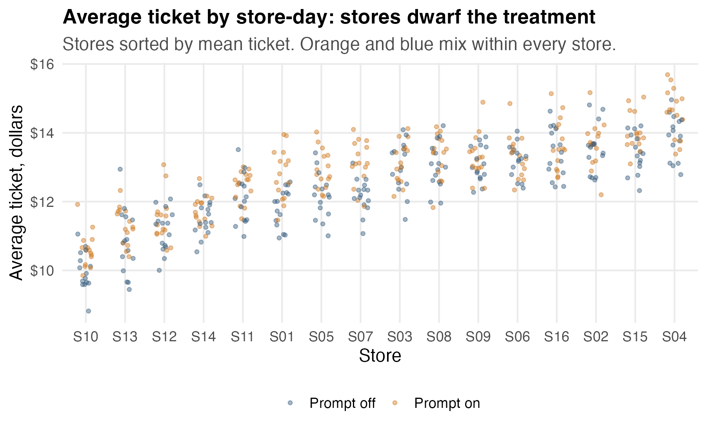
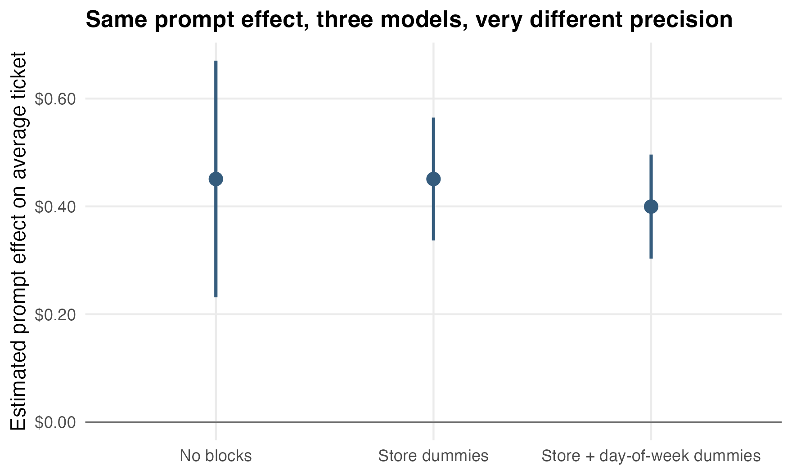
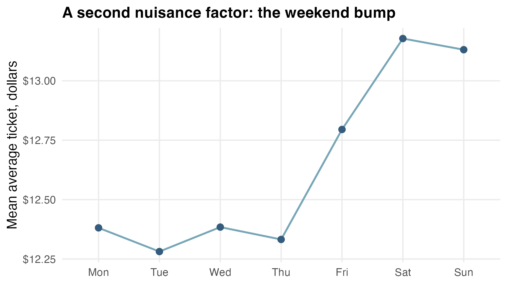
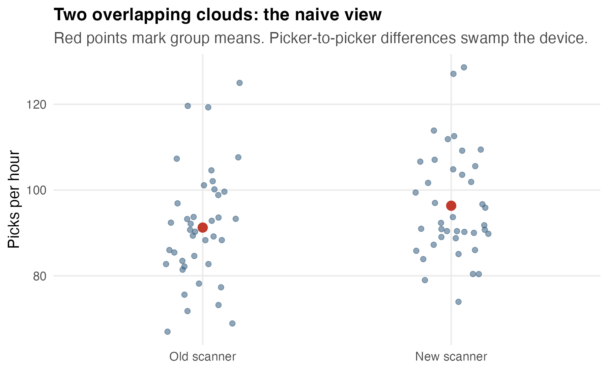
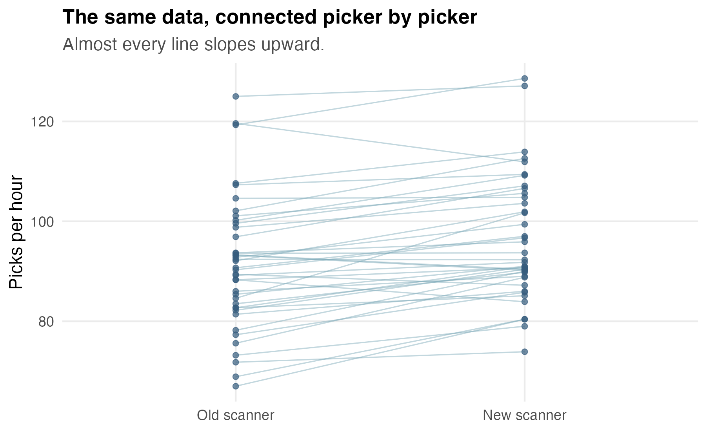
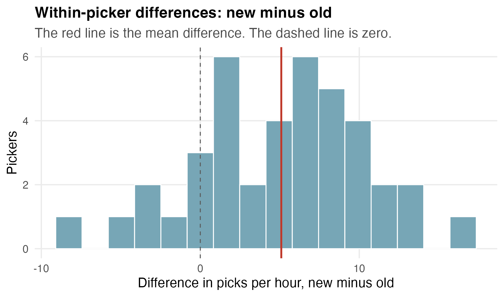

## Today {.smaller}

Last module, every experimental unit was interchangeable: one account, one customer.

Real experiments run inside structure: stores, batches, evaluators, shifts, people measured twice.

Today:

- blocking: randomize within groups, compare within groups,
- fixed effects: many dummies that absorb nuisance variation,
- paired and repeated measurements: each unit as its own control,
- when a nuisance factor belongs in the design, the model, or the caveats.

## An upsell problem

A Texas fast-casual taco chain has self-order kiosks.

Product wants the kiosk to suggest a drink at checkout:

> "Add a large agua fresca for \$1.50?"

Does the prompt raise the average ticket, and by how much?

Finance will roll it out chain-wide if the lift is real.

## You cannot randomize customers here

The prompt is a kiosk configuration.

It is on or off for the whole store, all day.

So the thing being randomized is not a customer.

It is a **store-day**.

For each store, each day is a coin flip: prompt on or prompt off.

16 stores, 30 days: 480 store-days, half on, half off *within every store*.

## One row

Each row is one store-day.

| store | day | day of week | prompt | avg ticket |
|:------|----:|:------------|-------:|-----------:|
| S01   |   1 | Mon         |      0 |      11.62 |
| S01   |   2 | Tue         |      1 |      12.07 |
| S01   |   3 | Wed         |      1 |      13.19 |
| S01   |   4 | Thu         |      0 |      11.45 |
| S10   |  28 | Sun         |      0 |      10.50 |

The treatment lives at the store-day level.

So the analysis does too.

## The stores are not alike

{fig-alt="Jittered points of average ticket by store, sorted from about 10 dollars to about 14 dollars mean. Prompt-on and prompt-off days mix within every store, and store differences are much larger than any within-store treatment difference." width="92%"}

Store means run from about \$10.30 to \$14.20.

The effect we are hunting is a few dimes.

## The naive regression

Ignore stores. One dummy:

``` r
lm(avg_ticket ~ prompt)
```

$$
\widehat{\text{Ticket}} = 12.39 + 0.45\,(\text{Prompt}),
\qquad 95\%\ \text{CI: } [0.23,\ 0.67].
$$

The estimate is fine — randomization within stores balanced everything.

But the interval says "somewhere between 23 and 67 cents."

Finance cannot price a rollout with that.

## Where the noise came from

The naive model has one error bucket.

Into that bucket went:

- day-to-day randomness *within* a store,
- and the entire \$4 spread *between* stores.

The between-store spread has nothing to do with the prompt.

It is **nuisance variation**: real, large, and not what we asked about.

## The blocking idea

We already randomized within each store.

So compare within each store:

> on prompt days, was store S01 above its own normal? Was S02? Was S03?

Each store serves as a **block**: a mini-experiment run on more comparable units.

Then pool the 16 within-store comparisons.

## Fixed effects: blocks in regression form

``` r
lm(avg_ticket ~ prompt + store_id)
```

Fifteen store dummies absorb each store's baseline.

$$
\widehat{\text{Prompt effect}} = 0.45,
\qquad 95\%\ \text{CI: } [0.34,\ 0.57].
$$

Same point estimate, to the fourth decimal.

Half the interval width.

## Nothing moved except the precision

{fig-alt="Three point estimates near 40 to 45 cents. The naive interval spans 23 to 67 cents. The store-dummy interval spans 34 to 57 cents. The store plus day-of-week interval spans 30 to 50 cents." width="90%"}

Randomization already protected the estimate from bias.

Blocking protects it from noise.

Those are different jobs.

## Fixed effects are dummies you never read

The store model has 15 store coefficients. Nobody interprets them.

They are there to *absorb* stable store differences — location, menu mix, clientele — so the residual bucket holds only within-store noise.

That is all "fixed effects" means:

> many dummies for a nuisance grouping, included so the comparison of interest happens within groups.

## A second nuisance factor

{fig-alt="Line plot of mean ticket by day of week. Monday through Thursday sit near 12.30 to 12.40 dollars; Friday, Saturday, and Sunday rise to about 12.80 to 13.20 dollars." width="82%"}

Weekends run about 80 cents hotter.

The coin flips did not block on day of week.

They only balanced it *on average*.

## Add the day-of-week dummies

``` r
lm(avg_ticket ~ prompt + store_id + day_of_week)
```

$$
\widehat{\text{Prompt effect}} = 0.40,
\qquad 95\%\ \text{CI: } [0.30,\ 0.50].
$$

The estimate moved a little: by chance, prompt-on days landed slightly unevenly across weekdays.

The interval tightened a little more.

## Design versus after-the-fact adjustment

Store was **in the design**: 15 on-days and 15 off-days per store, guaranteed. Day of week was only **in the model**: balanced by luck, adjusted afterward.

- A blocked factor *cannot* be imbalanced. The guarantee is structural.
- An adjusted factor relies on the model being right, and on your having measured it.

**Block what you can. Model what you must.**

## Design, model, or caveat?

For each nuisance factor, ask what you can control:

| You can... | Then... | Example here |
|:----------------------|:----------------|:----------------------|
| force balance when randomizing | put it in the **design** | 15/15 within each store |
| measure it but not control assignment | put it in the **model** | day of week |
| neither measure nor control it | put it in the **caveats** | a rival's promo next door |

The third row is why experiments still need honest write-ups.

## What the chain learned

> Turning the prompt on raises the average ticket by about \$0.40 (95% CI: \$0.30 to \$0.50), estimated from within-store comparisons across 16 stores and 30 days.

At roughly 900 tickets per store-day, that is about \$360 per store per day.

The blocked analysis did not change the answer.

It changed how confidently the chain could act on it.

## The 432,000-row temptation {.smaller}

Every store-day in this experiment summarizes about 900 individual tickets.

The full ticket log has **432,000 rows**. Surely 432,000 rows beat 480?

Zoom into one store — S07, 30 days, 27,000 tickets — and run the *same comparison* both ways:

| analysis | rows | estimate | 95% CI |
|:---------------------|-------:|---------:|:------------------|
| individual tickets | 27,000 | \$0.94 | $[0.77,\ 1.11]$ |
| store-day means | 30 | \$0.94 | $[0.50,\ 1.37]$ |

Same estimate, to four decimals.

The 27,000-row interval is **2.5 times too narrow** — a false precision.

## n is the number of coin flips {.smaller}

The coin was flipped once per **store-day**, not once per ticket.

All 900 tickets in a day share that one flip — and the day's weather, staffing, and foot traffic. Rows that share a flip are not independent evidence.

> **Analyze at the level you randomized.** Aggregate rows to the randomized unit, or use a model that respects the grouping — the mixed models of module 7.

The store-day means were never a convenience. They were the correct unit all along.

## A scanner problem

A grocery distributor runs a warehouse in San Marcos.

Pickers use handheld RF scanners. A vendor claims its new ergonomic model speeds up picking.

New scanners cost \$1,100 each, and the warehouse would need 300.

The pilot: 40 pickers.

Outcome: picks per hour over a week of shifts.

## The design: everyone uses both

Each picker works one week on the **old** scanner and one week on the **new** — order decided by a coin flip per picker, 20 starting with each.

That ordering trick is called **counterbalancing**. Hold that thought.

Each row is one picker-week:

| picker | week | device | picks per hour |
|:-------|-----:|:-------|---------------:|
| P01    |    1 | old    |           67.0 |
| P01    |    2 | new    |           80.4 |
| P02    |    1 | new    |           90.7 |
| P02    |    2 | old    |           88.3 |

## The naive comparison

{fig-alt="Two jittered clouds of points, old scanner and new scanner, spanning roughly 65 to 128 picks per hour each. The clouds overlap heavily. Red group means sit at about 91 and 96." width="88%"}

Old mean: 91.2. New mean: 96.3.

``` r
lm(picks_per_hour ~ device)
```

$$
+5.09 \text{ picks/hr}, \quad 95\%\ \text{CI: } [-0.61,\ 10.80], \quad p = 0.08.
$$

Verdict: no detectable effect. Meeting over?

## What the naive analysis threw away

The two clouds overlap because **pickers differ enormously**.

The fastest pickers run near 125 picks per hour. The slowest near 70.

That spread — experience, fitness, route knowledge — lands in the error bucket.

But this experiment measured *every picker on both devices*.

The naive model never used that fact.

## Connect the dots

{fig-alt="Slope graph connecting each picker's old-scanner and new-scanner picks per hour. Nearly all 40 lines slope upward from old to new." width="88%"}

Same 80 numbers as the previous slide.

34 of 40 lines slope upward.

The effect was there all along, hiding behind picker-to-picker spread.

## Within-picker differences

{fig-alt="Histogram of 40 within-picker differences, centered near positive 5 picks per hour, with most mass above zero and a dashed line at zero." width="84%"}

Mean difference: $+5.1$ picks per hour.

85% of pickers improved.

The paired t-test on these differences: $t = 6.1$.

## Pairing is regression with person dummies

``` r
t.test(diffs$new - diffs$old)          # the paired t-test

lm(picks_per_hour ~ device + picker_id)  # the same comparison
```

Thirty-nine picker dummies absorb each picker's baseline speed.

$$
\widehat{\text{Device effect}} = +5.09,
\qquad 95\%\ \text{CI: } [3.40,\ 6.79].
$$

Same $+5.09$ as the naive model.

The standard error fell from $2.86$ to $0.84$.

## Each unit as its own control

Pairing is blocking pushed to the limit: block size two.

The comparison never crosses a person.

So *everything* stable about a person — skill, experience, effort — cancels out exactly.

This is why paired designs, before/after measurements on the same unit, and within-subject studies punch so far above their sample size.

40 pickers settled a \$330K question.

## Why counterbalance?

Week 2 came with a learning bump: everyone knew the routes a little better.

$$
\widehat{\text{Week 2 effect}} \approx +1.6 \text{ picks/hr}.
$$

If every picker had used the new scanner second, that bump would have been *inside* the device effect. Inseparable.

Because order was randomized, the bump splits evenly across devices — and we can model it:

``` r
lm(picks_per_hour ~ device + factor(week) + picker_id)
```

Device effect: $+5.09$, CI $[3.46,\ 6.73]$. Barely moves.

## Fixed effects or random effects?

The hierarchical-models module handled grouped data with partial pooling. Which tool when?

**Fixed effects** (this module): a handful to a few hundred groups, decent data per group, and the groups are nuisance — you only want them out of the way.

**Partial pooling** (`stan_lmer`): many groups, sparse or unbalanced data, or the group-level estimates are themselves the deliverable.

Here: 40 pickers, 2 balanced measurements each, nobody cares about individual pickers.

Fixed effects are the simple, right-sized tool.

## What to report {.smaller}

Weak report:

> The device difference was not significant in the raw comparison but became significant after adjustment.

Better report:

> Across 40 pickers who each used both devices, the new scanner added 5.1 picks per hour (95% CI: 3.4 to 6.8), about a 5.6% throughput gain. Order effects were counterbalanced and modeled.

Decision math: 5.6% of throughput against \$330K of hardware.

## What blocks look like in the wild {.smaller}

- **Batches**: resin lots, wafer runs, reagent kits.
- **Sites**: stores, clinics, warehouses, campuses.
- **Evaluators**: graders, radiologists, QA reviewers, taste panels.
- **Time**: shifts, days, seasons, semesters.
- **Units measured repeatedly**: patients, machines, sales reps, pickers.

The pattern never changes:

> randomize within the block if you can, put the block dummies in the model, and read only the treatment coefficient.

## What to carry forward {.smaller}

1. Nuisance variation is real variation you did not ask about. Left alone, it lands in the error term and buries the effect.
2. Blocking = randomizing within groups. It attacks noise; randomization already handled bias.
3. Fixed effects = block dummies you include but never interpret.
4. A blocked factor is guaranteed balanced; an adjusted factor is balanced by hope.
5. Paired and repeated measurements make each unit its own control — the strongest block there is.
6. Counterbalance order when units are measured more than once.

Next module: what to do when you could not randomize at all, but the world handed you a before/after or a threshold.
