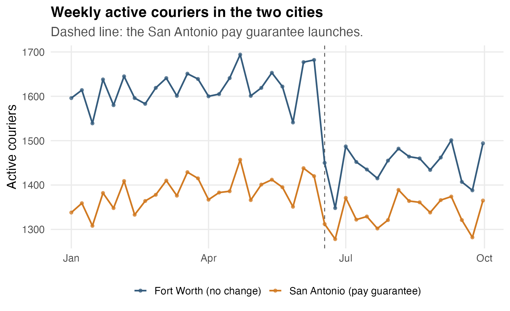
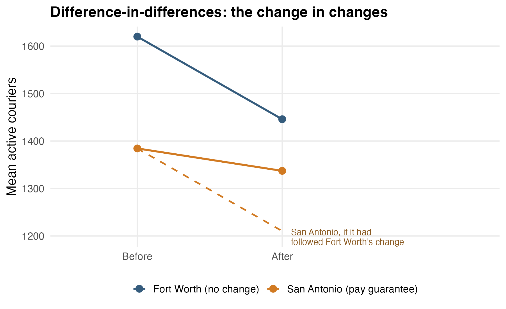
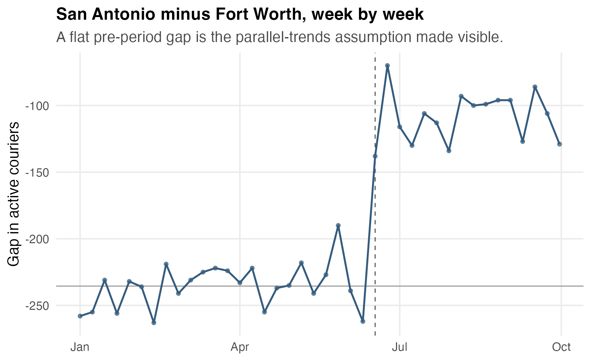
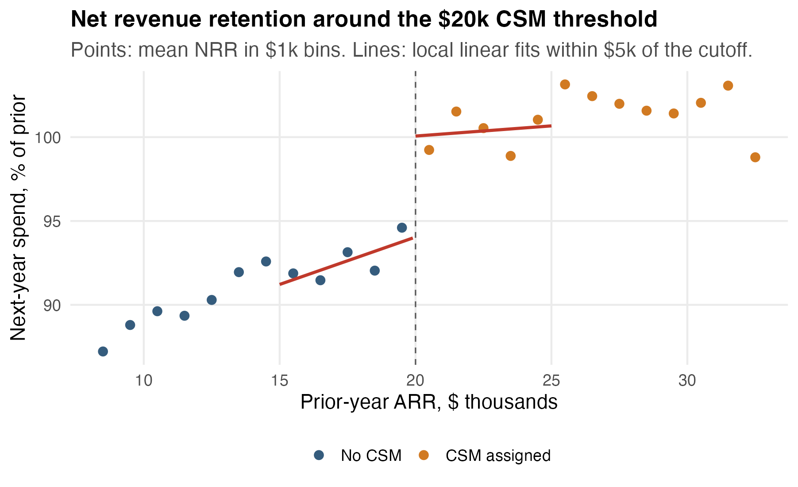
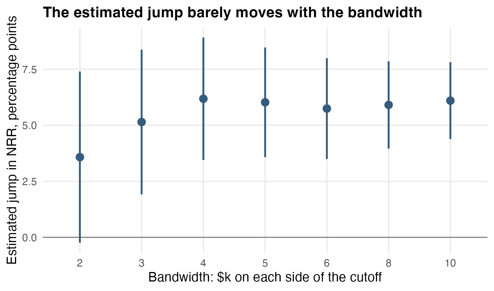
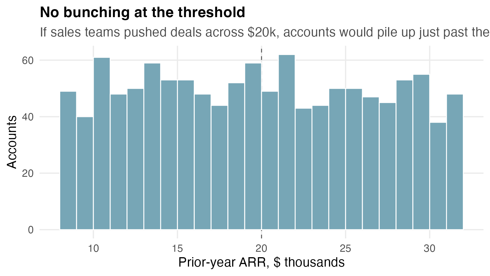

## Today {.smaller}

The last two modules assumed you got to randomize. Often you cannot: the launch already happened, or randomizing would be unfair or impossible.

Today, two designs that recover a credible comparison from structure the data already have:

- **difference-in-differences**: before/after data plus a comparison group,
- **regression discontinuity**: a threshold rule plus the observations near it.

In both, the regression is easy; the credibility lives in the assumptions.

## A courier problem

A restaurant delivery marketplace is losing couriers in San Antonio.

Ops proposes a **guaranteed hourly minimum**: if fares fall short of \$18/hour while active, the company tops it up.

It is expensive, so in mid-June the guarantee launches in **San Antonio only**, with the CFO watching.

> Did the guarantee keep couriers on the platform?

## One row

Each row is one city-week.

| city        | week | week start | treated | post | active couriers |
|:------------|-----:|:-----------|--------:|-----:|----------------:|
| fort_worth  |    1 | 2024-01-01 |       0 |    0 |            1596 |
| san_antonio |    1 | 2024-01-01 |       1 |    0 |            1338 |
| fort_worth  |   13 | 2024-03-25 |       0 |    0 |            1639 |
| san_antonio |   13 | 2024-03-25 |       1 |    0 |            1415 |

`treated`: is this the guarantee city?

`post`: is this week after the mid-June launch?

## The tempting analysis

Compare San Antonio before and after launch:

| period          | mean active couriers |
|:----------------|---------------------:|
| before (24 wks) |                 1384 |
| after (16 wks)  |                 1337 |

San Antonio **lost 47 couriers** after the guarantee launched.

Verdict: the guarantee failed?

## What before/after quietly assumes

The before/after comparison treats *time* as the only thing that changed.

But mid-June, something else happened statewide:

> a rideshare company launched a big driver-recruitment promotion, and delivery couriers everywhere started defecting.

The guarantee launched into a headwind.

Before/after cannot tell the policy apart from the headwind.

## Look at both cities

{fig-alt="Two weekly time series from January to October. Fort Worth runs near 1620 couriers and San Antonio near 1385, tracking each other's wiggles. At the mid-June dashed line, both cities drop, but Fort Worth falls much further than San Antonio." width="92%"}

Fort Worth got the headwind but **not** the guarantee.

Both cities fell. Fort Worth fell much harder.

## The four means

|             |  before |   after |   change |
|:------------|--------:|--------:|---------:|
| Fort Worth  | 1620 | 1446 | $-174$ |
| San Antonio | 1384 | 1337 |  $-47$ |

Fort Worth's change estimates the headwind: $-174$ couriers.

San Antonio's change mixes headwind and guarantee: $-47$.

The **difference in the differences**:

$$
(-47) - (-174) = +127 \text{ couriers}.
$$

## The change in changes

{fig-align="center" fig-alt="Fort Worth's mean falls from 1620 to 1446. San Antonio's falls from 1384 to 1337. A dashed line shows where San Antonio would have landed had it matched Fort Worth's decline: about 1210. The actual San Antonio point sits about 127 couriers above the dashed line." width="66%"}

The dashed line is the claim:

> without the guarantee, San Antonio would have followed Fort Worth's slide.

The gap between dashed and actual is the effect.

## Difference-in-differences as regression

``` r
lm(active_couriers ~ treated * post)
```

$$
\begin{aligned}
\widehat{\text{Couriers}}
= 1620
&- 235\,(\text{Treated})
- 174\,(\text{Post}) \\
&+ 127\,(\text{Treated} \times \text{Post}).
\end{aligned}
$$

Four coefficients, four cell means. The interaction **is** the change in changes.

## Reading the coefficients

- $1620$: Fort Worth, before. The baseline cell.
- $-235$: San Antonio's permanent gap. It was always the smaller market.
- $-174$: the headwind. What happened to the *untreated* city after launch.
- $+127$: the guarantee effect. How much San Antonio beat its expected slide.

The first three are scenery. The interaction is the answer:

$$
+127 \text{ couriers}, \quad 95\%\ \text{CI: } [93,\ 161].
$$

## A module-10 upgrade

The market-wide wiggles are shared week shocks — nuisance variation with a name.

Week dummies absorb them:

``` r
lm(active_couriers ~ treated + factor(week) + treated:post)
```

$$
+127 \text{ couriers}, \quad 95\%\ \text{CI: } [115,\ 138].
$$

Same estimate. Much tighter interval.

Blocks, fixed effects, and DiD are one toolkit, not three.

## The assumption you just bought

**Parallel trends**, in ordinary language:

> if the guarantee had never launched, San Antonio's courier count would have moved the way Fort Worth's did.

The claim is about the *changes*, not the levels — the cities can differ permanently.

It is unverifiable in the post period — that is exactly the counterfactual.

But it leaves fingerprints in the pre period.

## Checking the fingerprints

{fig-alt="Weekly gap between San Antonio and Fort Worth courier counts. Before the launch line the gap wobbles around minus 235 with no trend. After launch the gap jumps by roughly 127 and stays there." width="90%"}

Before launch, the gap is flat: the cities moved together for six months.

That does not prove parallel trends. It makes them plausible.

A drifting pre-period gap would have killed this analysis.

## What breaks difference-in-differences {.smaller}

- **A local co-event.** San Antonio raised parking fines for couriers the same month? The interaction absorbs it, wrongly.
- **Composition change.** The guarantee attracts *new* couriers while old ones still quit. "Active couriers" counts both; retention and recruitment get blended.
- **Anticipation.** Couriers heard rumors in May and stuck around; the "before" period is contaminated.
- **Targeted timing.** If SA got the policy *because* it was suddenly bleeding couriers, mean reversion masquerades as an effect.
- **Two markets.** One treated and one control city is the minimum viable design; every added market makes the uncertainty statement more credible.

None of these appear in the regression output.

They appear when you ask how the launch was decided.

## What to report {.smaller}

Weak report:

> Couriers declined 3.4% after launch, so the guarantee was ineffective.

Better report:

> Relative to Fort Worth, San Antonio retained about 127 more couriers per week (95% CI: 115 to 138) after launch. Pre-period trends were parallel. The caveat: no other San Antonio-specific shock at launch.

Estimate, design, evidence for the assumption, caveat.

## A customer-success problem

An Austin B2B software company assigns a named **customer success manager** (CSM) to every account with prior-year ARR of **\$20,000 or more**.

Below the line: self-serve support only.

CSMs are expensive. The CFO asks:

> does the CSM program actually improve retention?

The outcome: **net revenue retention** — next-year spend as a percent of prior-year spend.

## One row

Each row is one account at renewal time.

| account | prior ARR (\$k) | CSM | next-year spend (%) |
|:--------|----------------:|----:|--------------------:|
| K8322   |            11.5 |   0 |                90.9 |
| K6685   |            18.1 |   0 |               101.0 |
| K8132   |            19.2 |   0 |                94.0 |
| K7652   |            21.3 |   1 |                95.6 |

The \$20k rule decides the treatment.

Nobody randomized anything.

## The tempting analysis

Compare all CSM accounts against all non-CSM accounts:

| group        | accounts | mean NRR |
|:-------------|---------:|---------:|
| no CSM       |      610 |    91.1% |
| CSM assigned |      590 |   101.4% |

"+10.3 points! The program pays for itself!"

But CSM accounts are, by the rule itself, the **bigger** accounts — and bigger accounts retain better with or without help.

The comparison is confounded by the very variable that assigns treatment.

## The threshold is the opportunity

Compare two accounts: one at **\$19.8k** ARR, one at **\$20.2k**.

As businesses they are interchangeable — yet the rule treats them completely differently.

> Right at the cutoff, the rule behaves like a coin flip.

That is **regression discontinuity**: a local experiment the threshold runs for free.

## The picture

{fig-alt="Mean NRR rises smoothly with account size from about 87 percent at 8k to about 95 percent just below 20k. At the dashed 20k cutoff the points jump up by about 6 points, then continue rising gently through 32k." width="92%"}

Two things are true at once:

- retention rises smoothly with account size,
- and it **jumps** at the line where CSMs begin.

The smooth part is size. The jump is the program.

## The regression discontinuity model

Center the running variable at the cutoff and let each side of a window have its own line:

``` r
local <- filter(accounts, abs(arr_prior_k - 20) <= 5)

lm(renewal_spend_pct ~ I(arr_prior_k - 20) * csm, data = local)
```

The `csm` coefficient is the vertical gap between the two fitted lines *at the cutoff*:

$$
+6.0 \text{ points}, \quad 95\%\ \text{CI: } [3.6,\ 8.5].
$$

Not $+10.3$: the naive comparison was crediting the program with account size.

## This is local curve fitting

You met this machinery in the smoothing module.

RD is local linear regression with one addition: the curve is allowed to **break** at the cutoff, and the size of the break is the estimate.

The window width is the same **bandwidth** tradeoff as before:

- narrow window: cleaner comparison, fewer accounts, noisier estimate,
- wide window: more accounts, but the straight line must now survive curvature.

## Bandwidth sensitivity

{fig-align="center" fig-alt="Point estimates with confidence intervals for bandwidths of 2 through 10. The 2k bandwidth gives a noisy estimate near 3.6 with an interval crossing zero. From bandwidth 3 up, estimates settle between 5 and 6 with intervals well above zero." width="72%"}

At \$2k the window holds only 229 accounts: honest but noisy.

From \$3k on, the estimate settles near $+6$.

A global quadratic with a jump gives $+5.9$.

Report the sensitivity table, not one privileged number.

## The assumption you just bought

Everything else about an account must move **smoothly** through \$20k.

The estimate breaks if:

- other perks kick in at the same \$20k line (priority support, better SLAs),
- or accounts **sort** themselves across the line.

Sorting is the sneaky one: if sales reps pad contracts to push clients past \$20k, the accounts just above the line are the ones with pushy reps — not fair comparisons.

## The bunching check

{fig-alt="Histogram of prior-year ARR from 8k to 32k. Bar heights are roughly even across the range, with no spike in the bin just above 20k." width="86%"}

If deals were being pushed across the line, accounts would pile up just past \$20k.

They do not.

A spike just above the cutoff would have been disqualifying.

## What RD estimates, exactly

The jump is the CSM effect **for accounts near \$20k**. It says nothing direct about a \$500k enterprise account.

Often the local answer is the decision-relevant one anyway:

> "Should we lower the threshold to \$15k?" is a question about marginal accounts — exactly the ones RD describes.

## What to report {.smaller}

Weak report:

> CSM accounts retain 10 points better than non-CSM accounts.

Better report:

> Among accounts near the \$20k threshold, crossing into CSM coverage raises next-year retention by about 6 points (95% CI: 3.6 to 8.5 at a \$5k bandwidth; estimates of 5 to 6 across bandwidths). No bunching appears at the cutoff, and no other benefit changes at \$20k. The estimate applies to mid-sized accounts near the line, not to the largest accounts.

## Two designs, one logic

Neither design randomized anything. Each found a comparison the world had already built:

- **DiD**: a group that got the same *shocks* but not the treatment. Credibility = parallel trends.
- **RD**: neighbors on either side of an arbitrary line. Credibility = nothing else changes at the line.

In both, the estimate is one regression coefficient.

The work is arguing the comparison is fair — and showing the picture that makes the argument.

## What to carry forward {.smaller}

1. A naive before/after comparison assumes the world stood still. It rarely did.
2. DiD = group-by-post interaction. The coefficient is a change in changes.
3. Parallel trends is a claim about counterfactual changes. Check its pre-period fingerprints.
4. RD compares near-identical neighbors across a threshold rule. The jump at the cutoff is the effect.
5. Vary the bandwidth, check for bunching, and confirm nothing else changes at the line.
6. Both estimates are local to their design: DiD to this rollout, RD to accounts near the cutoff. Say so.
