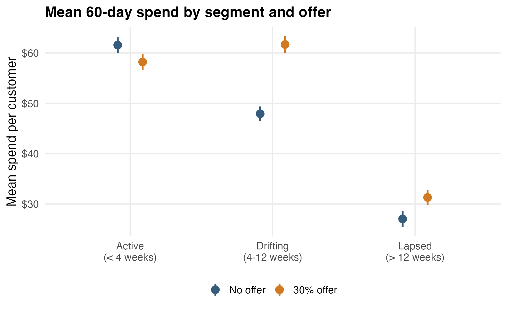
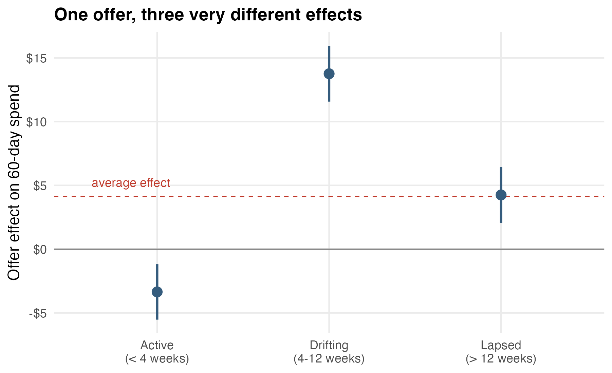
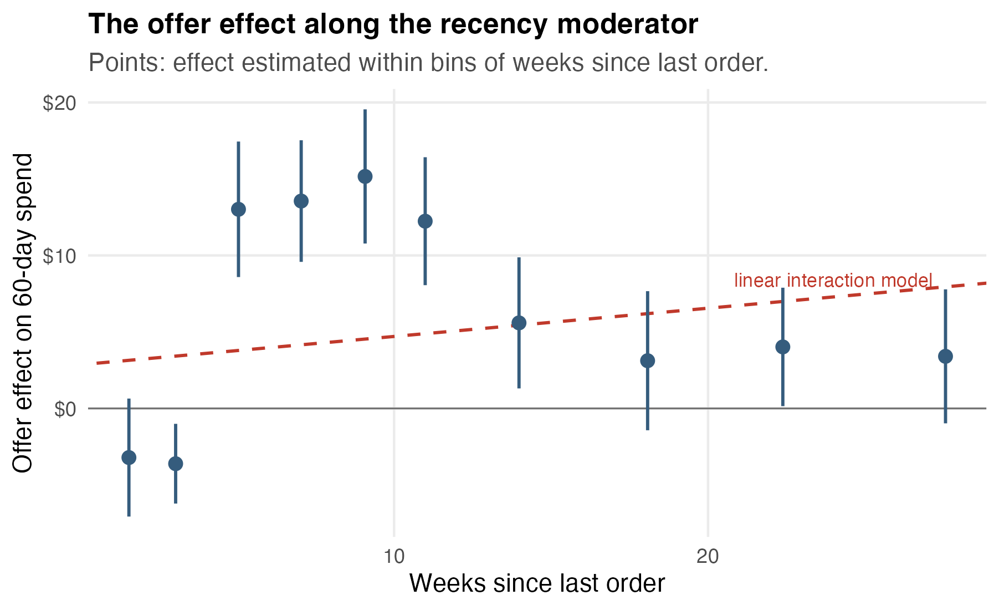
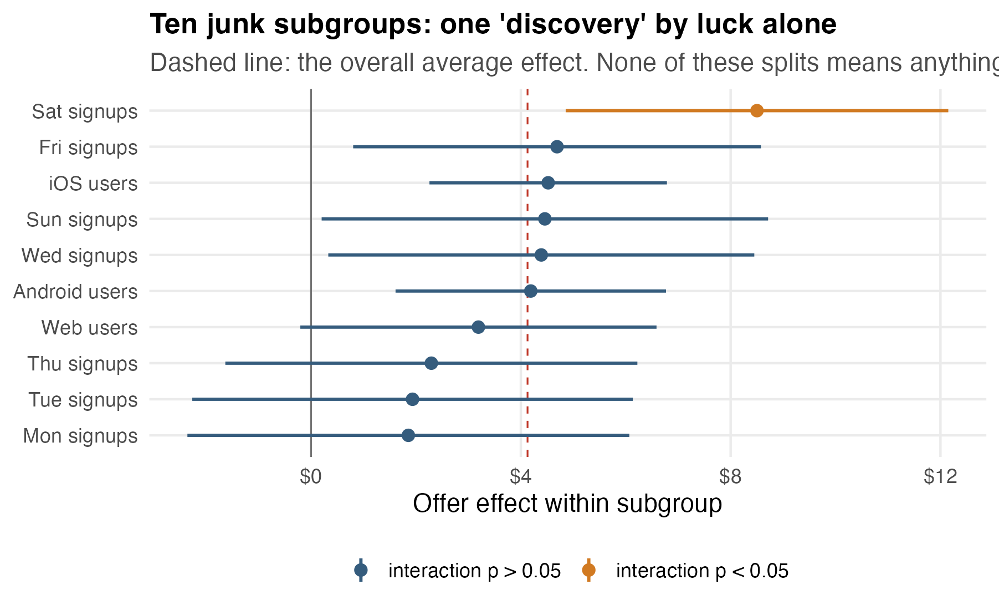
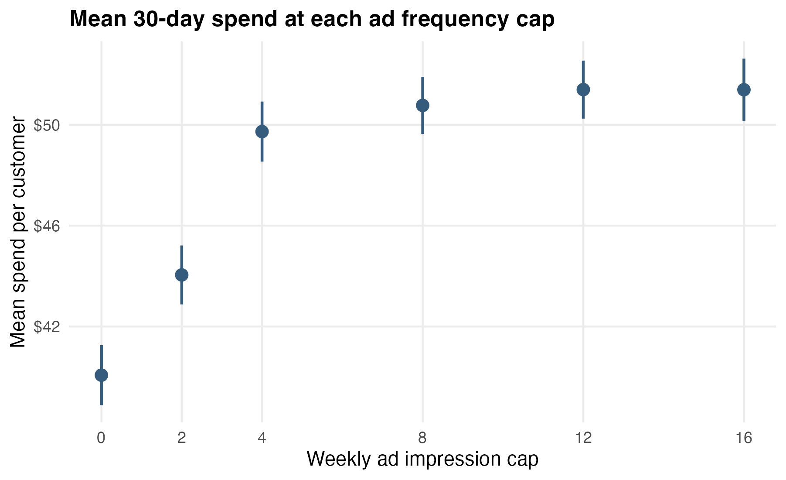
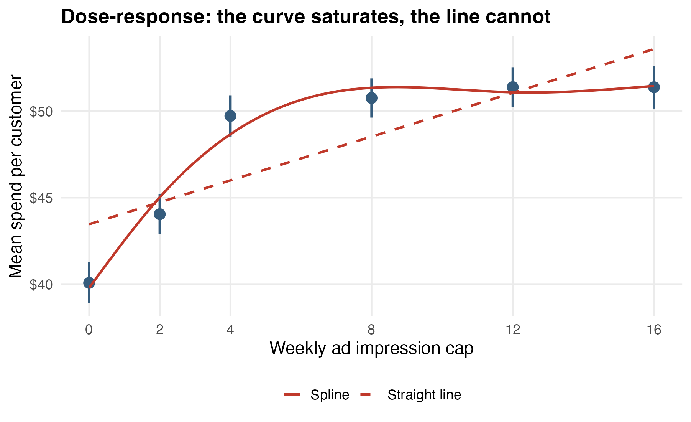
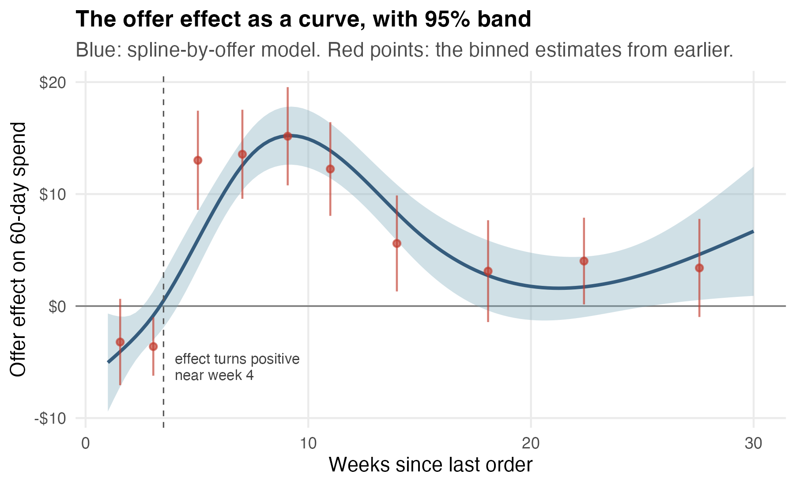
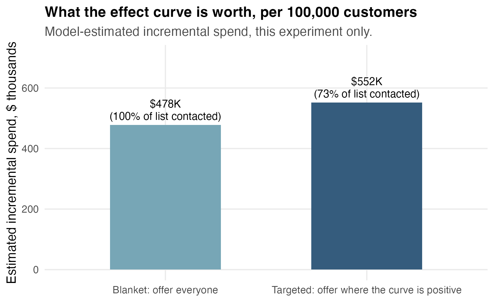

## Today {.smaller}

Every experiment so far ended with one number: *the* treatment effect.

But treatments almost never work equally well for everyone.

Today:

- treatment-by-group interactions: effects that differ across segments,
- treatment-by-covariate interactions: effects that vary along a number,
- the subgroup-fishing trap, and why discovered subgroups need skepticism,
- dose-response: the effect as a curve in the treatment itself,
- to close: the effect as a fitted *curve*, and the targeting rule it buys.

The question shifts from *does it work?* to *where, for whom, and how much?*

## Back at the pet-supply retailer

The Austin pet-supply retailer from the factorial experiment is still running tests.

The growth team's new idea: a **win-back offer** — 30% off your next order, by email.

The experiment: 4,000 customers who have not ordered recently, randomized 50/50.

Outcome: spend over the next 60 days.

## One row

Each row is one customer.

| customer | weeks since last order | segment | offer | spend_60d |
|:---------|-----------------------:|:---------|------:|----------:|
| W19218   |                    3.2 | active   |     0 |     38.72 |
| W10591   |                    8.3 | drifting |     0 |     51.90 |
| W25509   |                   10.3 | drifting |     1 |     36.42 |
| W61002   |                   28.4 | lapsed   |     1 |     13.18 |

Segments come from the CRM's lifecycle labels, defined **before** the experiment: **active** (ordered within 4 weeks), **drifting** (4-12 weeks quiet), **lapsed** (more than 12).

## The average answer

``` r
lm(spend_60d ~ offer)
```

$$
+\$4.13 \text{ per customer}, \quad 95\%\ \text{CI: } [2.61,\ 5.65].
$$

Clearly positive. The email costs almost nothing.

So: roll it out to all 200,000 customers?

## Average of what?

The $+\$4.13$ is an average over three very different kinds of customer:

- someone who ordered **last week**,
- someone quietly **drifting away**,
- someone **gone for six months**.

There is no reason one discount should do the same thing to all three.

The average answers "does it work *on net*?"

The rollout decision needs "*for whom*?"

## The raw comparison, by segment

{fig-alt="Mean spend for no-offer and offer customers within each segment. Active: about 61.6 dollars without the offer and 58.2 with it. Drifting: about 47.9 versus 61.7. Lapsed: about 27.0 versus 31.3." width="90%"}

Six means: each segment, with and without the offer.

The offer gap is different in every segment — and it points *down* in one.

## The picture

{fig-alt="Three point estimates with intervals. Active customers: about minus 3.35 dollars, interval entirely below zero. Drifting customers: about plus 13.76, far above the average. Lapsed customers: about plus 4.25, near the dashed average-effect line at 4.13." width="90%"}

One offer. Three different answers.

The average describes **none** of the three segments well.

## The offer *hurts* among active customers

Active-segment effect:

$$
-\$3.35, \quad 95\%\ \text{CI: } [-5.53,\ -1.18].
$$

Nothing mysterious. These customers were about to order anyway.

The offer took 30% off purchases that would have happened at full price.

Revenue went down.

The trade has a name: **cannibalization**. Only heterogeneity analysis can see it — the average effect hides a paying segment being subsidized.

## The interaction model

``` r
lm(spend_60d ~ offer * segment)
```

$$
\begin{aligned}
\widehat{\text{Spend}}
= 61.58
&- 3.35\,(\text{Offer})
- 13.65\,(\text{Drifting})
- 34.54\,(\text{Lapsed}) \\
&+ 17.11\,(\text{Offer} \times \text{Drifting})
+ 7.60\,(\text{Offer} \times \text{Lapsed}).
\end{aligned}
$$

New reading:

- `offer`: the effect **in the baseline segment** (active): $-3.35$.
- each interaction: **how much that segment's effect differs** from the baseline effect.

## Reading the interactions

Drifting-segment effect:

$$
-3.35 + 17.11 = +\$13.76.
$$

Lapsed-segment effect:

$$
-3.35 + 7.60 = +\$4.25.
$$

The interaction coefficients are *differences between treatment effects* — and they come with intervals:

$$
\text{Offer} \times \text{Drifting}: \quad +17.11, \quad [14.09,\ 20.14].
$$

The segments genuinely differ. This is not noise.

## The decision changes

Blanket rollout, 200,000 customers: about $+\$4.13$ each, **minus** the damage hidden inside.

Targeted rollout:

| segment | effect | action |
|:---------|-------:|:---------------------------|
| active   | $-\$3.35$ | exclude |
| drifting | $+\$13.76$ | send |
| lapsed   | $+\$4.25$ | send, or test a stronger offer |

Same experiment. Same data.

The heterogeneity analysis roughly **doubles** the payoff by turning off the segment where the offer loses money.

## A numeric moderator

Segments are bins of a number the retailer already has: **weeks since last order**.

Why not use the number itself?

``` r
lm(spend_60d ~ offer * weeks_since_last_order)
```

$$
\text{Offer} \times \text{Weeks}: \quad +\$0.18 \text{ per week}, \quad [0.03,\ 0.34].
$$

Statistically significant. The effect "grows with recency."

Tidy. And wrong about the shape.

## The shape the line missed

{fig-align="center" fig-alt="Binned offer effects: negative around minus 3 for customers under 4 weeks, rising to 13 to 15 dollars between 4 and 12 weeks, then falling back to 3 to 5 dollars beyond 12 weeks. A dashed straight line from the linear interaction model rises gently and misses both the peak and the negative region." width="76%"}

The real effect **rises and then falls**. A single linear interaction cannot bend, so it reported the average tilt and missed the story.

Moderators can need curves — the smoothing module's lesson, now applied to *effects*.

## A tempting next step

The CRM has dozens more columns.

> "While you're at it — split by platform. And signup weekday. And..."

Ten more subgroup analyses cost ten lines of code.

Here is what they return.

## Ten junk subgroups

{fig-alt="Forest plot of offer effects for iOS, Android, web, and each signup weekday. Nine intervals cluster around the dashed average line. Saturday signups show 8.50 dollars with interaction p equal to 0.016, highlighted in orange." width="90%"}

**Saturday signups: $+\$8.50$, interaction $p = 0.016$.**

Platform and signup weekday were generated with *no connection* to the offer.

The Saturday result is pure luck.

## Why luck is guaranteed

Ten subgroup tests at the 5% level:

$$
P(\text{at least one false hit}) = 1 - 0.95^{10} \approx 40\%.
$$

Fish through enough splits and the data **will** hand you a story.

The story will have a p-value. It will still be a mirage.

And subgroup estimates are noisier than the average — smaller $n$, wider intervals — so they swing dramatically by chance.

## Prespecified versus discovered {.smaller}

The recency segments and the Saturday finding have different pedigrees:

- **Prespecified** (recency): named before launch, with a business reason — a discount should matter differently to someone about to order versus someone gone for months.
- **Discovered** (Saturday): found by searching after the fact, explanation invented afterward.

Rules of engagement for discoveries:

1. Demote them to **hypotheses**.
2. Replicate in the **next** experiment before acting.
3. If you must search, count your searches and correct for them.

## The dose question

Second experiment. The retailer runs retargeting ads, and the media buyer asks:

> "How many impressions per week should we show one person?"

Not *whether* the treatment works — **how much treatment to give**.

The design: 3,600 customers randomized to a weekly impression cap of 0, 2, 4, 8, 12, or 16. Outcome: spend over 30 days.

## One row

| customer | weekly ad cap | spend_30d |
|:---------|--------------:|----------:|
| F71315   |             0 |     27.20 |
| F94758   |             4 |     30.90 |
| F82627   |             8 |     41.10 |
| F42994   |            16 |     37.20 |

The treatment is a **number**, not a yes/no.

The effect is a **curve**, not a coefficient.

## The arm means

{fig-alt="Mean spend rises steeply from about 40 dollars at cap 0 to about 50 dollars at cap 8, then flattens: caps 8, 12, and 16 all sit near 51 dollars." width="88%"}

Spend climbs steeply at first.

Then it stops climbing.

## The straight-line dose model

``` r
lm(spend_30d ~ weekly_ad_cap)
```

$$
\widehat{\text{Spend}} = 43.47 + 0.63\,(\text{Cap}), \quad [0.55,\ 0.72].
$$

The line promises **63 cents per impression, forever**.

Extrapolate: 30 impressions a week would buy $+\$19$ per customer.

Every advertiser wishes.

## Let the dose bend

{fig-alt="The straight dashed line underfits both ends. The solid spline rises steeply to about cap 8, then goes flat near 51.40 dollars through cap 16, matching the arm means." width="90%"}

``` r
lm(spend_30d ~ ns(weekly_ad_cap, df = 4))
```

Same spline machinery as the smoothing module.

The curve saturates. The line cannot.

## What the curve is worth

Fitted spend from the spline:

| impressions | fitted spend | gain |
|:-----------:|-------------:|--------------------:|
| 0           |      \$39.79 |                     |
| 4           |      \$48.67 | $+\$8.88$ |
| 8           |      \$51.36 | $+\$2.69$ |
| 16          |      \$51.46 | $+\$0.10$ |

The first four impressions earn about **\$2.20 each**.

The next four earn about 67 cents each.

Beyond eight, impressions buy **about a penny apiece** — while costing the same to serve.

## The decision

Cap at **8 impressions per week**.

Everything past 8 is paid delivery of nothing — and audiences eventually punish over-exposure.

Notice what answered the question:

> not a treatment effect, but a **marginal** treatment effect read off a fitted curve.

Dose-response is heterogeneity *along the treatment itself*: the next unit of treatment does not do what the last one did.

## Case 3: finish the job

The win-back case left two loose ends: the binned effects traced a shape no linear interaction could follow, and the segments are three crude bins of a number the retailer knows exactly.

The dose-response case just handed us the tool for shapes: **splines**.

So put the spline where the heterogeneity is:

> let the *treatment effect itself* be a smooth curve in weeks since last order.

## The effect-curve model

``` r
lm(spend_60d ~ ns(weeks_since_last_order, df = 4) * offer)
```

Two smooth curves: one for control customers, one for offer customers.

The treatment effect at recency $w$ is the **vertical gap** between them:

$$
\widehat\tau(w) = \widehat f_1(w) - \widehat f_0(w).
$$

Each $\widehat\tau(w)$ is a linear combination of coefficients — a **contrast**, exactly as in the experiments module — so it carries a standard error:

$$
\widehat\tau(w) \pm 1.96\,\sqrt{L_w^{\top}\, V\, L_w}.
$$

## The effect curve

{fig-align="center" fig-alt="A smooth effect curve starting near minus 5 dollars at one week, crossing zero near week 4, peaking around 15 dollars near week 9, then declining to a few dollars for lapsed customers, with a wider band at the edges. Red binned estimates track the curve." width="76%"}

Everything the segments said, plus *where the boundaries actually are*: losses below week 4, a sweet spot peaking near $+\$15$ around week 9, a few dollars after week 15 — and a band that widens where the data thin out.

## From curve to rule {.smaller}

The segments forced one decision per bin. The curve supports a decision per *customer*:

> send the offer wherever $\widehat\tau(w) > 0$ — here, customers quiet for more than about 4 weeks.

For a 100,000-customer file, the model prices the two policies:

| policy | contacted | est. incremental spend |
|:--------------------------|----------:|-----------------------:|
| blanket: everyone | 100% | \$478K |
| targeted: curve positive | 73% | \$552K |

## What the rule is worth

{fig-alt="Two bars: blanket policy at 478 thousand dollars contacting the full list, curve-targeted policy at 552 thousand dollars contacting 73 percent of the list." width="86%"}

About \$74K more, while sending 27% *fewer* emails.

The gain is entirely the active segment's negative effect, turned off.

## The honesty clause {.smaller}

Two caveats belong in the write-up, not the footnotes:

1. **The rule was built and priced on the same experiment.** Cutoffs chosen where a fitted curve crosses zero inherit that curve's noise, and same-data payoff estimates lean optimistic. Freeze the rule, then validate it on the next campaign.
2. **The curve only exists where the data do.** Nobody in this experiment was quiet for 40 weeks. The rule says nothing about them.

An effect curve estimated from a randomized experiment is the honest version of "personalization": every promise it makes is a contrast between randomized groups.

## One family of questions {.smaller}

Everything today was the same move — let the treatment effect vary, then model the variation:

- across **groups**: treatment × segment dummies,
- along a **covariate**: treatment × number, curved if needed,
- along the **dose**: the response as a smooth curve in treatment intensity.

And the same warning each time:

> effect differences are estimated with less data than effects. They are noisier, easier to overclaim, and the favorite habitat of false discoveries.

## Why heterogeneity is worth the trouble {.smaller}

- **Targeting**: send the offer where it earns, not where it cannibalizes.
- **Rollout**: launch where the effect is proven; test where it is not.
- **Dosing**: spend to the flat part of the curve and stop.
- **Fairness**: "works on average" can coexist with "fails for an important group." Averages hide who pays for the win.

An average effect is a summary.

A heterogeneity analysis is a plan.

## What to report {.smaller}

Weak report:

> The win-back campaign worked (+\$4.13, p \< 0.001). Saturday signups responded especially strongly.

Better report:

> The offer averaged $+\$4.13$ per customer, but prespecified segments differ: $+\$13.76$ for drifting, $+\$4.25$ for lapsed, and $-\$3.35$ for active customers. Exclude active customers. Treat the post-hoc Saturday split as a next-test hypothesis.

## What to carry forward

1. An average treatment effect is an average. The rollout decision usually needs the segment-level answer.
2. Treatment-by-group interactions are differences between treatment effects, with intervals of their own.
3. Numeric moderators may need curves. A linear interaction reports a tilt, not a shape.
4. Ten subgroup searches buy a 40% chance of a false discovery. Prespecify what you can; demote the rest to hypotheses.

## What to carry forward, continued

1. Dose-response puts the curve in the treatment.
2. A spline-by-treatment interaction turns the effect into a fitted curve.
3. Same-data targeting payoffs are promises to validate, not results.
4. Heterogeneity is where experiments meet decisions.

That closes the experiments unit: designed comparisons, nuisance control, found comparisons, and now effects that vary.
